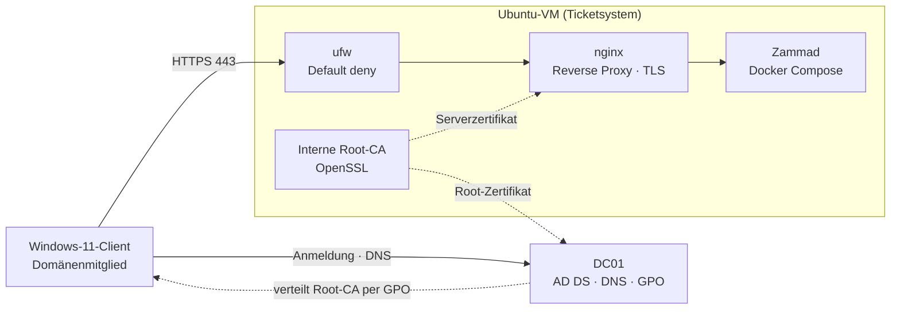

# Mini-IT-Infrastruktur mit Service-Desk

> **Kurzfassung für Eilige**
> - **Umgebung:** Windows Server 2022 (DC01, AD DS, DNS, GPO), Windows-11-Client in der Domäne, Ubuntu Server mit Zammad (Docker Compose)
> - **Security:** eigene Root-CA, TLS über nginx-Reverse-Proxy, Root-Zertifikat per GPO verteilt, Host-Firewall (ufw, default deny)
> - **Compliance:** Maßnahmen gegen NIS2 Art. 21 und ISO 27001 Anhang A gemappt, inkl. Mini-Risikoanalyse → [SECURITY-COMPLIANCE.md](SECURITY-COMPLIANCE.md)
> - **Troubleshooting:** 25 real aufgetretene Fehler mit Ursache, Lösung und Nachweis dokumentiert
>
> **Ausgewählte Fälle:** [SSH trotz korrekter Konfiguration nicht erreichbar](docs/02-zammad.md#troubleshooting-vm-per-ssh-vom-notebook-nicht-erreichbar-obwohl-alles-korrekt-konfiguriert-ist) · [CSRF-Fehler bei der Zammad-Anmeldung](docs/03-pki-tls.md#troubleshooting-zammad-anmeldung-scheitert-mit-verifizierung-des-sicherheits-tokens-fehlgeschlagen) · [IP-Adresskonflikt Host/Server](docs/01-active-directory.md#troubleshooting-ip-adresskonflikt-zwischen-host-und-server-vm)

Ziel dieses Projekts ist der praktische Aufbau und Betrieb einer kleinen IT-Infrastruktur im Homelab, um die theoretisch erlernten Inhalte aus dem Google IT Support Professional Certificate praktisch anzuwenden und zu dokumentieren. Das Projekt bildet typische Aufgaben eines Service-Desk-Mitarbeiters ab: Benutzerverwaltung über Active Directory, Support-Fallbearbeitung über ein Ticketsystem sowie grundlegende Windows-Client/Server-Administration.

Das Lab wird schrittweise um Netzwerk- und Security-Komponenten erweitert (virtuelle Firewall, interne CA mit TLS, VLAN-Segmentierung, Netzwerkanalyse). Der aktuelle Stand steht im Abschnitt [Netzwerk- und Security-Erweiterung](docs/05-netzwerk-security.md#-netzwerk--und-security-erweiterung-in-arbeit). Die umgesetzten Sicherheitsmaßnahmen sind zusätzlich NIS2 Art. 21 und ISO 27001 Anhang A gegenübergestellt, inklusive offener Lücken und einer Mini-Risikoanalyse: [SECURITY-COMPLIANCE.md](SECURITY-COMPLIANCE.md).

> **Hinweis zur Entstehung:** Aufbau, Konfiguration, Fehlersuche und Screenshots habe ich selbst im Lab durchgeführt. Die Dokumentation habe ich mit KI-Unterstützung (Claude) formuliert und strukturiert und inhaltlich selbst geprüft. Deshalb taucht Claude bei einzelnen Commits als Co-Autor auf.

## Entwicklungsverlauf

Das Lab wächst schrittweise. Jede Stufe bringt es näher an eine reale Unternehmensumgebung: erst lauffähig machen, dann absichern, dann so betreiben, wie es im Alltag üblich ist.

| Zeitraum | Ausbaustufe | Was dazukam | Näher an der Realität, weil … |
|---|---|---|---|
| Juli 2026 | Grundaufbau | Windows Server 2022 (DC01), AD DS, DNS, OU-Struktur, Windows-11-Client in der Domäne | Zentrale Benutzer- und Geräteverwaltung statt Einzelrechner |
| Aug. 2026 | Service Desk | Ticketsystem eingerichtet | Support läuft über Tickets statt auf Zuruf |
| Okt. 2026 | Neuaufbau Ticketsystem | Zammad v2 (Ubuntu, Docker Compose), Rollen L1–L3 | Wiederholbarer Aufbau, Supportstufen wie im echten Service Desk |
| Okt. 2026 | Absicherung | Interne Root-CA, TLS über nginx, Root-Zertifikat per GPO, Host-Firewall (ufw) | Verschlüsselte Dienste, zentral verteiltes Vertrauen, Default deny |
| Okt. 2026 | Compliance | Mapping auf NIS2 Art. 21 und ISO 27001, Mini-Risikoanalyse | Maßnahmen werden begründet und Lücken benannt |
| Nov. 2026 | Rollenmodell | OU-Umbau nach Objekttyp, getrennte Admin- und Support-Konten | Least Privilege statt eines Administratorkontos für alles |
| geplant | Betrieb wie im Alltag | Verwaltung vom Admin-Arbeitsplatz (RSAT), Delegation, Automatisierung per PowerShell, LAPS | Keine Anmeldung direkt am Server, Rechte nur pro Aufgabe |
| geplant | Netzwerk | Virtuelle Firewall, VLANs, Backup mit getesteter Wiederherstellung | Segmentierung und Ausfallsicherheit |

## Architektur

**Datenfluss im Überblick:**

## Umgesetzter Stand
- [x] Windows Server 2022 installiert und konfiguriert
- [x] Active Directory Domain Services (AD DS), Domäne homelab.local
- [x] OU-Struktur (IT, Support, Vertrieb) angelegt
- [x] Benutzer und Gruppen in der OU-Struktur angelegt
- [x] OU-Struktur nach Objekttyp umgebaut, Admin- und Support-Konten getrennt (Rollenmodell in Arbeit)
- [ ] Rollenmodell: AGDLP-Gruppen, Delegation L1/L2, lokale Adminrechte per GPO, Remoteverwaltung, LAPS
- [x] Windows-11-Client installiert, Netzwerk konfiguriert
- [x] Server und Client können sich gegenseitig erreichen (Ping erfolgreich)
- [x] Windows-Client in Domäne aufgenommen
- [x] Ticketsystem eingerichtet
- [x] Ticketsystem-VM (Zammad) neu aufgebaut (v2), Weboberfläche erreichbar, Rollen Support L1–L3 angelegt
- [x] Interne CA und TLS für Zammad über Reverse Proxy (nginx), Root-CA per GPO an die Domäne verteilt
- [ ] Zammad konfigurieren: Gruppen, Testbenutzer, Eskalationsablauf L1–L3
- [x] Host-Firewall (ufw) auf der Ticketsystem-VM: Default deny, HTTPS offen, SSH nur von Lab-Netz und Admin-Notebook
- [x] Security-Controls- und Compliance-Mapping (NIS2 / ISO 27001), siehe [SECURITY-COMPLIANCE.md](SECURITY-COMPLIANCE.md)
- [ ] Backup auf ein getrenntes Medium mit getesteter Wiederherstellung (geplant)
- [ ] Virtuelle Firewall (OPNsense) für das interne Netz (geplant)
- [ ] VLAN-Segmentierung (geplant)

## Teilprojekte

| Teilprojekt | Inhalt | Status |
|---|---|---|
| [Active Directory & Client](docs/01-active-directory.md) | DC01, AD DS, DNS, Client in der Domäne, AD-Rollenmodell (Least Privilege) | ✅ / Rollenmodell in Arbeit |
| [Ticketsystem Zammad](docs/02-zammad.md) | Ubuntu Server, Docker Compose, Neuaufbau v2, Rollen L1–L3 | ✅ |
| [Interne CA & TLS](docs/03-pki-tls.md) | Root-CA, Serverzertifikat, nginx-Reverse-Proxy, Verteilung per GPO | ✅ |
| [Host-Firewall (ufw)](docs/04-host-firewall.md) | Default deny, HTTPS offen, SSH nur aus dem Lab-Netz | ✅ |
| [Netzwerk & Security (Roadmap)](docs/05-netzwerk-security.md) | OPNsense, VLANs, Netzwerkanalyse, Backup | ⬜ geplant |
| [Security & Compliance](SECURITY-COMPLIANCE.md) | Mapping NIS2 Art. 21 / ISO 27001, Mini-Risikoanalyse | ✅ |

**Troubleshooting:** alle 25 Fehlerfälle gesammelt im [Troubleshooting-Index](TROUBLESHOOTING.md).

## Nächste Schritte

- AD-Rollenmodell abschließen (siehe [Meilenstein](docs/01-active-directory.md#meilenstein-ad-rollenmodell-nach-least-privilege-in-arbeit))
- Backup auf ein getrenntes Medium einrichten und eine Wiederherstellung testen (höchstes Risiko laut [Risikoanalyse](SECURITY-COMPLIANCE.md#3-mini-risikoanalyse))
- Gruppen anlegen und den Rollen L1 bis L3 Gruppenzugriff zuweisen
- Testbenutzer (Agent und Kunde) und Testtickets anlegen, Eskalation von L1 
  an L2 durchspielen
- Virtuelle Firewall aufsetzen und das interne Netz dahinter betreiben
- SSH-Zugang härten (eigener Benutzername statt Standardnamen, 
  Schlüsselauthentifizierung)
- Erneuerung des Serverzertifikats (Ablauf 19.10.2027) als Aufgabe einplanen
