Ziel dieses Projekts ist der praktische Aufbau und Betrieb einer kleinen IT-Infrastruktur im Homelab, um die theoretisch erlernten Inhalte aus dem Google IT Support Professional Certificate praktisch anzuwenden und zu dokumentieren. Das Projekt bildet typische Aufgaben eines Service-Desk-Mitarbeiters ab: Benutzerverwaltung über Active Directory, Support-Fallbearbeitung über ein Ticketsystem sowie grundlegende Windows-Client/Server-Administration.

Das Lab wird schrittweise um Netzwerk- und Security-Komponenten erweitert (virtuelle Firewall, interne CA mit TLS, VLAN-Segmentierung, Netzwerkanalyse). Der aktuelle Stand steht im Abschnitt [Netzwerk- und Security-Erweiterung](#-netzwerk--und-security-erweiterung-in-arbeit).

# Architektur


# Umgesetzter Stand
- [x] Windows Server 2022 installiert und konfiguriert
- [x] Active Directory Domain Services (AD DS), Domäne homelab.local
- [x] OU-Struktur (IT, Support, Vertrieb) angelegt
- [x] Erster Benutzer angelegt
- [x] Windows-11-Client installiert, Netzwerk konfiguriert
- [x] Server und Client können sich gegenseitig erreichen (Ping erfolgreich)
- [x] Windows-Client in Domäne aufgenommen
- [x] Ticketsystem eingerichtet
- [x] Ticketsystem-VM (Zammad) neu aufgebaut (v2), Weboberfläche erreichbar, Rollen Support L1–L3 angelegt
- [x] Interne CA und TLS für Zammad über Reverse Proxy (nginx), Root-CA per GPO an die Domäne verteilt
- [ ] Zammad konfigurieren: Gruppen, Testbenutzer, Eskalationsablauf L1–L3
- [x] Host-Firewall (ufw) auf der Ticketsystem-VM: Default deny, HTTPS offen, SSH nur von Lab-Netz und Admin-Notebook
- [ ] Virtuelle Firewall (OPNsense) für das interne Netz (geplant)
- [ ] VLAN-Segmentierung (geplant)


# Was ich dabei gelernt habe

Beim Einrichten des Windows Servers bin ich auf ein Netzwerkproblem gestoßen: 
der zweite Netzwerkadapter war in VirtualBox nicht aktiviert, wodurch die 
Domänenkommunikation zunächst nicht funktionierte. Dies hat mir gezeigt, wie 
wichtig es ist, Netzwerkkonfigurationen systematisch zu prüfen, bevor man 
nach komplexeren Ursachen sucht.


## Troubleshooting: Schwarzer Bildschirm bei Windows-11-Client-VM

Beim ersten Start der Windows-11-Client-VM blieb der Bildschirm in VirtualBox 
dauerhaft schwarz, obwohl die CPU-Auslastung im Hintergrund leicht schwankte – 
ein Hinweis darauf, dass die VM lief, aber nichts angezeigt wurde.

**Vorgehen:**
1. Grafikcontroller auf VMSVGA umgestellt, 3D-Beschleunigung deaktiviert – 
   keine Besserung
2. VBox.log gezielt nach Fehlern durchsucht (Suche nach "Error", "NEM", "EFI")
3. Fündig geworden: `HM: HMR3Init: Attempting fall back to NEM: VT-x is not available` 
   – VirtualBox konnte nicht direkt auf die Hardware-Virtualisierung (VT-x) 
   zugreifen und wich auf einen langsameren Software-Fallback aus
4. Windows Core Isolation / Memory Integrity deaktiviert – Problem blieb bestehen
5. `bcdedit /set hypervisorlaunchtype off` gesetzt – Problem blieb weiterhin bestehen
6. BIOS-Virtualisierung geprüft (Task-Manager → Leistung → CPU) – VT-x war 
   bereits aktiviert, also keine BIOS-Ursache
7. Über `msinfo32` festgestellt, dass "Virtualisierungsbasierte Sicherheit" 
   trotz aller Änderungen weiterhin lief, zusätzlich war "App Control for 
   Business" als Richtlinie erzwungen – ein Hinweis auf verbliebene 
   Enterprise-Sicherheitsrichtlinien (Device Guard/Credential Guard) aus der 
   vorherigen Nutzung des generalüberholten Business-Geräts

**Ursache:** Das gebraucht gekaufte Lenovo ThinkCentre M720q lief zuvor in 
einer Unternehmensumgebung mit aktivierten Device-Guard-/Credential-Guard-
Richtlinien. Diese Richtlinien blieben auch nach dem Refurbishing über die 
lokale Gruppenrichtlinie aktiv und aktivierten Windows' eigene 
Virtualisierungsschicht (Hyper-V/VBS) bei jedem Systemstart neu – dadurch 
stand VirtualBox kein direkter VT-x-Zugriff mehr zur Verfügung.

**Lösung:** Über die lokale Gruppenrichtlinie (`gpedit.msc` → 
Computerkonfiguration → Administrative Vorlagen → System → Device Guard) 
"Auf Virtualisierung basierende Sicherheit aktivieren" explizit auf 
**Deaktiviert** gesetzt (nicht nur "Nicht konfiguriert"), anschließend 
`gpupdate /force` und Neustart des Hosts. Danach lief die VM ohne 
Einschränkungen.

**Erkenntnis:** Bei gebrauchter Business-Hardware können Sicherheits-
richtlinien aus der vorherigen Nutzung tief im System verankert bleiben und 
sich nicht durch einfache Einstellungsänderungen beheben lassen. Die 
eigentliche Ursache ließ sich erst durch systematisches Auswerten der 
VirtualBox-Logs und der Windows-Systeminformationen statt durch reines 
Ausprobieren finden.

## Troubleshooting: IP-Adresskonflikt zwischen Host und Server-VM

Nach der Netzwerkkonfiguration von Server und Client meldete Windows Server 
bei seiner eigenen Host-only-IP (`192.168.56.10`) dauerhaft den Status 
„Dupliziert" und wich auf eine automatische Behelfsadresse (169.254.x.x) aus. 
Ping-Versuche zwischen Server und Client schlugen dadurch in beide 
Richtungen fehl.

**Vorgehen:**
1. Feste IP-Konfiguration auf Server und Client einzeln über `ipconfig /all` 
   geprüft – beide korrekt eingetragen, kein Tippfehler
2. Mit `arp -a` vom Client aus geprüft, welches Gerät tatsächlich auf 
   `192.168.56.10` antwortet
3. Die dabei ermittelte MAC-Adresse mit den bekannten Adaptern abgeglichen – 
   sie gehörte weder zum Server noch zum Client, sondern zum 
   **VirtualBox Host-Only-Adapter auf dem Host-PC selbst**
4. Festgestellt: Bei der vorherigen Fehlersuche wurde versehentlich auf dem 
   Host-Adapter (statt innerhalb der Server-VM) eine manuelle IP im selben 
   Adressbereich gesetzt – leicht passiert, da mehrere verschachtelte 
   Remotedesktop-/VM-Fenster gleichzeitig offen waren

**Ursache:** Zwei Geräte im selben internen Netzwerk (Host-PC und Server-VM) 
beanspruchten dieselbe IP-Adresse, weil die Netzwerkeinstellungen versehentlich 
auf der falschen Ebene (Host statt Gast-VM) geändert wurden.

**Lösung:** Die manuelle IP-Konfiguration auf dem Host-only-Adapter des 
Host-PCs zurück auf automatischen Bezug gestellt, sodass ausschließlich 
Server (`192.168.56.10`) und Client (`192.168.56.20`) feste Adressen im 
internen Netz halten. Nach einem Neustart des Adapters funktionierte die 
Kommunikation zwischen Server und Client fehlerfrei.

**Erkenntnis:** Bei verschachtelten Umgebungen (Host, Remotedesktop, mehrere 
VM-Fenster gleichzeitig) ist es entscheidend, vor jeder Netzwerkänderung zu 
prüfen, auf welcher Ebene man sich gerade befindet. Ein `arp -a` vom 
unbeteiligten dritten Gerät aus (hier: Client) war der entscheidende 
Schritt, um die Ursache eindeutig zu lokalisieren, statt nur auf dem 
betroffenen Server selbst zu suchen.

## Meilenstein: Client erfolgreich in Domäne aufgenommen

Nach Behebung des IP-Konflikts konnte der Windows-11-Client erfolgreich der 
Domäne `homelab.local` beitreten. Nach einem Neustart erfolgt der Login nun 
über das Domänenkonto (`HOMELAB\Administrator`), der Client erscheint 
korrekt im Container „Computers" der Active-Directory-Struktur auf dem Server.

## Screenshots

### VirtualBox – Snapshot-Verlauf
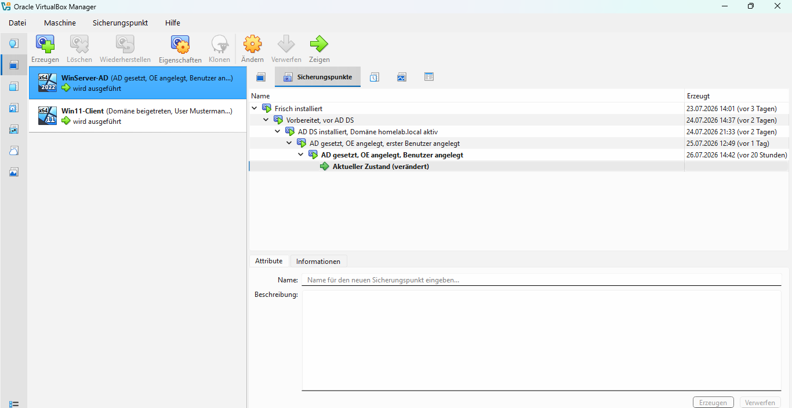

Jeder wichtige Meilenstein wurde als Snapshot gesichert – von der 
Frischinstallation bis zum Domänenbeitritt des Clients.

### Server- und Client-VM im Überblick
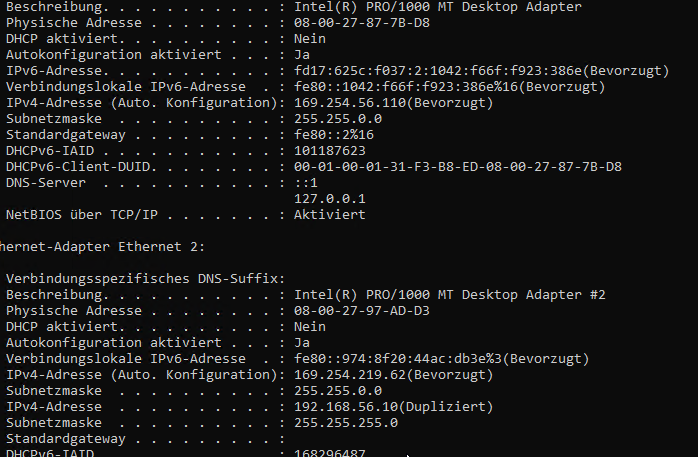
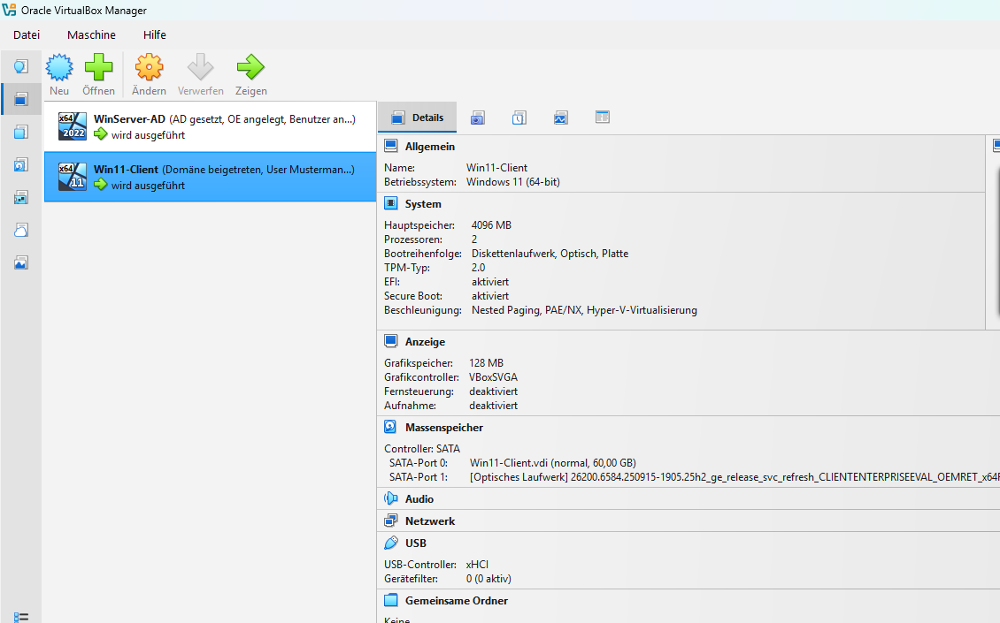

### VM-Erstellung: Ressourcenzuteilung
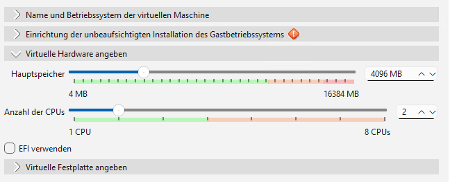

### Server-Manager: Lokaler Server
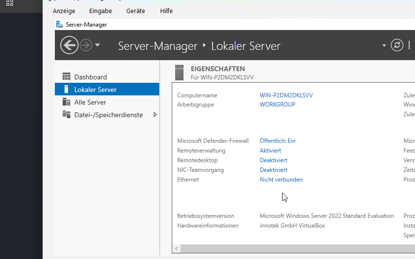

### Netzwerkadapter-Konfiguration (Host-only)
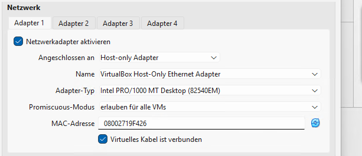
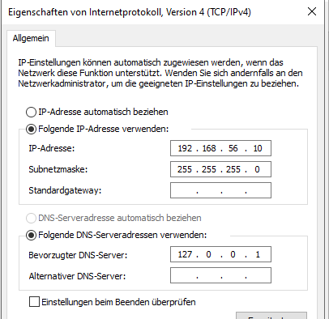

Feste IP-Adressen im internen Netz vergeben: Server `192.168.56.10`, 
Client `192.168.56.20`.

### Troubleshooting: IP-Adresskonflikt

**Fehlerbild:** Der zweite Netzwerkadapter (NAT) hatte versehentlich eine 
leere, ungültige manuelle IP-Konfiguration.
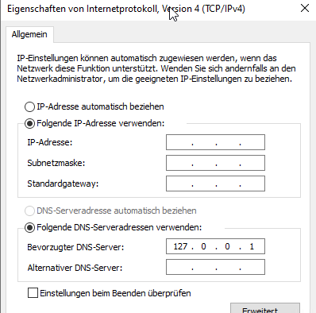

**Symptom:** Der Server zeigte bei seiner eigenen IP den Status „Dupliziert“, 
Ping zwischen Server und Client schlug fehl.
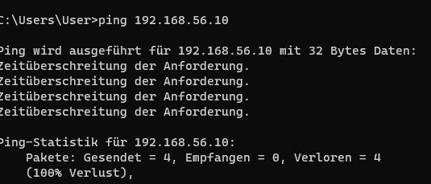
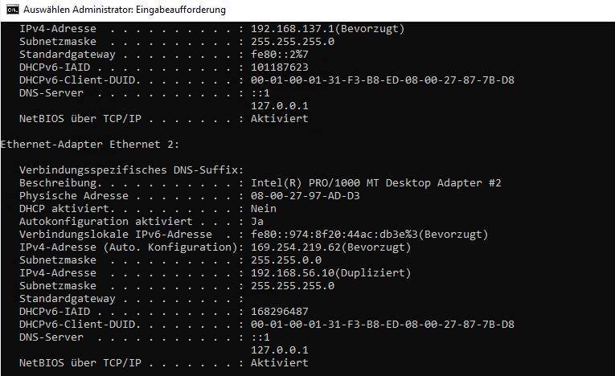

**Diagnose:** Mit `arp -a` vom Client aus die tatsächlich antwortende 
MAC-Adresse ermittelt und mit den bekannten Adaptern abgeglichen.

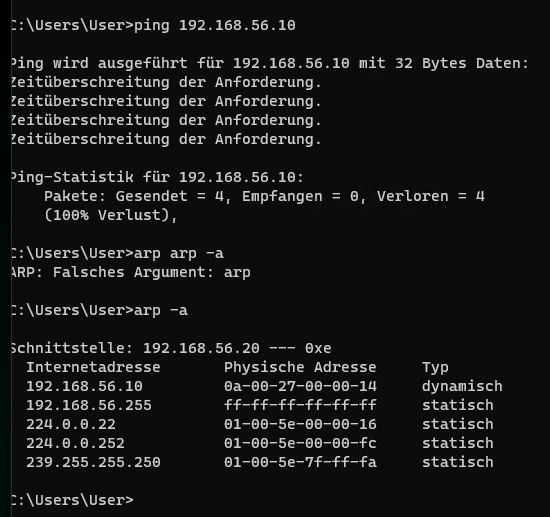

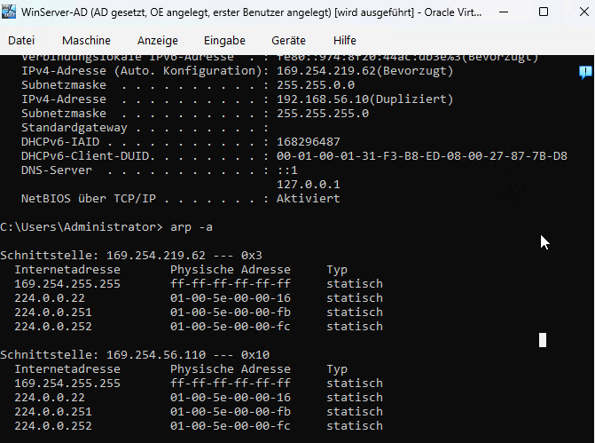

**Lösung:** Nach Korrektur der Host-Adapter-Konfiguration funktionierte die 
Kommunikation fehlerfrei.
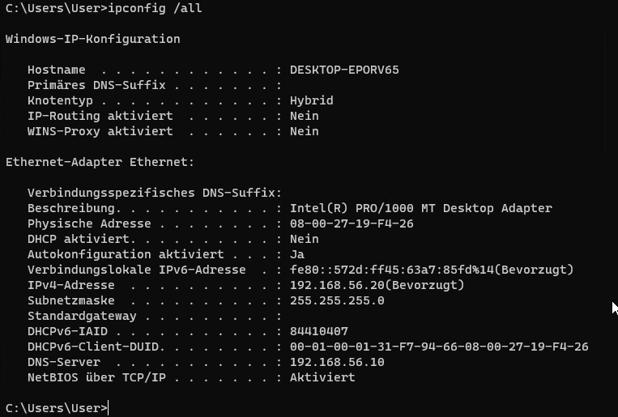

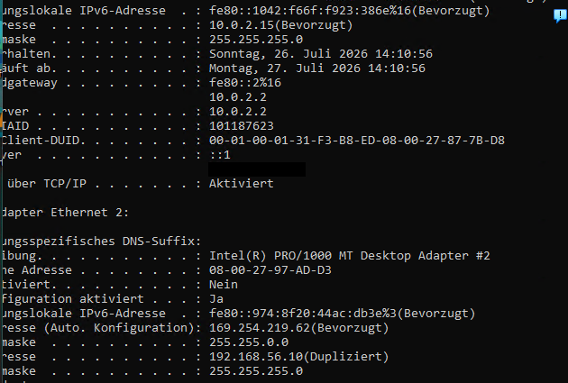

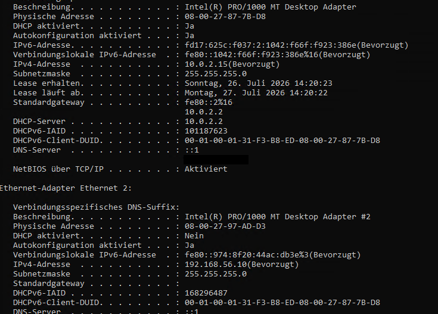

### Server-Identität nach Umbenennung (DC01)
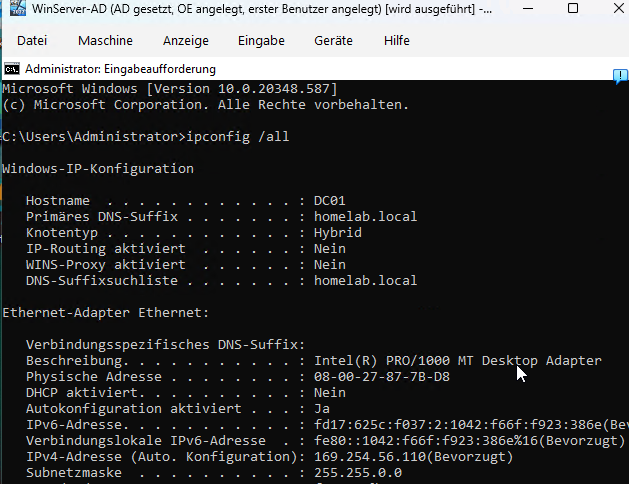

## Meilenstein: Ticketsystem-VM (Ubuntu Server + Docker)

Als dritte Komponente wurde eine Ubuntu Server 26.04 LTS VM aufgesetzt, 
auf der Zammad containerisiert über Docker Compose betrieben wird.

### Troubleshooting: Netplan-Konfiguration schlägt trotz korrektem Inhalt fehl

**Fehlerbild:** `netplan apply` meldete wiederholt 
`expected mapping (check indentation)`, obwohl die eingefügte YAML-Datei 
augenscheinlich korrekt aussah.

**Ursache:** Die VirtualBox-Textkonsole (ohne grafische Oberfläche) 
entfernt beim Einfügen mehrzeiligen Texts die führenden Leerzeichen jeder 
Zeile – dadurch ging die für YAML zwingend nötige Einrückung verloren.

**Lösung:** Die Konfigurationsdatei stattdessen über einen kontrollierten 
`printf`-Befehl in einer einzigen Zeile geschrieben, sodass Einrückung 
und Zeilenumbrüche nicht durch das Einfügeverhalten der Konsole verändert 
werden konnten.

### Troubleshooting: Host verliert Verbindung zu allen Lab-VMs

**Fehlerbild:** Nach einem vorherigen Fix (Host-Adapter auf automatischen 
IP-Bezug zurückgesetzt) konnte der Host-PC plötzlich weder Server, Client 
noch die neue Ticketsystem-VM erreichen.

**Diagnose:** `ipconfig /all` zeigte beim Host-only-Adapter eine 
APIPA-Adresse (169.254.x.x) statt einer gültigen IP – der Adapter 
versuchte per DHCP eine Adresse zu beziehen, bekam aber keine Antwort, 
da der DHCP-Server im internen Netz bewusst deaktiviert ist.

**Lösung:** Dem Host-Adapter eine eigene, feste IP (192.168.56.1) 
zugewiesen, die nicht mit Server (.10), Client (.20) oder Ticketsystem 
(.30) kollidiert.

**Erkenntnis:** Bei einem selbst verwalteten internen Netzwerk ohne 
DHCP-Server benötigt jedes teilnehmende Gerät – auch der Host selbst – 
eine bewusst vergebene, feste IP-Adresse.

## Neuaufbau der Ticketsystem-VM (Zammad v2)

Die Ticketsystem-VM (`ZammadTicketv2`) wurde neu aufgesetzt, diesmal 
bewusst selbstständig anhand der offiziellen Online-Dokumentation. Die VM 
(Ubuntu Server 26.04) hat zwei Netzwerkadapter: `enp0s3` für den 
Internetzugang (Updates, Docker-Images) und `enp0s8` im internen Host-only-Netz 
mit der festen Adresse `192.168.56.30`. Der Zugriff vom Notebook erfolgt über 
NAT mit Portweiterleitung (siehe unten); zwischenzeitlich wurde eine 
Netzwerkbrücke verwendet.

Ressourcen der VM: 8 GB RAM, 2 Prozessoren, virtuelle Platte mit 25 GB. 
Der Überblick zeigt alle VMs des Labs.
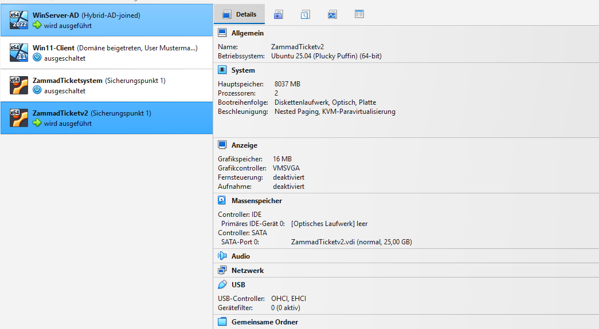

### Troubleshooting: Fehlermeldung bei der Netzwerkkonfiguration im Ubuntu-Installer

**Fehlerbild:** Der Installer lehnte die statische Adresse mit 
`'192.168.56.30' is not contained in '255.255.255.0/24'` ab.
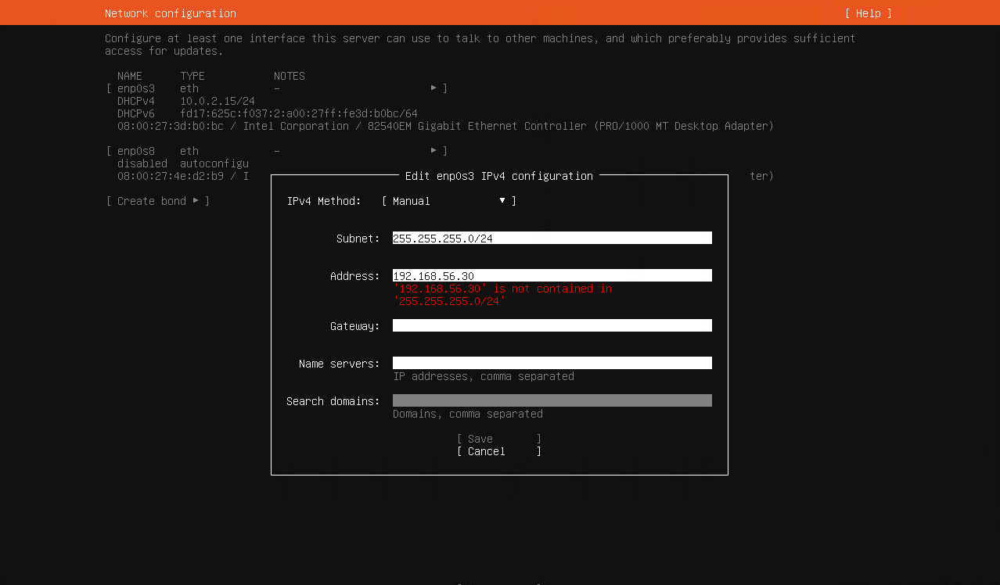

**Ursache:** Zwei Fehler gleichzeitig:
1. Im Feld *Subnet* war die Subnetzmaske (`255.255.255.0/24`) eingetragen, 
   der Installer erwartet dort die **Netzadresse in CIDR-Schreibweise** 
   (`192.168.56.0/24`).
2. Die Interfaces waren vertauscht: `enp0s3` ist der NAT-Adapter 
   (DHCP, `10.0.2.15/24`), das Host-only-Netz gehört zu `enp0s8`. Eine 
   statische Host-only-Adresse auf `enp0s3` hätte den Internetzugang der VM 
   gekappt.

**Lösung:** `enp0s3` unverändert per DHCP belassen, `enp0s8` auf *Manual* 
gestellt mit Subnet `192.168.56.0/24` und Address `192.168.56.30`, 
Gateway und Name servers leer (im Host-only-Netz gibt es keines).
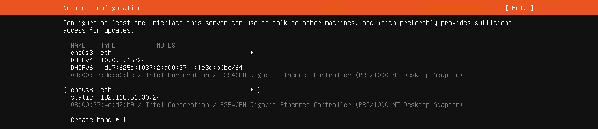

**Erkenntnis:** Die Zuordnung der Interfaces lässt sich über die 
MAC-Adressen im Installer und die Adapter-Reihenfolge in den 
VirtualBox-Netzwerkeinstellungen (Adapter 1 = NAT, Adapter 2 = Host-only) 
verlässlich prüfen. Nach der Installation bestätigte `ip a` die Konfiguration.
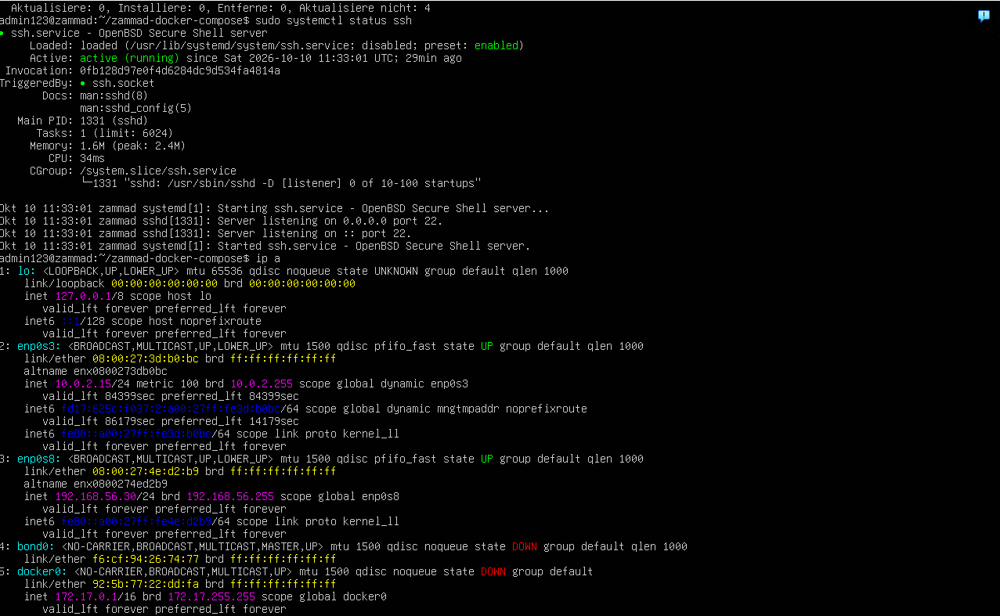

### Troubleshooting: VM per SSH vom Notebook nicht erreichbar, obwohl alles korrekt konfiguriert ist

**Symptom:** Von der Windows-Server-VM war die Zammad-VM erreichbar, vom 
Notebook (Zugriff auf das Lab) dagegen weder per Ping noch per 
`Test-NetConnection 192.168.56.30 -Port 22` (Timeout). Im Testergebnis fiel 
auf: `InterfaceAlias: WLAN`, `SourceAddress: 192.168.178.27` – die Pakete 
verließen das Notebook über das WLAN statt über den Host-only-Adapter.
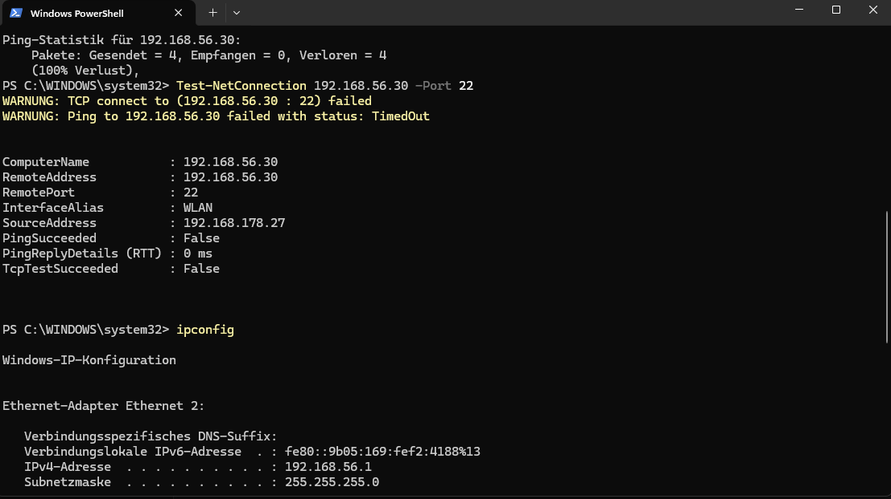

**Vorgehen:**
1. `ipconfig` am Notebook: Der Host-only-Adapter hat `192.168.56.1/24`, 
   liegt also im selben Netz wie die VM – die Konfiguration wirkte stimmig
   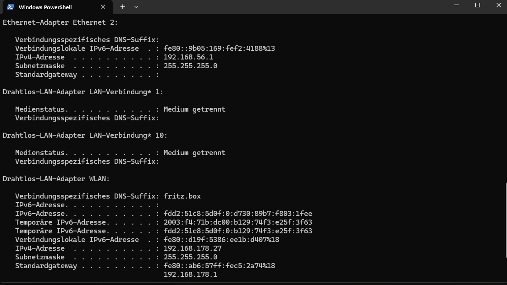
2. `Find-NetRoute -RemoteIPAddress 192.168.56.30`: Windows routet über die 
   Standardroute (WLAN, Fritzbox) statt über den Host-only-Adapter
3. `Get-NetRoute` und `Get-NetAdapter`: Die Route `192.168.56.0/24` existiert, 
   der Adapter ist `Up` und `Connected` – der Adapter selbst ist also intakt
4. `ping -S 192.168.56.1 192.168.56.30` (Quelladresse erzwungen) lieferte 
   „Zielhost nicht erreichbar“ vom Absender `192.168.56.1` selbst – die 
   ARP-Auflösung bleibt unbeantwortet, das Problem liegt auf Layer 2 und 
   weder bei Firewall noch bei Routing
5. Gegenprobe in der VM: `ping 192.168.56.1` funktioniert (`ttl=128`), 
   `ip neigh` zeigt für `192.168.56.1` die MAC `0a:00:27:00:00:14`
   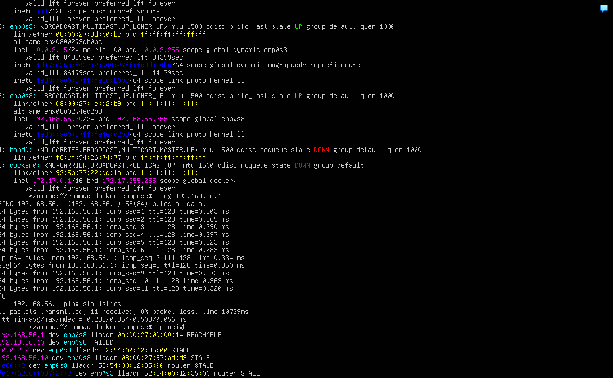
6. `Get-NetAdapter` am Notebook: Der Host-only-Adapter hat die MAC 
   `0A-00-27-00-00-0D` – **nicht** dieselbe MAC, die die VM sieht

**Ursache:** Die VM läuft nicht auf dem Notebook, sondern auf dem Mini-PC 
(Lenovo ThinkCentre M720q). Ein Host-only-Netz existiert nur auf dem Rechner, 
auf dem VirtualBox läuft. Das Notebook besitzt einen eigenen, völlig 
getrennten Host-only-Adapter, der zufällig dieselbe Standardadresse 
`192.168.56.1` trägt. Dass die Windows-Server-VM die Zammad-VM erreicht, 
liegt daran, dass beide im Host-only-Netz des Mini-PCs hängen.

**Lösung (Zwischenlösung):** In der VM-Konfiguration den Adapter 1 von NAT auf 
**Netzwerkbrücke** (Bridged) umgestellt. Die VM erhielt eine Adresse aus 
dem Heimnetz (`192.168.178.31`) und war vom Notebook per SSH erreichbar. 
Adapter 2 (`enp0s8`, `192.168.56.30`) blieb unverändert für die interne 
Kommunikation mit Server und Client. Die Brücke wurde später wegen sehr 
langsamer Downloads wieder durch NAT mit Portweiterleitung ersetzt (siehe 
weiter unten).
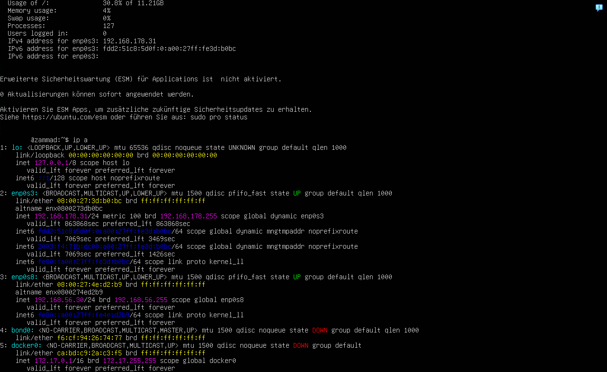

**Erkenntnis:** Host-only-Netze sind auf den jeweiligen Host-Rechner 
begrenzt; derselbe Standardadressbereich kann auf mehreren Rechnern 
gleichzeitig existieren und täuscht dann Erreichbarkeit vor. Entscheidend 
war der **Vergleich der MAC-Adressen** zwischen Gast (`ip neigh`) und Host 
(`Get-NetAdapter`). Ein erzwungener Ping mit `-S` schloss Firewall und 
Routing sauber aus, bevor die Ursache gefunden wurde.

### Troubleshooting: Zammad-Weboberfläche nicht erreichbar („Verbindung abgelehnt“)

**Symptom:** In der Fritzbox erscheint die VM, die Schaltfläche 
„Konfiguration“ liefert „Fehler 404 – Seite nicht gefunden“. Im Browser meldet 
`192.168.178.31` „Verbindung abgelehnt“.

**Diagnose:**
1. „Verbindung abgelehnt“ (statt Timeout) bedeutet: Die VM ist erreichbar, 
   aber auf dem angefragten Port lauscht kein Dienst – eine Firewall wäre es nicht
2. `ss -tlnp`: Es lauschen nur SSH (Port 22) und der lokale DNS-Stub, 
   nichts auf Port 80 oder 8080
3. `docker compose ps` meldete `docker: unknown command: docker compose`
   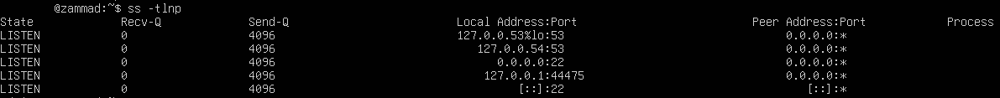

**Ursache:** Das Docker-Compose-Plugin fehlt, der Zammad-Stack wurde 
deshalb nie gestartet. Die Schaltfläche der Fritzbox ruft Port 80 auf, auf dem 
die VM nichts anbietet; die 404-Seite stammt vermutlich von der Fritzbox selbst.

**Erkenntnis:** Der Unterschied zwischen „Verbindung abgelehnt“ (Dienst 
lauscht nicht) und Timeout (Paket kommt nicht an / wird gefiltert) grenzt die 
Fehlersuche sofort ein, `ss -tlnp` belegt es.

### Troubleshooting: Docker-Repository lässt sich nicht einbinden

**Fehlerbild:** Bei der Installation von `docker-ce`, `docker-compose-plugin` 
und Co. meldete `apt`: „Für Paket ›docker-ce‹ existiert kein 
Installationskandidat“. Zuvor hatte der Befehl zum Anlegen des Schlüssels 
`gpg: no valid OpenPGP data found` ausgegeben.
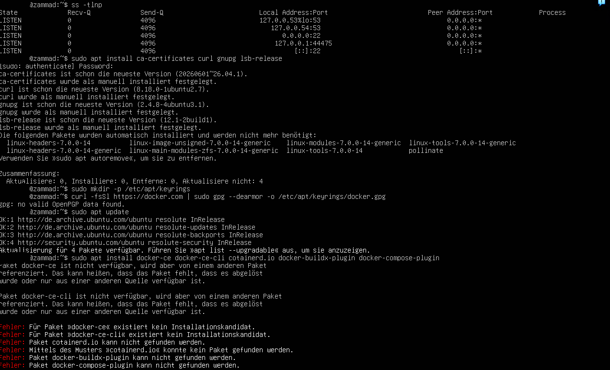

**Diagnose und Behebung:**
1. Der Schlüssel wurde mit `curl` von `https://docker.com` geladen – das 
   liefert die Webseite (HTML), keinen GPG-Schlüssel. Richtig ist 
   `https://download.docker.com/linux/ubuntu/gpg`.
2. `apt update` meldete für `https://www.docker.com resolute` „404 Not Found“ 
   und „enthält keine Release-Datei“. In `/etc/apt/sources.list.d/docker.list` 
   stand die falsche URL `https://docker.com`. Gefunden mit 
   `grep -rn "docker" /etc/apt/sources.list /etc/apt/sources.list.d/`, die 
   Datei wurde gelöscht.
   
3. Neuer Eintrag `/etc/apt/sources.list.d/docker.sources` mit 
   `URIs: https://download.docker.com/linux/ubuntu` und `Suites: resolute`. 
   `apt update` lud nun die Paketliste von `download.docker.com` – das 
   Docker-Repository unterstützt Ubuntu 26.04 also – meldete aber 
   `NO_PUBKEY`, weil die Schlüsseldatei `/etc/apt/keyrings/docker.asc` nie 
   angelegt worden war (der `curl`-Befehl war beim fehlerhaften Einfügen 
   untergegangen, siehe nächster Abschnitt).
   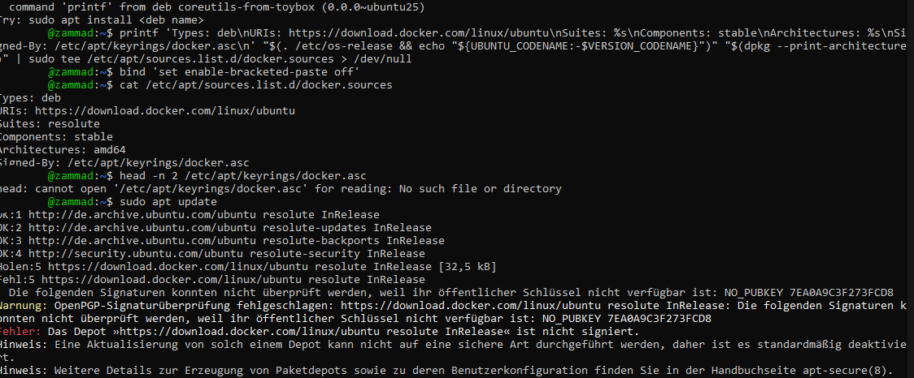
4. Schlüssel von der richtigen URL nachgeladen, `apt update` lief ohne 
   Fehler. Danach `docker-ce`, `docker-ce-cli`, `containerd.io`, 
   `docker-buildx-plugin` und `docker-compose-plugin` installiert. Dabei 
   wurden die zuvor installierten Ubuntu-Pakete `docker.io`, `containerd` 
   und `runc` ersetzt.
   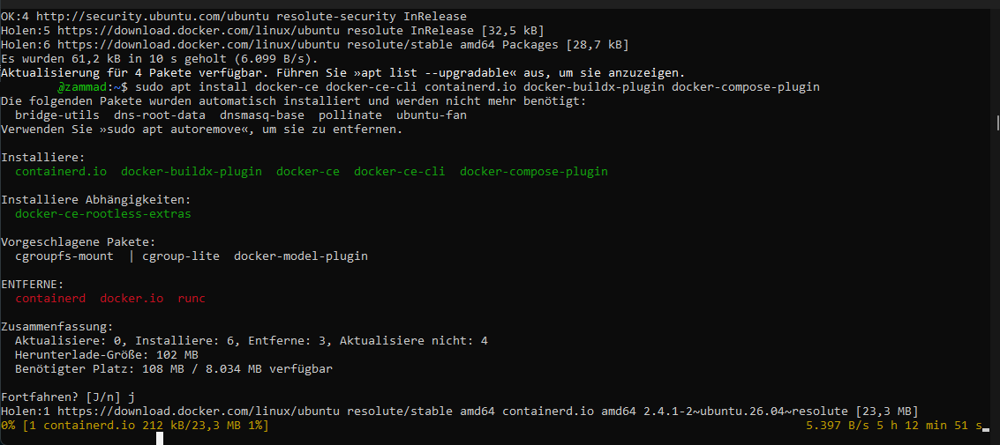
5. Test mit `sudo docker run hello-world` erfolgreich.
   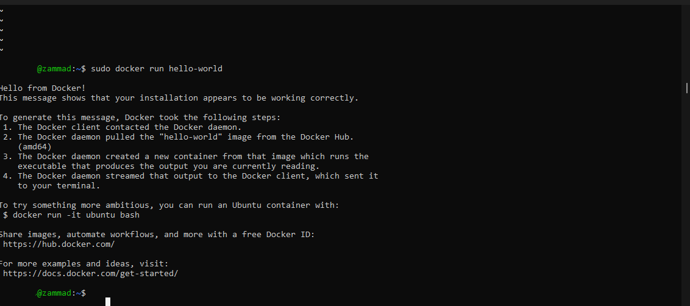

**Ursache:** Mehrere Fehler zusammen: falsche Schlüssel-URL und falsche 
Repository-URL (jeweils ohne `download.`), eine nie angelegte Schlüsseldatei 
und ein zuvor installiertes `docker.io` aus den Ubuntu-Quellen, das kein 
Compose-Plugin mitbrachte.

**Erkenntnis:** `NO_PUBKEY` zeigt, dass die Quelle stimmt und nur der 
Schlüssel fehlt; „404“ und „keine Release-Datei“ weisen dagegen auf eine 
falsche Repository-URL hin. Das offizielle Docker-Repository bietet Pakete 
für Ubuntu 26.04 (`resolute`) an.

### Troubleshooting: Befehle lassen sich nicht sauber einfügen

**Fehlerbild:** Beim Einfügen mehrzeiliger Befehlsblöcke in die SSH-Sitzung 
tauchten Steuerzeichen im Text auf: `^[[200~` und `^[[201~` vor bzw. hinter 
dem Block sowie `^M` am Zeilenende. Folgen: `sudo: command not found` (aus 
`sudo` wurde `^[[201~sudo`), und ein Heredoc, das nicht endete, weil die 
Shell `EOF^M` nicht als Abschluss erkannte.

**Ursache:** Das Terminal sendet beim Einfügen die Markierungen des 
„Bracketed Paste“-Modus, die als Text ankamen, und die Zeilenenden aus der 
Windows-Zwischenablage wurden als `^M` übergeben.

**Lösung:**
- Für die Sitzung `bind 'set enable-bracketed-paste off'`
- Befehle einzeln statt als Block einfügen, eine Passwortabfrage vorher mit 
  `sudo -v` erledigen
- Konfigurationsdateien statt per Heredoc mit einem einzeiligen 
  `printf … | sudo tee …` schreiben (wie schon bei der Netplan-Datei)

**Erkenntnis:** Auch eine SSH-Sitzung löst das Einfügeproblem der 
VM-Konsole nicht automatisch. Entscheidend ist, eingefügte Befehle vor dem 
Absenden auf Steuerzeichen zu prüfen und das Ergebnis jedes Schritts zu 
kontrollieren (`cat`, `head`).

### Troubleshooting: „permission denied“ beim Zugriff auf den Docker-Socket

**Fehlerbild:** `docker compose up` meldete 
`permission denied while trying to connect to the docker API at unix:///var/run/docker.sock`. 
Die Warnung zu `postgresql-initdb.mode` („not supported outside Swarm mode“) 
ist dagegen harmlos und wird ignoriert.

**Ursache:** Der Benutzer war nicht Mitglied der Gruppe `docker`.

**Lösung:** `sudo usermod -aG docker $USER`, danach ab- und wieder anmelden. 
Anschließend läuft `docker compose` ohne `sudo`.

**Hinweis:** Die Mitgliedschaft in der Gruppe `docker` entspricht praktisch 
Root-Rechten auf dem Host. Im Lab ist das ein bewusster Kompromiss.

### Troubleshooting: Sehr langsamer Image-Download mit Netzwerkbrücke über WLAN

**Symptom:** Der Download der Zammad-Images kam mit der Netzwerkbrücke kaum 
voran. Beim ersten Aufbau der VM (mit NAT) hatte der gesamte Download 
ungefähr 10 Minuten gedauert.
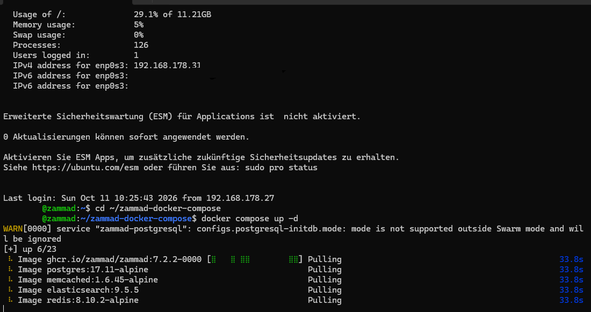

**Diagnose:** Der Mini-PC hängt per WLAN am Router (ein LAN-Kabel ist nicht 
möglich). Die empfangenen Bytes über zehn Sekunden gemessen: 
`cat /sys/class/net/enp0s3/statistics/rx_bytes; sleep 10; cat /sys/class/net/enp0s3/statistics/rx_bytes` 
ergab 4.125.918 Bytes, also rund 410 kB/s. Der Unterschied zum ersten Aufbau 
war der Adaptertyp: damals NAT, jetzt Netzwerkbrücke über WLAN.
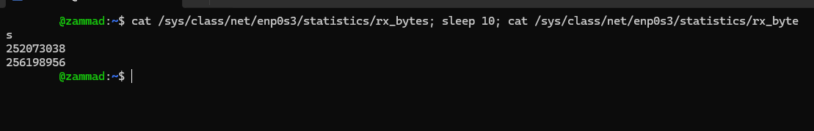

**Lösung:** Adapter 1 zurück auf **NAT** gestellt und zwei 
Portweiterleitungen angelegt: Host-Port `2222` auf Gast-Port `22` (SSH) und 
Host-Port `8080` auf Gast-Port `8080` (Zammad). `enp0s8` blieb unverändert.
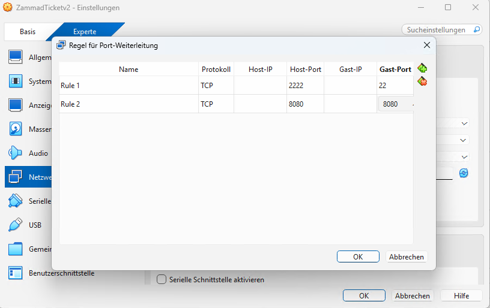
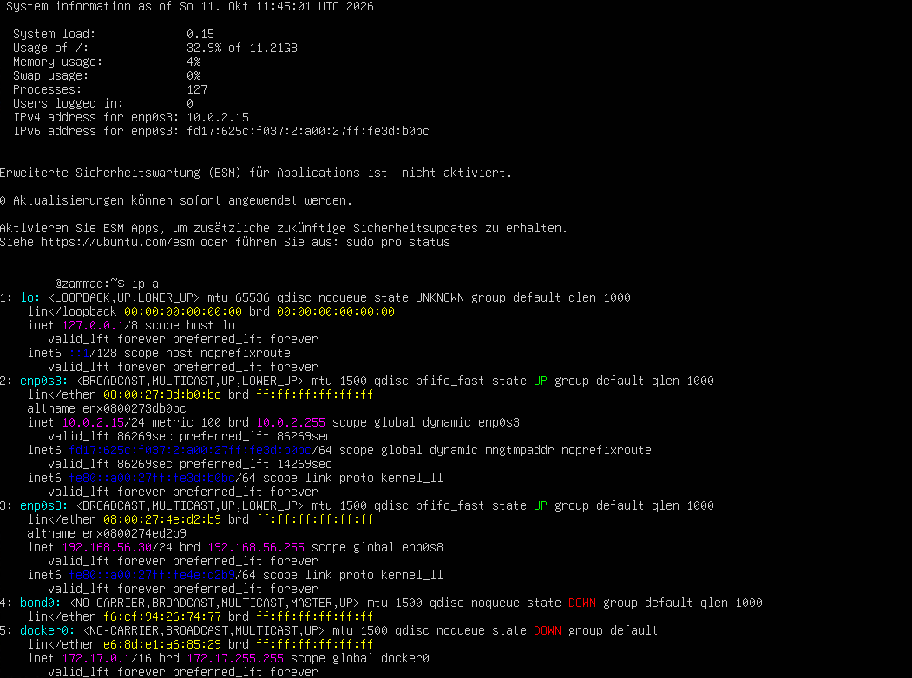

Der Zugriff vom Notebook erfolgt nun über die IP des Mini-PCs: 
`ssh -p 2222 <benutzer>@<IP-des-Mini-PCs>` und 
`http://<IP-des-Mini-PCs>:8080`. Seit dem Umbau auf HTTPS (siehe 
[Interne CA und TLS](#meilenstein-interne-ca-und-tls-für-zammad)) ist 
Zammad nicht mehr direkt auf Port 8080 erreichbar, sondern nur noch über nginx 
auf Port 443.

**Erkenntnis:** Bei NAT liegt die VM in einem eigenen privaten Netz (`10.0.2.x`) 
hinter dem Host. Vom Notebook aus spricht man deshalb immer den Mini-PC an, 
VirtualBox reicht die Verbindung per Portweiterleitung an die VM weiter. 
Dass die Netzwerkbrücke über WLAN die Ursache war, ergibt sich aus dem 
Vorher-Nachher-Vergleich und nicht aus einer isolierten Messung. Zu beachten: 
Ohne Host-IP in den Regeln sind die Ports von allen Geräten im Heimnetz 
erreichbar.

## Meilenstein: Zammad läuft

Der Stack wird im Verzeichnis `zammad-docker-compose` mit 
`docker compose up -d` gestartet. Im Home-Verzeichnis meldet `docker compose` 
dagegen „no configuration file provided: not found“, denn die Befehle müssen 
dort ausgeführt werden, wo die `docker-compose.yml` liegt. Beim Start 
wurden Netzwerk und Volumes angelegt, Redis, PostgreSQL und Memcached meldeten 
sich als `Healthy`, der Rails-Server wartete auf den Init-Container.
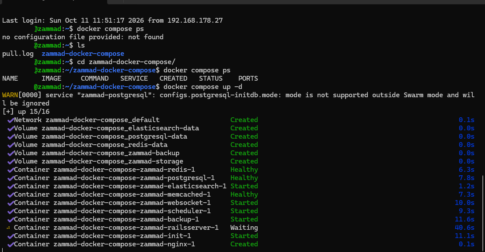

Anschließend war die Weboberfläche unter `http://<IP-des-Mini-PCs>:8080` 
erreichbar, und der Einrichtungsassistent konnte durchlaufen werden.
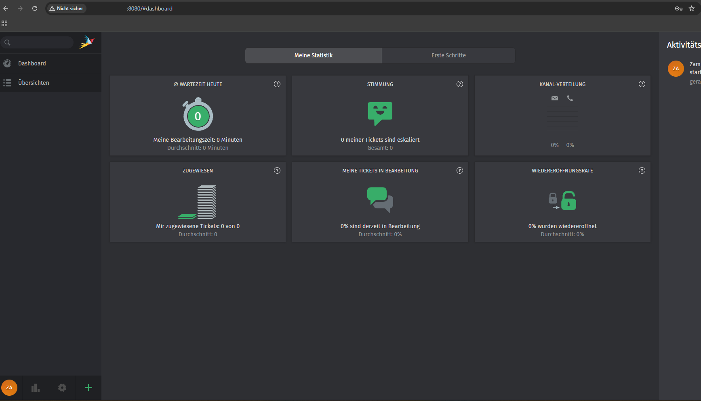

Zusätzlich zu den Standardrollen (Admin, Agent, Customer) wurden die Rollen 
**Support L1, L2 und L3** angelegt, um eine Eskalationsstruktur wie in einem 
Service Desk abzubilden.
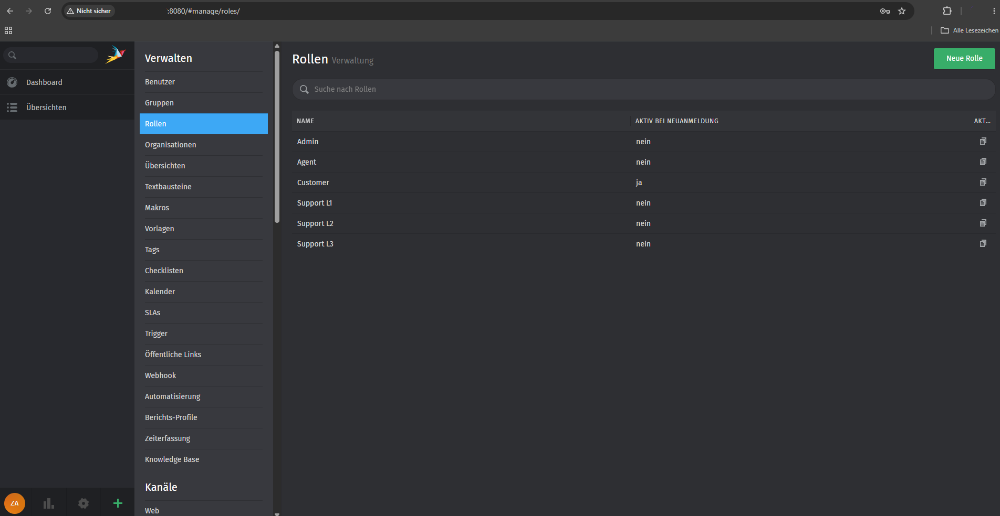

<!-- Berechtigungen und Gruppenzugriff der Rollen nach der Konfiguration ergänzen -->

### Troubleshooting: Weniger Speicherplatz als die virtuelle Platte hat

**Symptom:** Das System zeigte nur rund 11 GB (`Usage of /: … of 11.21GB`), 
obwohl die virtuelle Platte 25 GB groß ist.

**Ursache:** Der Ubuntu-Installer legt das logische Volume standardmäßig nur 
auf einen Teil der Platte, der Rest bleibt in der Volume Group ungenutzt.

**Lösung:** `sudo lvextend -r -l +100%FREE /dev/ubuntu-vg/ubuntu-lv`. Die 
Option `-r` vergrößert das Dateisystem gleich mit, im laufenden Betrieb und 
ohne Neustart. Das Volume wuchs von 11,5 GiB auf 23 GiB, `df -h /` zeigt 
anschließend 23 GB Gesamtgröße und 14 GB frei.
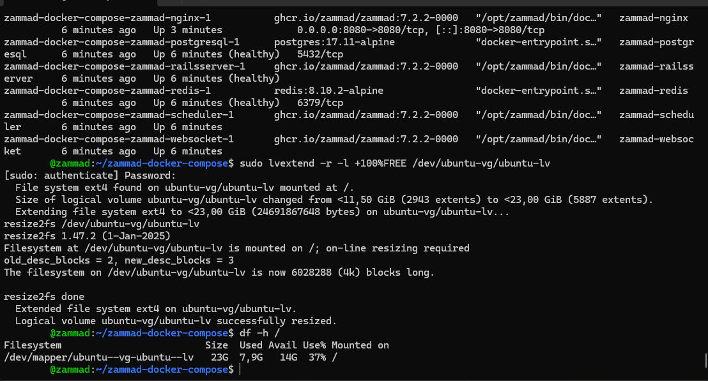

**Erkenntnis:** Der Installer-Standard nutzt nicht den gesamten Plattenplatz. 
Gerade bei Anwendungen, die wachsen (Zammad mit Datenbank und Suchindex), 
lohnt sich die Kontrolle mit `df -h` und `vgs` nach der Installation.

## Meilenstein: Interne CA und TLS für Zammad

Zammad lief bisher unverschlüsselt über HTTP („Nicht sicher“ im Browser). Jetzt ist die Weboberfläche über `https://zammad.homelab.local` erreichbar, abgesichert mit einem Zertifikat einer eigenen Root-CA. Die CA wird per Gruppenrichtlinie an die Domänen-Clients verteilt, sodass der Browser ohne Warnung vertraut.

### Aufbau

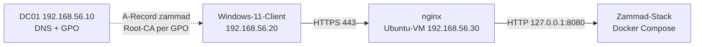

| Komponente | Aufgabe |
|---|---|
| DC01 (`192.168.56.10`) | DNS-Eintrag `zammad.homelab.local`, GPO `Lab-Root-CA` verteilt das Root-Zertifikat |
| Ubuntu-VM (`192.168.56.30`) | Root-CA (OpenSSL), nginx als Reverse Proxy mit TLS, Zammad-Stack |
| Windows-11-Client | vertraut der Root-CA über den Zertifikatspeicher der Domäne |

Ablauf: Der Client löst `zammad.homelab.local` über den DC auf, spricht per HTTPS mit nginx, und nginx reicht die Anfrage intern per HTTP an Zammad auf `127.0.0.1:8080` weiter.

### Umsetzung

**1. DNS-Eintrag (DC01, PowerShell)**

Zuerst die Host-only-Adresse der Ubuntu-VM ermitteln (`ip -4 a`, Adapter `enp0s8`). Eingetragen wird diese Adresse, nicht die NAT-Adresse `10.0.2.x`.
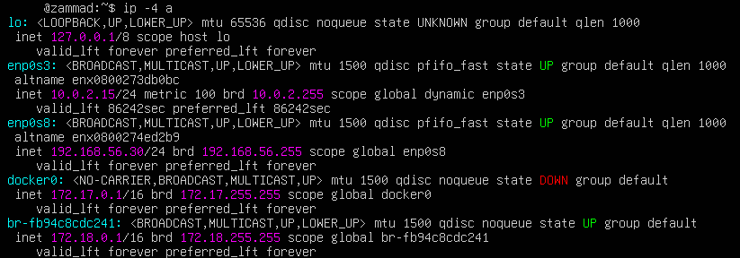

```powershell
Add-DnsServerResourceRecordA -ZoneName "homelab.local" -Name "zammad" -IPv4Address "192.168.56.30"
```

Test am Client mit `nslookup zammad.homelab.local` (Antwort `192.168.56.30`).
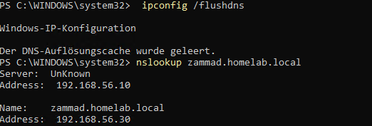

**2. Root-CA und Serverzertifikat (Ubuntu-VM, OpenSSL)**

```bash
mkdir -p ~/ca && cd ~/ca && chmod 700 .
openssl genrsa -aes256 -out rootCA.key 4096
openssl req -x509 -new -key rootCA.key -sha256 -days 1825 -subj "/CN=Homelab Root CA" -out rootCA.crt
openssl genrsa -out zammad.key 2048
openssl req -new -key zammad.key -subj "/CN=zammad.homelab.local" -out zammad.csr
printf "subjectAltName=DNS:zammad.homelab.local\nbasicConstraints=CA:FALSE\nkeyUsage=digitalSignature,keyEncipherment\nextendedKeyUsage=serverAuth\n" > ext.cnf
openssl x509 -req -in zammad.csr -CA rootCA.crt -CAkey rootCA.key -CAcreateserial -days 365 -sha256 -extfile ext.cnf -out zammad.crt
```

Der Root-Key ist mit einer Passphrase geschützt. Das Serverzertifikat enthält den Namen als **SAN** (Subject Alternative Name), denn moderne Browser ignorieren den Common Name. Die Laufzeit beträgt 365 Tage, weil Chrome und Safari bei Serverzertifikaten mehr als 398 Tage ablehnen.
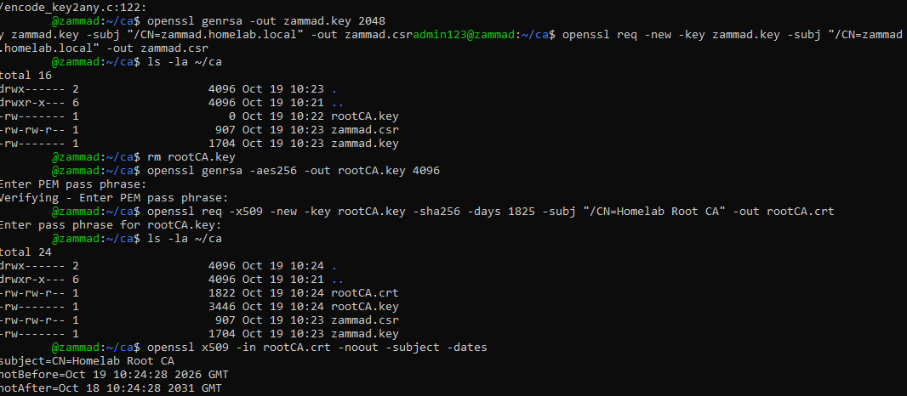

Prüfung:

```bash
openssl verify -CAfile rootCA.crt zammad.crt
openssl x509 -in zammad.crt -noout -subject -issuer -dates -ext subjectAltName
openssl x509 -in rootCA.crt -noout -ext basicConstraints
```

Erwartet: `zammad.crt: OK`, Issuer `Homelab Root CA`, SAN `DNS:zammad.homelab.local`, Root mit `CA:TRUE`.
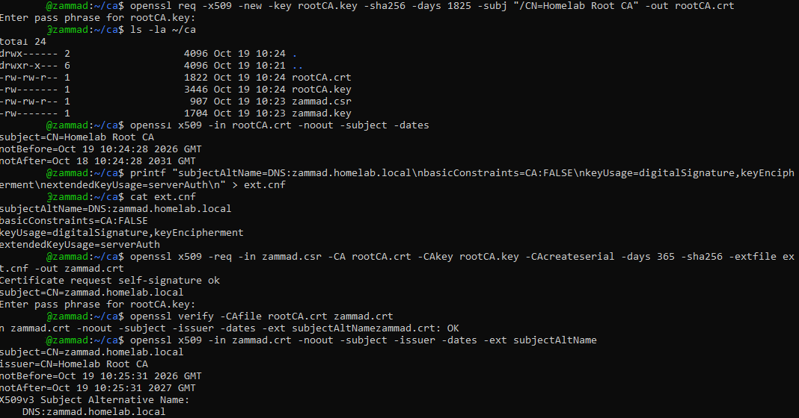

**3. nginx als Reverse Proxy (Ubuntu-VM)**

Zertifikat und Server-Key liegen unter `/etc/ssl`, der Root-Key bleibt im Ordner `~/ca` und gehört nicht auf den Webserver:

```bash
sudo install -m 644 zammad.crt /etc/ssl/certs/zammad.crt
sudo install -m 600 -o root -g root zammad.key /etc/ssl/private/zammad.key
```

Server-Block `/etc/nginx/sites-available/zammad`:

```nginx
server {
  listen 443 ssl;
  server_name zammad.homelab.local;
  ssl_certificate /etc/ssl/certs/zammad.crt;
  ssl_certificate_key /etc/ssl/private/zammad.key;
  ssl_protocols TLSv1.2 TLSv1.3;
  client_max_body_size 50M;
  location / {
    proxy_pass http://127.0.0.1:8080;
    proxy_http_version 1.1;
    proxy_set_header Upgrade $http_upgrade;
    proxy_set_header Connection "upgrade";
    proxy_set_header Host $host;
    proxy_set_header X-Real-IP $remote_addr;
    proxy_set_header X-Forwarded-For $proxy_add_x_forwarded_for;
    proxy_set_header X-Forwarded-Proto https;
    proxy_read_timeout 86400;
  }
}
```

Die Upgrade-Header sind nötig, weil Zammad für Live-Updates WebSockets nutzt. Aktiviert mit einem Symlink in `sites-enabled`, danach `sudo nginx -t` und `sudo systemctl restart nginx`.
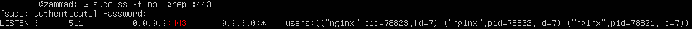

**4. Zammad-Port auf localhost binden**

Docker öffnet veröffentlichte Ports an den Regeln der Host-Firewall vorbei. Deshalb ist die Bindung an `127.0.0.1` die eigentliche Absicherung: Zammad ist nur noch über nginx erreichbar. In der `docker-compose.yml` des nginx-Containers von Zammad (Zeile 164) wurde vor den Host-Port die Adresse `127.0.0.1` gesetzt:

```yaml
ports:
  - "127.0.0.1:${NGINX_EXPOSE_PORT:-8080}:${NGINX_PORT:-8080}"
```

Danach `docker compose up -d`. `docker ps` zeigt nur noch `127.0.0.1:8080->8080/tcp`, ohne `0.0.0.0` und ohne `[::]`. Die ursprüngliche Datei liegt als `docker-compose.yml.bak` daneben.
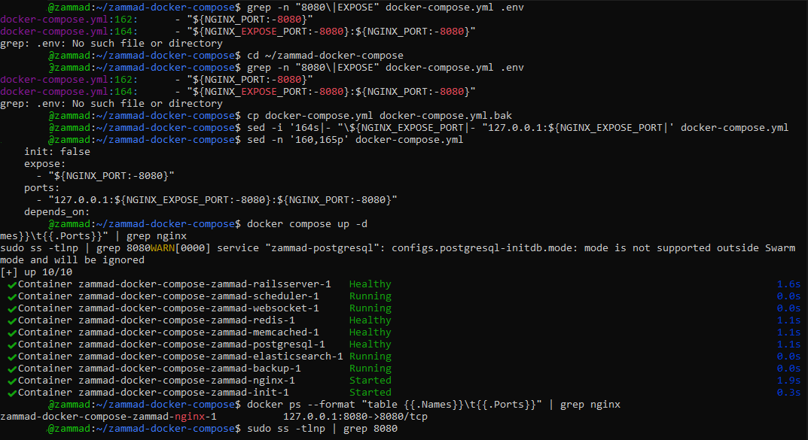

Test auf dem Server (die Kette wird gegen die eigene Root-CA geprüft):

```bash
curl --cacert ~/ca/rootCA.crt --resolve zammad.homelab.local:443:127.0.0.1 -I https://zammad.homelab.local
```

Antwort: `HTTP/1.1 200 OK`.
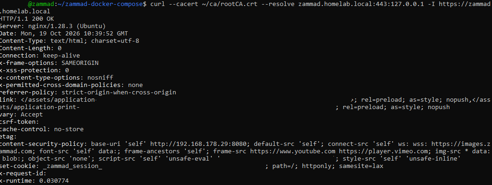

**5. Root-CA per Gruppenrichtlinie verteilen (DC01)**

`rootCA.crt` (nur die öffentliche Datei, niemals den Key) wurde per `scp` auf den DC kopiert und mit einem Hashvergleich (`openssl x509 -fingerprint -sha256` gegen `certutil -hashfile … SHA256`) auf Unverändertheit geprüft. In `gpmc.msc` wurde die GPO `Lab-Root-CA` mit der Domäne verknüpft und das Zertifikat unter *Computerkonfiguration → Richtlinien → Windows-Einstellungen → Sicherheitseinstellungen → Richtlinien für öffentliche Schlüssel → Vertrauenswürdige Stammzertifizierungsstellen* importiert.
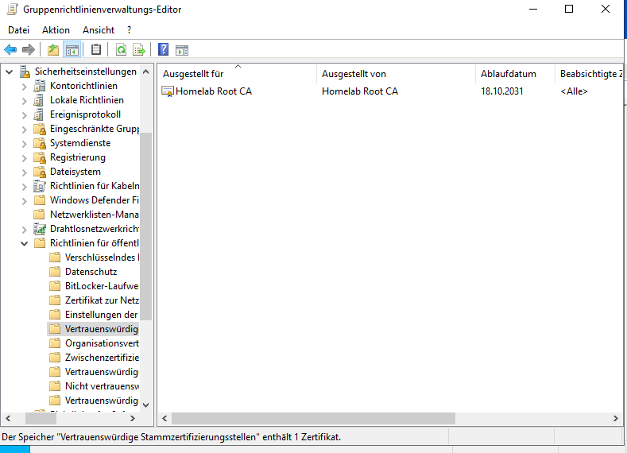

Am Client: `gpupdate /force`, dann in Edge `https://zammad.homelab.local` aufrufen. Das Schloss erscheint ohne Warnung.
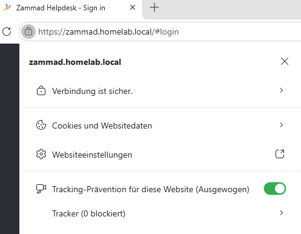

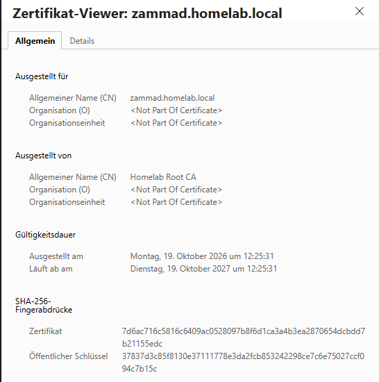

Der Zertifikats-Viewer zeigt `zammad.homelab.local`, ausgestellt von `Homelab Root CA`, gültig vom 19.10.2026 bis 19.10.2027.

Die Zertifikathierarchie zeigt die Kette `Homelab Root CA` → `zammad.homelab.local`. Der Browser prüft die Kette also gegen die eigene CA, es ist keine Ausnahme gesetzt.
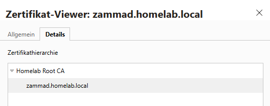

**6. System-Adresse in Zammad umstellen**

Unter *Admin → System → Einstellungen → Basis* wurden der Domainname auf `zammad.homelab.local` und der HTTP-Typ auf `https` gesetzt. Zuvor zeigte die Anmeldeseite noch die alte Adresse mit Port 8080, und die Content-Security-Policy im Antwort-Header erlaubte nur diese Adresse. Die SystemID bleibt unverändert, sie steckt in jeder Ticketnummer.
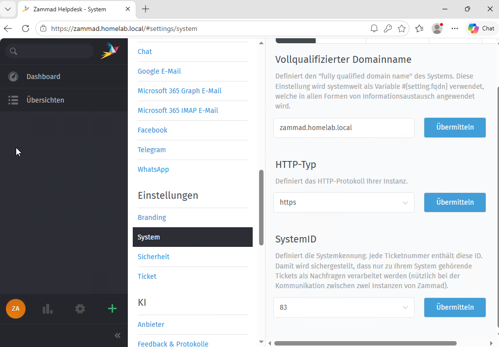

### Troubleshooting: Host-Laufwerk voll (`VERR_DISK_FULL`)

**Symptom:** Während des Betriebs erschien in VirtualBox die Meldung „The I/O cache encountered an error while updating data in medium ahci-0-0 (rc=VERR_DISK_FULL)“, die VM wurde pausiert.


**Ursache:** Das Laufwerk des **Hosts** war voll, nicht das der VM. Auf dem Mini-PC lagen noch alte VM-Ordner, deren Einträge zwar aus VirtualBox entfernt waren, deren Plattendateien aber weiter Platz belegten (Entfernen ohne die Option „Alle Dateien löschen“). Dazu kommen die Differenzdateien der Snapshots.

**Lösung:** Erst Platz schaffen, dann die VM fortsetzen, nicht umgekehrt. Nach dem Aufräumen waren rund 60 GB frei. Anschließend prüfte `sudo dmesg | grep -iE "error|i/o|ext4"` das Dateisystem: Es gab keine EXT4-Fehler, nur die normale Bootabfolge (`ro` → `r/w`). Die roten `vmwgfx`-Zeilen betreffen nur die Konsolengrafik der VM und sind für den Betrieb unerheblich.


**Erkenntnis:** Die Meldung spricht von „disk“, meint aber den Datenträger des Hosts, und das ist irreführend. Verwaiste Plattendateien nach dem Entfernen einer VM sind eine häufige, unsichtbare Ursache.

### Troubleshooting: Root-Key hat 0 Bytes (`Verify failure`)

**Symptom:** `openssl genrsa -aes256 …` brach mit `Verify failure` und `problems getting password` ab. Im Ordner lag danach eine `rootCA.key` mit **0 Bytes**.

**Ursache:** Beide Passphrase-Eingaben stimmten nicht überein. Die Eingabe ist verdeckt, ein Vertipper (oder ein abweichendes Tastaturlayout in der VM-Konsole) fällt nicht auf. openssl legt die Zieldatei an, bevor die Passphrase bestätigt ist, und lässt sie leer zurück.

**Lösung:** Leere Datei mit `rm rootCA.key` löschen und neu erzeugen. Kontrolle mit `ls -la`: Die fertige Datei hat rund 3,4 kB (im Screenshot oben bei der Root-CA zu sehen).

**Erkenntnis:** Nach jedem Schlüsselbefehl die Dateigröße prüfen. Eine leere Schlüsseldatei verursacht später Folgefehler an Stellen, die scheinbar nichts mit der Passphrase zu tun haben.

### Troubleshooting: Eingefügte Befehle werden verfälscht

**Symptom:** Zusätzlich zu den oben schon dokumentierten Einfügeproblemen scheiterte der Befehl `mkdir` mit `command not found`, weil davor `^[[200~` stand.


Ein anderer eingefügter Block endete mit `sudo: maximum 3 incorrect authentication attempts`.


**Ursache:** Die erste `sudo`-Zeile fragte nach dem Passwort, und das Terminal schickte die restlichen eingefügten Zeilen sofort hinterher. sudo las sie als Passwortversuche und brach nach drei „falschen“ ab. In einem anderen Fall wurden zwei Befehle ohne Zeilenumbruch zusammengeklebt (`grep 8080curl --cacert …`), was zu `grep: unrecognized option '--cacert'` führte.

**Lösung:** `bind 'set enable-bracketed-paste off'` setzen, vor eingefügten Blöcken einmal von Hand `sudo -v` ausführen und Befehle einzeln absenden.

**Erkenntnis:** Fehlermeldungen wie „command not found“ oder „unrecognized option“ bei einem eigentlich korrekten Befehl deuten auf verfälschten Text hin, nicht auf einen Fehler in der Konfiguration.

### Troubleshooting: `install: invalid group: 'ssl-cert'`

**Symptom:** Das Ablegen des Server-Keys mit `-g ssl-cert` scheiterte.

**Ursache:** Die Gruppe `ssl-cert` kommt mit dem gleichnamigen Paket und war auf dieser Maschine nicht vorhanden.

**Lösung:** Key mit `install -m 600 -o root -g root` ablegen. nginx liest den Key beim Start als root, eine Gruppe wird nicht gebraucht, und der strengere Modus ist sogar sicherer.

### Troubleshooting: nginx direkt gestartet (`Permission denied` beim Key)

**Symptom:** `nginx` (ohne `sudo`) meldete `cannot load certificate key … Permission denied`.


**Ursache:** Der Key gehört `root:root` mit Modus 600, ein normaler Benutzer darf ihn nicht lesen. Das ist gewollt. Der Dienst läuft über systemd als root.

**Lösung:** nginx nur über `sudo nginx -t` und `sudo systemctl restart nginx` prüfen und starten.

### Troubleshooting: SSH-Warnung `REMOTE HOST IDENTIFICATION HAS CHANGED`

**Symptom:** `scp` vom DC zur Ubuntu-VM brach mit der Warnung vor einem geänderten Host-Key ab.


**Ursache:** Im `known_hosts` des DC stand noch der Key einer früheren VM mit derselben IP-Adresse (`192.168.56.30`), denn die VM war neu aufgebaut worden.

**Lösung:** Erst den Fingerabdruck auf der VM auslesen (`ssh-keygen -lf /etc/ssh/ssh_host_ecdsa_key.pub`) und mit dem in der Warnung vergleichen, damit ein echter Man-in-the-Middle ausgeschlossen ist. Erst danach den alten Eintrag mit `ssh-keygen -R 192.168.56.30` entfernen.

**Erkenntnis:** Die Warnung nicht einfach wegklicken. Der Fingerabdruck-Vergleich dauert eine Minute und macht aus „wird schon stimmen“ eine Prüfung.

### Troubleshooting: SSH-Test aus dem Heimnetz läuft in den Timeout

**Symptom:** `ssh` und `ping` zu `192.168.56.30` und zum DC liefen in einen Timeout.

**Ursache:** `Test-NetConnection` zeigte `SourceAddress 192.168.178.27` über das WLAN, getestet wurde also von einem Rechner im Heimnetz. Das Host-only-Netz existiert nur auf dem Mini-PC (dasselbe Muster wie im Abschnitt zur Netzwerkbrücke oben). Von außen erreicht man die VM nur über die NAT-Portweiterleitung am Mini-PC.

**Lösung:** Mit der LAN-Adresse des Mini-PCs und dem weitergeleiteten Port verbinden (`ssh -p 2222 <benutzer>@<IP-des-Mini-PCs>`). Innerhalb des Labs, zum Beispiel vom DC zur Ubuntu-VM, genügt die Host-only-Adresse.

### Troubleshooting: PowerShell erkennt den Parameter nicht

**Symptom:** `Add-DnsServerResourceRecordA - ZoneName …` meldete `Es wurde kein Positionsparameter gefunden`.


**Ursache:** Zwischen Minuszeichen und Parametername stand ein Leerzeichen. PowerShell las `ZoneName` als Positionsargument.

### Troubleshooting: `ERR_CERT_AUTHORITY_INVALID` auf einem Rechner ohne Root-CA

**Symptom:** Auf einem Rechner außerhalb der Domäne zeigte Edge „Ihre Verbindung ist nicht privat“.


**Ursache:** Der Rechner kannte die `Homelab Root CA` nicht, weil die GPO nur Domänenmitglieder erreicht. Name und Laufzeit des Zertifikats waren in Ordnung, sonst wäre `ERR_CERT_COMMON_NAME_INVALID` oder `ERR_CERT_DATE_INVALID` erschienen.

**Lösung:** Nicht „Weiter“ klicken, sondern die Root-CA gezielt installieren:

```powershell
Import-Certificate -FilePath C:\Temp\rootCA.crt -CertStoreLocation Cert:\LocalMachine\Root
```

**Erkenntnis:** Die Fehlerkennung benennt die Ursache genau. Die Warnung ohne CA ist zugleich die Gegenprobe, dass die Vertrauenskette wirklich geprüft wird und nicht nur eine Ausnahme gesetzt wurde. Firefox nutzt einen eigenen Speicher (`security.enterprise_roots.enabled = true`).

### Troubleshooting: Zammad-Passwort vergessen

**Symptom:** Der Admin-Zugang war nicht mehr bekannt. Der Weg über „Passwort vergessen?“ braucht einen konfigurierten Mailversand, den das Lab nicht hat.

**Lösung:** Passwort über die Rails-Konsole im Container zurücksetzen und danach in der Oberfläche durch ein endgültiges ersetzen. Das temporäre Passwort steht in der Shell-History und bleibt deshalb nicht bestehen.

```bash
cd ~/zammad-docker-compose
docker compose exec zammad-railsserver rails r "u = User.find_by(login: '<LOGIN>'); u.password = '<TEMPORAERES-PASSWORT>'; u.save!; puts 'ok'"
```

### Troubleshooting: Zammad-Anmeldung scheitert mit „Verifizierung des Sicherheits-Tokens fehlgeschlagen“

**Symptom:** Nach der Umstellung auf HTTPS zeigte `https://zammad.homelab.local` auf der Anmeldeseite einen Dialog „Die Verifizierung des Sicherheits-Tokens ist fehlgeschlagen“. Der Countdown lud die Seite neu, der Fehler kehrte zurück.


**Diagnose:** Die Meldung stammt von der CSRF-Prüfung in Rails. Bei einem Reverse Proxy ist die häufigste Ursache ein falsch weitergereichtes Protokoll, deshalb habe ich beide Proxy-Stufen einzeln geprüft. Auf dem Host steckt die Konfiguration direkt in `nginx.conf`, nicht in `sites-enabled` (ein `grep` dort blieb leer). `nginx -T` zeigt die tatsächlich geladene Konfiguration, unabhängig vom Pfad:

```bash
sudo nginx -T 2>/dev/null | grep -nE "server_name|listen|proxy_|ssl_certificate"
```


Der äußere nginx ist in Ordnung (`Host` und `X-Forwarded-Proto https` korrekt gesetzt). Hinter ihm läuft aber der nginx-Container des Zammad-Stacks, also eine zweite Proxy-Stufe:

```bash
docker compose exec zammad-nginx grep -rn "X-Forwarded\|proxy_set_header" /etc/nginx/
```


In den Zeilen 46, 63 und 77 steht `proxy_set_header X-Forwarded-Proto $scheme;`.

**Ursache:** Der äußere nginx terminiert TLS und spricht mit dem Container nur HTTP. Für den inneren nginx ist `$scheme` deshalb `http` und überschreibt das `https` der äußeren Stufe. Rails hielt die Anfrage für unverschlüsselt, die Prüfung scheiterte.

**Lösung:** Der Stack kennt die Variable `NGINX_SERVER_SCHEME` (in der `docker-compose.yml` vorhanden). Sie wird in einer neuen `.env` gesetzt, der Container neu erstellt und die Wirkung geprüft:

```bash
cd ~/zammad-docker-compose
grep -rn "NGINX_SERVER_SCHEME" .env docker-compose*.yml
echo 'NGINX_SERVER_SCHEME=https' >> .env
docker compose up -d zammad-nginx
docker compose exec zammad-nginx grep -n "X-Forwarded-Proto" /etc/nginx/sites-available/default
```


Danach funktioniert die Anmeldung im InPrivate-Fenster, nach dem Löschen der alten Cookies auch im normalen Browserfenster. Ein `restart` reicht nicht, die Variable wird erst beim Neuerstellen des Containers übernommen (`up -d`). Weil ich den `echo`-Befehl versehentlich mehrfach ausgeführt hatte, stand die Zeile mehrfach in der `.env`. Bereinigt und erneut geprüft:


**Erkenntnis:** Bei mehreren hintereinandergeschalteten Proxys jede Stufe einzeln prüfen, denn eine innere Stufe kann Header der äußeren überschreiben. Ein InPrivate-Fenster trennt Cookie-Altlasten schnell von Konfigurationsfehlern. Vor dem Anhängen mit `>>` den Dateiinhalt mit `cat` prüfen.

### Sicherheitsbetrachtung

- **CA-Key:** In der Praxis gehört der Root-Key offline und passphrasengeschützt aufbewahrt, idealerweise mit einer Zwischen-CA für die Ausstellung. Im Lab liegt er bewusst vereinfacht auf demselben Server.
- **Zertifikatslaufzeit:** Das Serverzertifikat läuft nach 365 Tagen ab (19.10.2027). Die Erneuerung ist als wiederkehrende Aufgabe zu planen, die Root-CA gilt fünf Jahre.
- **Port-Bindung:** Zammad lauscht nur auf `127.0.0.1:8080`. Das ist die eigentliche Absicherung, weil Docker veröffentlichte Ports an der Host-Firewall vorbei öffnet.
- **Host-Firewall:** `ufw` ist eingerichtet (siehe [Meilenstein](#meilenstein-host-firewall-ufw-auf-der-ticketsystem-vm)), ersetzt aber keine zentrale Firewall im Netz. Genau dafür ist die virtuelle Firewall (OPNsense) als nächster Ausbau vorgesehen.
- **Geheimnisse:** Keine Zugangsdaten und Schlüssel in Screenshots oder im Repo. Eine `.gitignore` mit `*.key`, `*.srl` und `*.csr` verhindert, dass Schlüsselmaterial versehentlich committet wird.

## Meilenstein: Host-Firewall (ufw) auf der Ticketsystem-VM

Die Ticketsystem-VM nimmt eingehenden Verkehr nur noch auf den Ports an, die sie braucht: HTTPS für nginx und SSH für die Administration. Alles andere wird verworfen. `ufw` schützt dabei nur diese eine VM und ersetzt keine zentrale Firewall im Netz (siehe [Sicherheitsbetrachtung](#sicherheitsbetrachtung)).

### Regelwerk

Standardrichtlinie: `deny` für eingehenden, `allow` für ausgehenden und `deny` für weitergeleiteten Verkehr, Logging auf `low`.

| Regel | Quelle | Begründung |
|---|---|---|
| `443/tcp` | Anywhere | HTTPS zu nginx, der einzige Weg zu Zammad |
| `22/tcp` | `192.168.56.0/24` | SSH aus dem Lab-Netz (DC01, Client) |
| `22/tcp` | `192.168.178.27` | SSH vom Admin-Notebook über die NAT-Weiterleitung (Mini-PC Port 2222 → VM Port 22) |

Port 8080 ist bewusst nicht freigegeben. Zammad lauscht ohnehin nur auf `127.0.0.1:8080` (siehe [TLS, Schritt 4](#meilenstein-interne-ca-und-tls-für-zammad)), die Firewall ist also eine zweite, unabhängige Schutzebene.

Das finale Regelwerk enthält ausschließlich IPv4-Regeln. IPv6 ist nicht freigegeben, der DNS-Eintrag `zammad.homelab.local` ist ein A-Record und alle Tests im Lab laufen über IPv4.

Zielzustand, in dieser Reihenfolge umgesetzt (SSH-Regeln **vor** `ufw enable`):

```bash
sudo ufw default deny incoming
sudo ufw default allow outgoing
sudo ufw allow 443/tcp
sudo ufw allow from 192.168.56.0/24 to any port 22 proto tcp
sudo ufw allow from 192.168.178.27 to any port 22 proto tcp
sudo ufw enable
sudo ufw status verbose
```

Beim Aktivieren warnt ufw (`Command may disrupt existing ssh connections`). Bestehende Verbindungen laufen nach dem Aktivieren weiter, deshalb gehört jeder Test in eine **neue** Sitzung, und die alte bleibt als Rückfallebene offen.

### Fehlersuche: Drei Stolpersteine

**1. Die Subnetz-Regel war wirkungslos.** Beim ersten Aktivieren standen `22/tcp` und `443/tcp` für „Anywhere“ bereits im Regelwerk, ufw meldete beim Hinzufügen von 443 `Skipping adding existing rule`. Die Regel `22/tcp` aus `192.168.56.0/24` schränkte damit nichts ein, SSH blieb von überall erreichbar.


**2. Falsche Annahme zur Quelladresse.** Geplant war, dass SSH über die NAT-Weiterleitung mit der Quelladresse `10.0.2.2` (VirtualBox-NAT) ankommt, und eine Regel für `10.0.2.0/24` wurde ergänzt. Das Journal des SSH-Dienstes zeigt etwas anderes: `Accepted password for <BENUTZER> from 192.168.178.27`, also die Adresse des Notebooks. Weder das Lab-Subnetz noch `10.0.2.0/24` passten, der Login lief ausschließlich über die offene Regel. Hätte ich die offene Regel einfach gelöscht, wäre der Fernzugriff weg gewesen.


Die Regel wurde deshalb auf die tatsächliche Quelle ausgerichtet (`192.168.178.27`), die Regel für `10.0.2.0/24` danach wieder entfernt.

**3. Überlappende Regeln.** Zwischenzeitlich standen die Einzeladresse und das Heimnetz `192.168.178.0/24` nebeneinander. Das /24 schließt die Einzeladresse ein, macht deren Regel überflüssig und öffnet SSH für jedes Gerät im Heimnetz. Beibehalten wurde nur die Einzeladresse. Gelöscht wird über `sudo ufw status numbered` und `sudo ufw delete <Nr>`, **von der höchsten Nummer abwärts**, weil sich die Nummern nach jedem Löschen verschieben.

**Erkenntnis:** Die Quelladresse gehört aus dem Log gelesen, nicht angenommen. Und eine Regel ist erst belegt, wenn der Test auch dann besteht, wenn keine andere Regel mehr dafür einspringen kann.

### Verifikation

| Test | Erwartung | Ergebnis |
|---|---|---|
| SSH vom Notebook über Port 2222, neue Sitzung, nach dem Entfernen der offenen Regel | Login klappt | Journal: `Accepted password … from 192.168.178.27` |
| SSH von DC01 (`192.168.56.10`) zur VM | Login klappt über die Regel für `192.168.56.0/24` | Login funktioniert |
| Regelwerk | Keine `22/tcp`-Regel für „Anywhere“ | `ufw status verbose` zeigt nur die drei Regeln aus der Tabelle |
| Port 443 von DC01 (`192.168.56.10`) | offen | `TcpTestSucceeded : True` |
| Port 8080 von DC01 | geschlossen | `TcpTestSucceeded : False` |


Zwei Anmerkungen zu den Ergebnissen:

- Der Test auf Port 8080 zeigt das **Gesamtergebnis** beider Schutzebenen (Bindung an `127.0.0.1` und Default deny). Er sagt nicht, welche der beiden allein ausreichen würde.
- `PingSucceeded : True` ist kein Widerspruch zu „Default deny“: ufw lässt ICMP-Echo über seine Standardregeln in `/etc/ufw/before.rules` zu, unabhängig von den eigenen Regeln. Für die Fehlersuche im Lab ist das gewollt.

### Voraussetzungen und offene Punkte

- **Feste Adresse für das Notebook:** Die SSH-Regel hängt an `192.168.178.27`. Damit sie dauerhaft trägt, ist die Adresse des Notebooks in der Fritzbox fest zugewiesen (statisch). Würde sie per DHCP wechseln, sperrte die Regel den Fernzugriff aus.
- **Authentifizierung:** SSH läuft weiterhin mit Passwort. Die Firewall begrenzt, wer den Port erreicht, nicht wie sich jemand anmeldet. Schlüsselauthentifizierung ist der nächste Schritt (siehe [Nächste Schritte](#nächste-schritte)).

## 🔐 Netzwerk- und Security-Erweiterung (in Arbeit)

Ausbau des Labs um typische Komponenten einer abgesicherten 
Unternehmensumgebung. Status: **teilweise umgesetzt**, einzelne Bausteine werden nach 
Abschluss mit Konfiguration, Screenshots und Troubleshooting dokumentiert. 
Zammad ist inzwischen per TLS über eine interne CA abgesichert, und die Ticketsystem-VM 
filtert eingehenden Verkehr per Host-Firewall (ufw); eine zentrale 
Firewall im Netz fehlt noch, genau das soll der weitere Ausbau ändern.

| Baustein | Ziel | Status |
|---|---|---|
| Virtuelle Firewall (OPNsense/pfSense) | Zentrale Absicherung des internen Netzes, Regelwerk, NAT/PAT, Portweiterleitung | ⬜ geplant |
| Interne CA und TLS-Zertifikate | X.509-Zertifikate, TLS für Zammad über Reverse Proxy (nginx) | ✅ umgesetzt, siehe [Meilenstein](#meilenstein-interne-ca-und-tls-für-zammad) |
| Host-Firewall (ufw) | Eingehenden Verkehr auf der Ticketsystem-VM auf SSH und HTTPS beschränken | ✅ umgesetzt, siehe [Meilenstein](#meilenstein-host-firewall-ufw-auf-der-ticketsystem-vm) |
| VLAN-Segmentierung | Trennung von Server-, Client- und Management-Netz | ⬜ geplant |
| Netzwerkanalyse | Paketmitschnitte mit tcpdump/Wireshark, DNS-Prüfung mit dig | ⬜ geplant |
| Konfig-Backup und Restore | Sicherung und Wiederherstellung der Firewall-Konfiguration | ⬜ geplant |

### Lernziele
- Firewall-Regeln planen, testen und anhand der Logs nachvollziehen
- Aufbau und Betrieb einer einfachen CA-Struktur, Ausstellen und Einbinden von Zertifikaten
- Fehlersuche auf Netzwerk- und Zertifikatsebene

### Dokumentation je Baustein
Ziel · Aufbau (Netzwerkdiagramm) · Konfiguration · Tests · Troubleshooting · Screenshots

## Nächste Schritte

- Gruppen anlegen und den Rollen L1 bis L3 Gruppenzugriff zuweisen
- Testbenutzer (Agent und Kunde) und Testtickets anlegen, Eskalation von L1 
  an L2 durchspielen
- Virtuelle Firewall aufsetzen und das interne Netz dahinter betreiben
- SSH-Zugang härten (eigener Benutzername statt Standardnamen, 
  Schlüsselauthentifizierung)
- Erneuerung des Serverzertifikats (Ablauf 19.10.2027) als Aufgabe einplanen
