# Active Directory, Client und Grundaufbau

[← Zur Übersicht](../README.md) · [Troubleshooting-Index](../TROUBLESHOOTING.md)

## Was ich dabei gelernt habe

Beim Einrichten des Windows Servers bin ich auf ein Netzwerkproblem gestoßen: 
der zweite Netzwerkadapter war in VirtualBox nicht aktiviert, wodurch die 
Domänenkommunikation zunächst nicht funktionierte. Dies hat mir gezeigt, wie 
wichtig es ist, Netzwerkkonfigurationen systematisch zu prüfen, bevor man 
nach komplexeren Ursachen sucht.


## Troubleshooting: Schwarzer Bildschirm bei Windows-11-Client-VM

Beim ersten Start der Windows-11-Client-VM blieb der Bildschirm in VirtualBox 
dauerhaft schwarz, obwohl die CPU-Auslastung im Hintergrund leicht schwankte – 
ein Hinweis darauf, dass die VM lief, aber nichts angezeigt wurde.

**Vorgehen:**
1. Grafikcontroller auf VMSVGA umgestellt, 3D-Beschleunigung deaktiviert – 
   keine Besserung
2. VBox.log gezielt nach Fehlern durchsucht (Suche nach "Error", "NEM", "EFI")
3. Fündig geworden: `HM: HMR3Init: Attempting fall back to NEM: VT-x is not available` 
   – VirtualBox konnte nicht direkt auf die Hardware-Virtualisierung (VT-x) 
   zugreifen und wich auf einen langsameren Software-Fallback aus
4. Windows Core Isolation / Memory Integrity deaktiviert – Problem blieb bestehen
5. `bcdedit /set hypervisorlaunchtype off` gesetzt – Problem blieb weiterhin bestehen
6. BIOS-Virtualisierung geprüft (Task-Manager → Leistung → CPU) – VT-x war 
   bereits aktiviert, also keine BIOS-Ursache
7. Über `msinfo32` festgestellt, dass "Virtualisierungsbasierte Sicherheit" 
   trotz aller Änderungen weiterhin lief, zusätzlich war "App Control for 
   Business" als Richtlinie erzwungen – ein Hinweis auf verbliebene 
   Enterprise-Sicherheitsrichtlinien (Device Guard/Credential Guard) aus der 
   vorherigen Nutzung des generalüberholten Business-Geräts

**Ursache:** Das gebraucht gekaufte Lenovo ThinkCentre M720q lief zuvor in 
einer Unternehmensumgebung mit aktivierten Device-Guard-/Credential-Guard-
Richtlinien. Diese Richtlinien blieben auch nach dem Refurbishing über die 
lokale Gruppenrichtlinie aktiv und aktivierten Windows' eigene 
Virtualisierungsschicht (Hyper-V/VBS) bei jedem Systemstart neu – dadurch 
stand VirtualBox kein direkter VT-x-Zugriff mehr zur Verfügung.

**Lösung:** Über die lokale Gruppenrichtlinie (`gpedit.msc` → 
Computerkonfiguration → Administrative Vorlagen → System → Device Guard) 
"Auf Virtualisierung basierende Sicherheit aktivieren" explizit auf 
**Deaktiviert** gesetzt (nicht nur "Nicht konfiguriert"), anschließend 
`gpupdate /force` und Neustart des Hosts. Danach lief die VM ohne 
Einschränkungen.

**Erkenntnis:** Bei gebrauchter Business-Hardware können Sicherheits-
richtlinien aus der vorherigen Nutzung tief im System verankert bleiben und 
sich nicht durch einfache Einstellungsänderungen beheben lassen. Die 
eigentliche Ursache ließ sich erst durch systematisches Auswerten der 
VirtualBox-Logs und der Windows-Systeminformationen statt durch reines 
Ausprobieren finden.

## Troubleshooting: IP-Adresskonflikt zwischen Host und Server-VM

Nach der Netzwerkkonfiguration von Server und Client meldete Windows Server 
bei seiner eigenen Host-only-IP (`192.168.56.10`) dauerhaft den Status 
„Dupliziert" und wich auf eine automatische Behelfsadresse (169.254.x.x) aus. 
Ping-Versuche zwischen Server und Client schlugen dadurch in beide 
Richtungen fehl.

**Vorgehen:**
1. Feste IP-Konfiguration auf Server und Client einzeln über `ipconfig /all` 
   geprüft – beide korrekt eingetragen, kein Tippfehler
2. Mit `arp -a` vom Client aus geprüft, welches Gerät tatsächlich auf 
   `192.168.56.10` antwortet
3. Die dabei ermittelte MAC-Adresse mit den bekannten Adaptern abgeglichen – 
   sie gehörte weder zum Server noch zum Client, sondern zum 
   **VirtualBox Host-Only-Adapter auf dem Host-PC selbst**
4. Festgestellt: Bei der vorherigen Fehlersuche wurde versehentlich auf dem 
   Host-Adapter (statt innerhalb der Server-VM) eine manuelle IP im selben 
   Adressbereich gesetzt – leicht passiert, da mehrere verschachtelte 
   Remotedesktop-/VM-Fenster gleichzeitig offen waren

**Ursache:** Zwei Geräte im selben internen Netzwerk (Host-PC und Server-VM) 
beanspruchten dieselbe IP-Adresse, weil die Netzwerkeinstellungen versehentlich 
auf der falschen Ebene (Host statt Gast-VM) geändert wurden.

**Lösung:** Die manuelle IP-Konfiguration auf dem Host-only-Adapter des 
Host-PCs zurück auf automatischen Bezug gestellt, sodass ausschließlich 
Server (`192.168.56.10`) und Client (`192.168.56.20`) feste Adressen im 
internen Netz halten. Nach einem Neustart des Adapters funktionierte die 
Kommunikation zwischen Server und Client fehlerfrei.

**Erkenntnis:** Bei verschachtelten Umgebungen (Host, Remotedesktop, mehrere 
VM-Fenster gleichzeitig) ist es entscheidend, vor jeder Netzwerkänderung zu 
prüfen, auf welcher Ebene man sich gerade befindet. Ein `arp -a` vom 
unbeteiligten dritten Gerät aus (hier: Client) war der entscheidende 
Schritt, um die Ursache eindeutig zu lokalisieren, statt nur auf dem 
betroffenen Server selbst zu suchen.

## Meilenstein: Client erfolgreich in Domäne aufgenommen

Nach Behebung des IP-Konflikts konnte der Windows-11-Client erfolgreich der 
Domäne `homelab.local` beitreten. Nach einem Neustart erfolgt der Login nun 
über das Domänenkonto (`HOMELAB\Administrator`), der Client erscheint 
korrekt im Container „Computers" der Active-Directory-Struktur auf dem Server.

## Screenshots

### VirtualBox – Snapshot-Verlauf
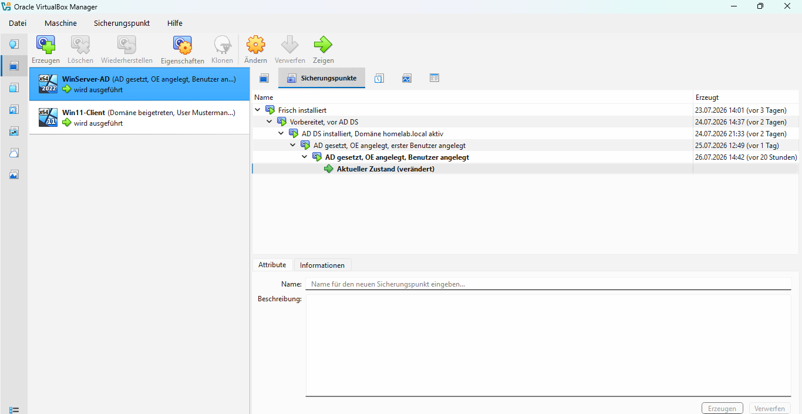

Jeder wichtige Meilenstein wurde als Snapshot gesichert – von der 
Frischinstallation bis zum Domänenbeitritt des Clients. Die Snapshots liegen 
auf demselben Datenträger wie die VMs und ersetzen daher kein Backup 
(siehe [Sicherheitsbetrachtung](03-pki-tls.md#sicherheitsbetrachtung)).

### Server- und Client-VM im Überblick
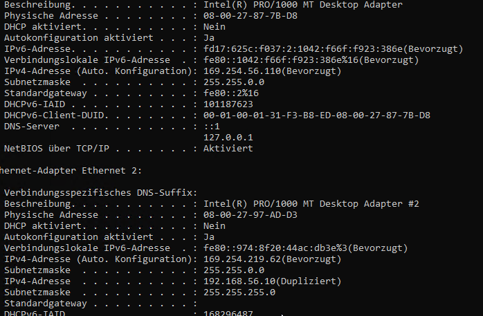
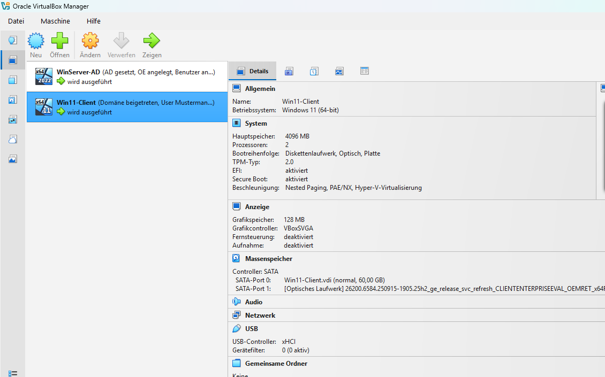

### VM-Erstellung: Ressourcenzuteilung
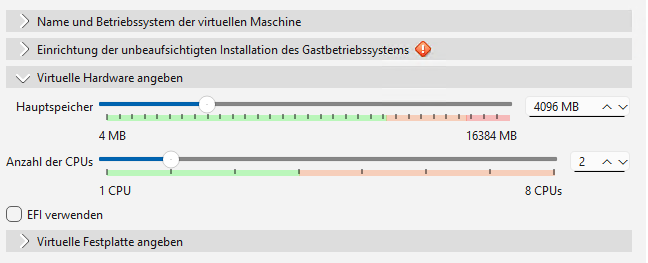

### Server-Manager: Lokaler Server
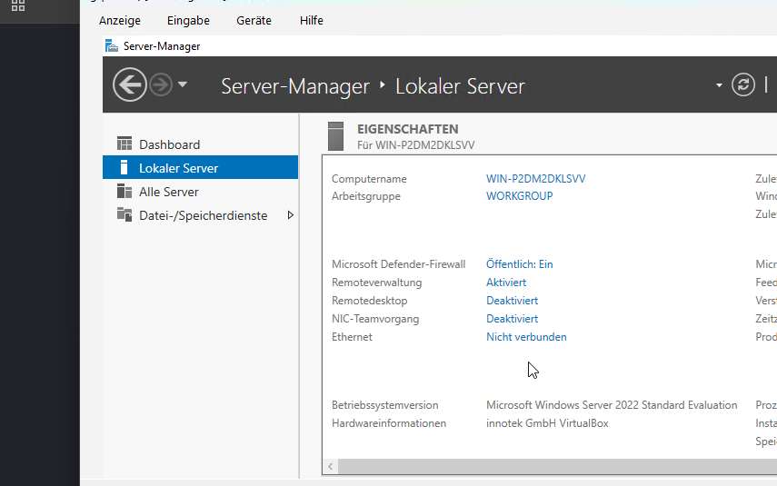

### Netzwerkadapter-Konfiguration (Host-only)
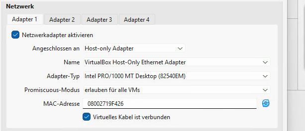
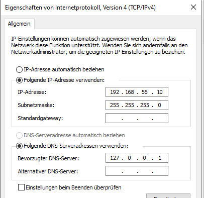

Feste IP-Adressen im internen Netz vergeben: Server `192.168.56.10`, 
Client `192.168.56.20`.

### Troubleshooting: IP-Adresskonflikt

**Fehlerbild:** Der zweite Netzwerkadapter (NAT) hatte versehentlich eine 
leere, ungültige manuelle IP-Konfiguration.
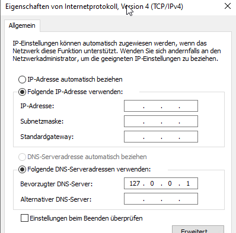

**Symptom:** Der Server zeigte bei seiner eigenen IP den Status „Dupliziert“, 
Ping zwischen Server und Client schlug fehl.
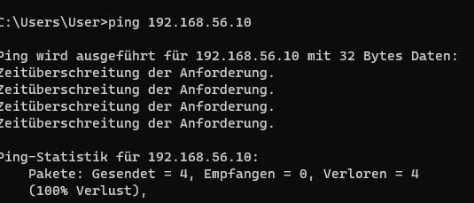
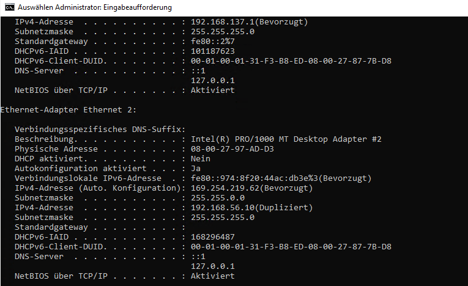

**Diagnose:** Mit `arp -a` vom Client aus die tatsächlich antwortende 
MAC-Adresse ermittelt und mit den bekannten Adaptern abgeglichen.

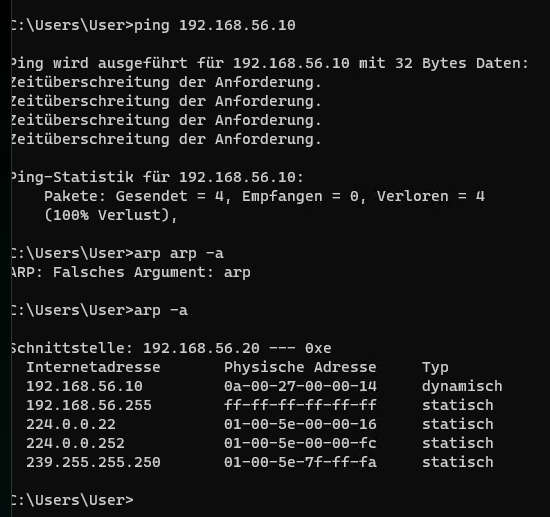

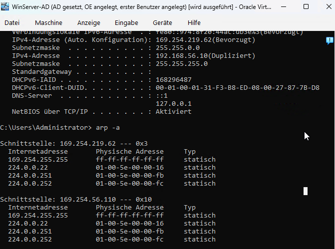

**Lösung:** Nach Korrektur der Host-Adapter-Konfiguration funktionierte die 
Kommunikation fehlerfrei.
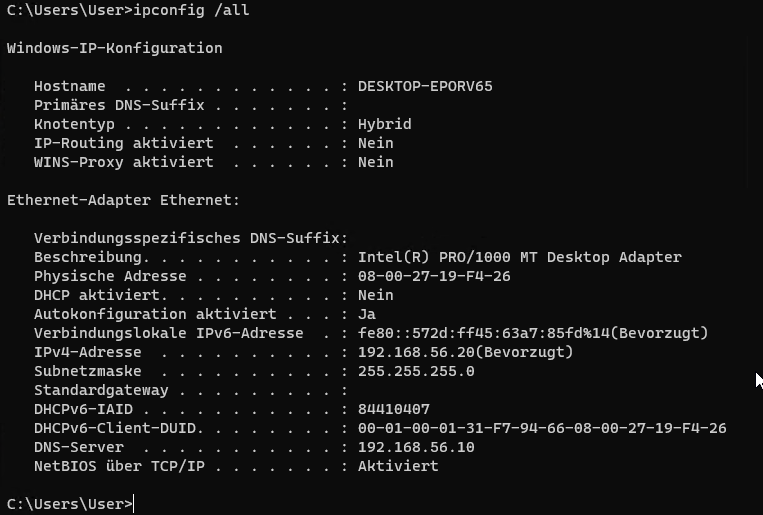

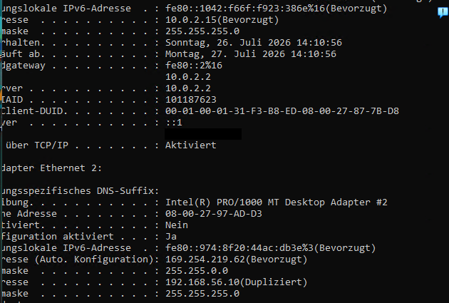

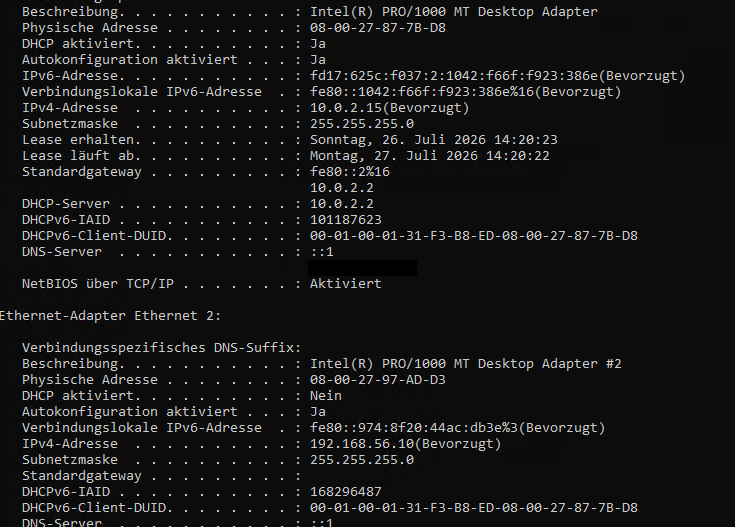

### Server-Identität nach Umbenennung (DC01)
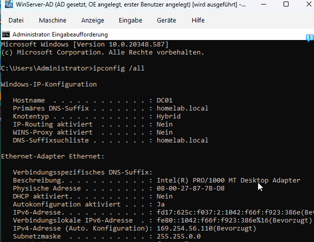


## Meilenstein: AD-Rollenmodell nach Least Privilege (in Arbeit)

Bisher lief die Verwaltung über ein einziges Administratorkonto. Ziel ist ein Rollenmodell wie in einer echten Umgebung: getrennte Konten für Administration und Support, Rechte nur so weit wie nötig und ausschließlich über Gruppen vergeben (AGDLP).

### Rollen

| Konto | Rolle | Globale Gruppe | Darf | Darf nicht |
|---|---|---|---|---|
| `df-support-l1` | 1st Level | `GG-Support-L1` | Kennwort zurücksetzen, Konto entsperren (OU *Benutzer*) | Konten anlegen/löschen, Serverzugriff |
| `df-support-l2` | 2nd Level | `GG-Support-L2` | zusätzlich Benutzer anlegen/deaktivieren, Gruppen ändern, Remote auf Clients | Server-Administration, GPOs |
| `df-admin` | Server-Admin | `GG-Server-Admins` | Lokaler Admin auf Member-Servern, Remoteverwaltung | Domain Admin, Alltagsanmeldung |
| `df-test` | Standardbenutzer | `GG-Mitarbeiter` | Normale Anmeldung | Admin-Werkzeuge, Remote |

Die Rechte hängen an domänenlokalen Gruppen (umgesetzt: `DL-Benutzer-PWReset`; geplant: `DL-OU-Benutzer-Verwalten`, `DL-Server-LocalAdmin`, `DL-Client-Remote`), in die die globalen Rollengruppen verschachtelt werden. Ein Rollenwechsel ist damit nur eine Änderung der Gruppenmitgliedschaft.

### OU-Struktur: vorher und nachher

Vorher lagen Abteilungs-OUs und Gruppen direkt in der Domänenwurzel.
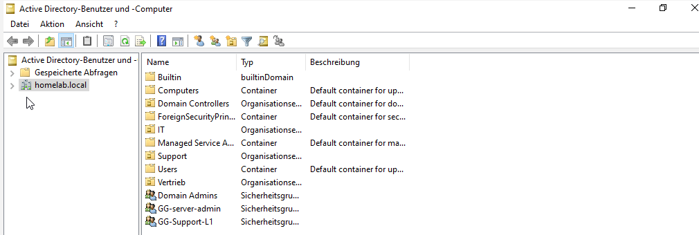

Umgebaut wurde auf eine eigene Oberebene `_Homelab` mit Trennung nach Objekttyp:

```
homelab.local
 +- _Homelab
     +- Admins      Konten mit erweiterten Rechten
     +- Benutzer    IT, Vertrieb, Support (normale Mitarbeiter)
     +- Gruppen     globale und domänenlokale Gruppen
     +- Server
     +- Clients
```

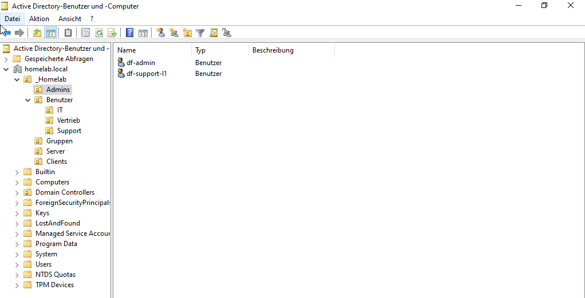
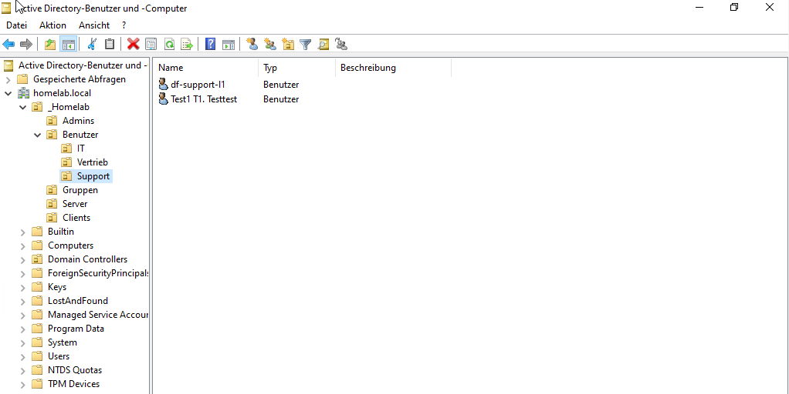
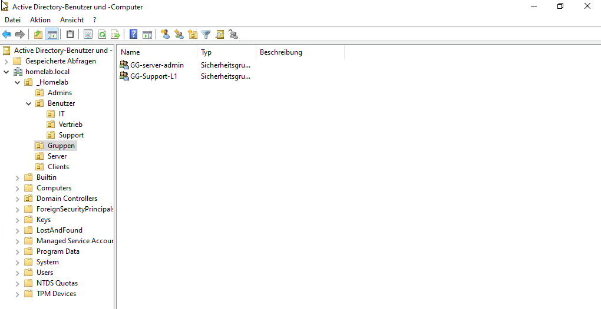

Designentscheidungen:

- **Konten mit Verwaltungsrechten liegen außerhalb des Bereichs, den sie verwalten.** Die Delegation für den 1st Level greift auf *Benutzer*. Läge `df-support-l1` selbst dort, könnte es Kennwörter anderer Support- oder Admin-Konten zurücksetzen und sich so höhere Rechte verschaffen.
- **Konten und Gruppen getrennt**, damit Rechte und Gruppenrichtlinien gezielt nach Objekttyp vergeben werden können.
- **Eingebaute Objekte bleiben in ihren Standardcontainern** (z. B. *Domain Admins* in *Users*). Ein Zwischenstand, in dem ich die Gruppe mitverschoben hatte, wurde zurückgenommen.
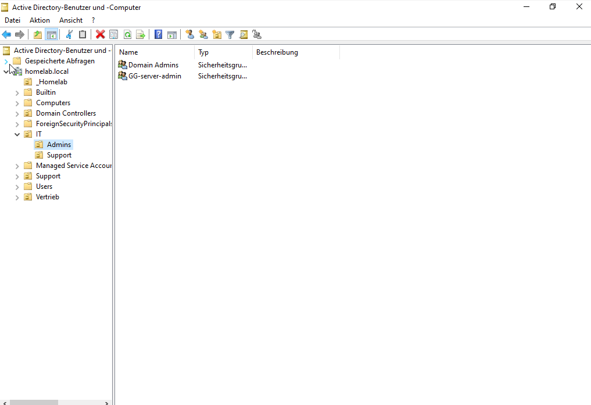
- **Erst verstehen, dann automatisieren:** Die Struktur entstand per GUI, Gruppen, Konten und Verschachtelung folgen per PowerShell-Skript mit CSV-Datei (Daten und Logik getrennt, mehrfach ausführbar ohne Fehler).

### Troubleshooting: „Zugriff verweigert“ beim Verschieben von OUs

Beim Umbau ließen sich OUs nicht verschieben, obwohl das Konto Domain-Admin-Rechte hatte. Ursache war der Schutz vor versehentlichem Löschen, den ADUC für neue OUs standardmäßig setzt. Verschieben ist für AD intern Löschen am alten und Anlegen am neuen Ort, deshalb blockiert der Schutz auch das Verschieben. Sichtbar wird die Einstellung erst unter *Ansicht → Erweiterte Features* im Reiter *Objekt*.

```powershell
Set-ADOrganizationalUnit "OU=Support,DC=homelab,DC=local" -ProtectedFromAccidentalDeletion $false
Move-ADObject "OU=Support,DC=homelab,DC=local" -TargetPath "OU=Benutzer,OU=_Homelab,DC=homelab,DC=local"
```

Danach wird der Schutz am neuen Ort wieder gesetzt.

**Erkenntnis:** „Zugriff verweigert“ heißt in Active Directory nicht automatisch „fehlende Rechte“.

### Vorgehen und nächste Ausbaustufe

Die OU-Struktur wurde bewusst noch direkt auf DC01 über die grafische Oberfläche angelegt. Im nächsten Schritt wird die Arbeitsweise so umgestellt, wie sie im Betrieb üblich ist: **Server werden nicht mehr durch Anmeldung am Server verwaltet, sondern vom Admin-Arbeitsplatz aus.**

| Schritt | Umsetzung | Status |
|---|---|---|
| Verwaltungswerkzeuge auf dem Client | RSAT (AD, GPMC, DNS) auf dem Windows-11-Client, AD-Abfrage remote | ✅ 08.11.2026 |
| Trennung Alltag / Administration | `df-admin` ohne lokale Adminrechte am Client; Installationen nur per „Als Administrator ausführen“ mit separatem Konto | ✅ 08.11.2026 |
| Anmeldung an Servern einschränken | GPO: lokale Anmeldung und RDP an Servern nur für Admin-Gruppen | ⬜ geplant |
| Massenanlage per PowerShell | Gruppen, Konten und Verschachtelung per Skript mit CSV, remote vom Client ausgeführt | ⬜ geplant |
| Nachweis | Negativtest: `df-support-l1` und `df-test` können sich nicht an DC01 anmelden | ⬜ geplant |

In einer produktiven Umgebung übernimmt diese Rolle ein eigener, gehärteter Admin-Arbeitsplatz (Privileged Access Workstation). Im Lab ist das der Windows-11-Client.

### Umsetzung 08.11.2026: Remoteverwaltung, Rechtebefund und erste Delegation

Vor allen Änderungen wurde ein Snapshot von DC01 erstellt.

#### 1. RSAT auf dem Client, Verwaltung ohne lokale Adminrechte

Am Windows-11-Client angemeldet als `df-admin` zeigte `whoami /groups` die **mittlere Verbindlichkeitsstufe** und keine lokale Administratorgruppe: Das Server-Admin-Konto hat auf dem Client bewusst keine Adminrechte. RSAT wurde deshalb einmalig mit einem separaten Administratorkonto installiert (Features on Demand über Windows Update, je Feature 10–20 Minuten in der VM).

```powershell
Add-WindowsCapability -Online -Name "Rsat.ActiveDirectory.DS-LDS.Tools~~~~0.0.1.0"
Add-WindowsCapability -Online -Name "Rsat.GroupPolicy.Management.Tools~~~~0.0.1.0"
Add-WindowsCapability -Online -Name "Rsat.Dns.Tools~~~~0.0.1.0"
```

Anschließend fragt `df-admin` das AD aus einem normalen, nicht erhöhten Fenster vom Client aus ab. Zum Verwalten braucht es keine lokalen Adminrechte, nur Rechte im AD.

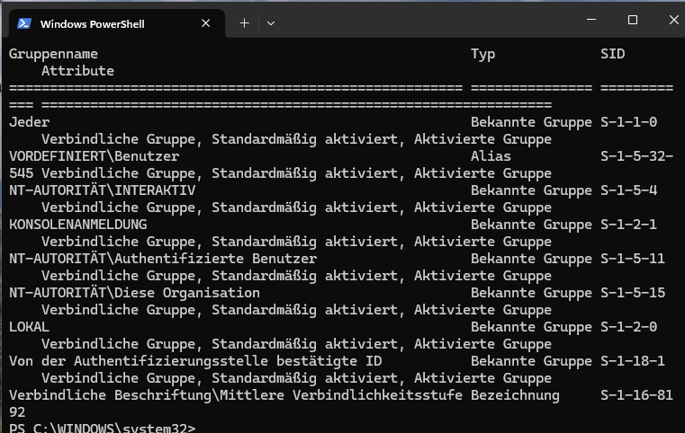
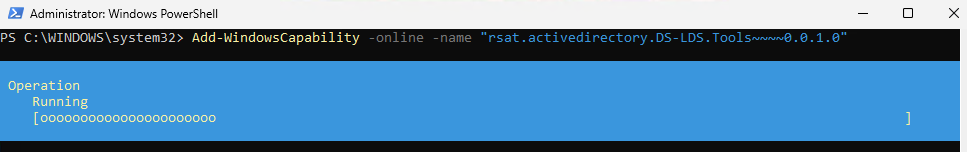
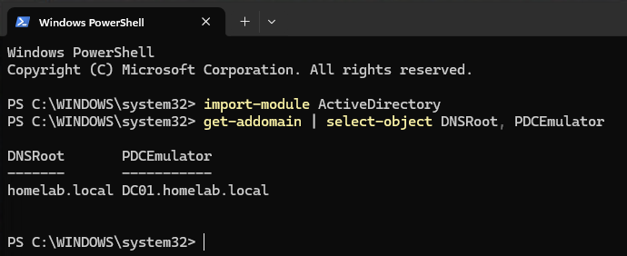

#### 2. Befund: Server-Admin-Konto hatte über eine unauffällige Gruppe DC-Vollzugriff

Die Prüfung der Gruppenmitgliedschaften zeigte, dass `df-admin` Mitglied der vordefinierten Domänengruppe **Administratoren** (*BUILTIN\Administrators*) war. Diese Gruppe wirkt auf den Domänencontrollern und gibt dort Vollzugriff: Anmeldung an DC01, Ändern von Gruppenrichtlinien, Aufnahme in *Domain Admins*. Faktisch entsprach das Domain-Admin-Rechten unter einem harmloseren Namen. Auf dem Client war davon nichts zu sehen, weil die Gruppe nur auf DCs gilt.

```powershell
Get-ADPrincipalGroupMembership df-admin | Select-Object Name
Remove-ADGroupMember -Identity "Administratoren" -Members df-admin -Confirm:$false
```

Danach ist `df-admin` nur noch in *Domänen-Benutzer* und `GG-Server-Admins`. Die Umbenennung von `GG-server-admin` in `GG-Server-Admins` wurde geprüft (Anzeigename und Prä-Windows-2000-Name identisch, Bereich *Global*).

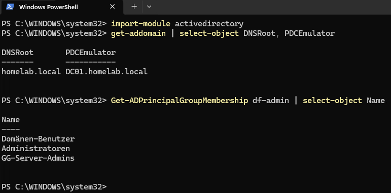
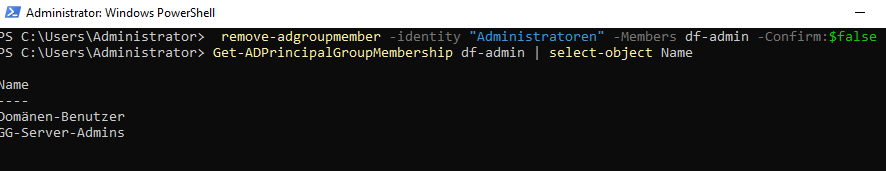

**Erkenntnis:** Rechte nicht nur an *Domain Admins* prüfen. Auch die vordefinierten Gruppen (*Administratoren*, *Konten-Operatoren*, *Server-Operatoren*, *Sicherungs-Operatoren*) geben weitreichende Rechte auf Domänencontrollern.

#### 3. AGDLP-Kette für den 1st Level: Kennwort zurücksetzen

Szenario: Der 1st Level darf in der OU *Benutzer* Kennwörter zurücksetzen und „Kennwort bei nächster Anmeldung ändern“ setzen, sonst nichts.

| Ebene | Objekt |
|---|---|
| **A**ccount | `df-support-l1` (OU *Admins*) |
| **G**lobale Gruppe (Rolle) | `GG-Support-L1` |
| **D**omänen**l**okale Gruppe (Recht) | `DL-Benutzer-PWReset` |
| **P**ermission | „Reset Password“ + Schreiben `pwdLastSet` auf Benutzerobjekte unter OU *Benutzer* |

```powershell
New-ADGroup -Name "DL-Benutzer-PWReset" -GroupScope DomainLocal -GroupCategory Security -Path "OU=Gruppen,OU=_Homelab,DC=homelab,DC=local"
Add-ADGroupMember -Identity "GG-Support-L1" -Members df-support-l1
Add-ADGroupMember -Identity "DL-Benutzer-PWReset" -Members "GG-Support-L1"

dsacls "OU=Benutzer,OU=_Homelab,DC=homelab,DC=local" /I:S /G "HOMELAB\DL-Benutzer-PWReset:CA;Reset Password;user"
dsacls "OU=Benutzer,OU=_Homelab,DC=homelab,DC=local" /I:S /G "HOMELAB\DL-Benutzer-PWReset:WP;pwdLastSet;user"
```

`/I:S` vererbt das Recht nur an Unterobjekte vom Typ *user*, also an alle Benutzer in *IT*, *Vertrieb* und *Support*, aber nicht an Gruppen oder die OU selbst. Bekommt später der 2nd Level dasselbe Recht, wird nur `GG-Support-L2` in die DL-Gruppe aufgenommen; die ACL bleibt unverändert.

Als Testkonto wurde `df-test` in *Benutzer\Vertrieb* angelegt.

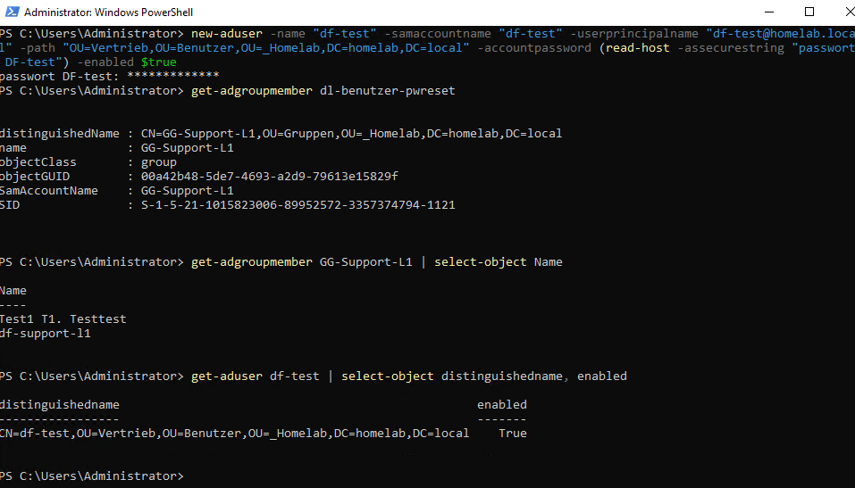
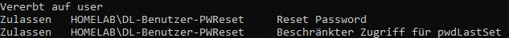

#### 4. Nachweis: Positiv- und Negativtests als `df-support-l1`

Test in einer Sitzung unter `df-support-l1` (`runas /user:homelab\df-support-l1 powershell`):

| Test | Erwartung | Ergebnis |
|---|---|---|
| Kennwort von `df-test` zurücksetzen, Änderung bei nächster Anmeldung erzwingen | erlaubt | ✅ erfolgreich |
| Kennwort von `df-admin` zurücksetzen (OU *Admins*) | verweigert | ✅ „Zugriff verweigert“ |
| `df-test` zu `GG-Support-L1` hinzufügen | verweigert | ✅ „Zugriffsrechte reichen nicht aus“ |

Der zweite Test belegt die Designentscheidung von oben: Weil Admin-Konten außerhalb der delegierten OU liegen, kann der 1st Level sich über ein Kennwort-Reset keine höheren Rechte verschaffen.

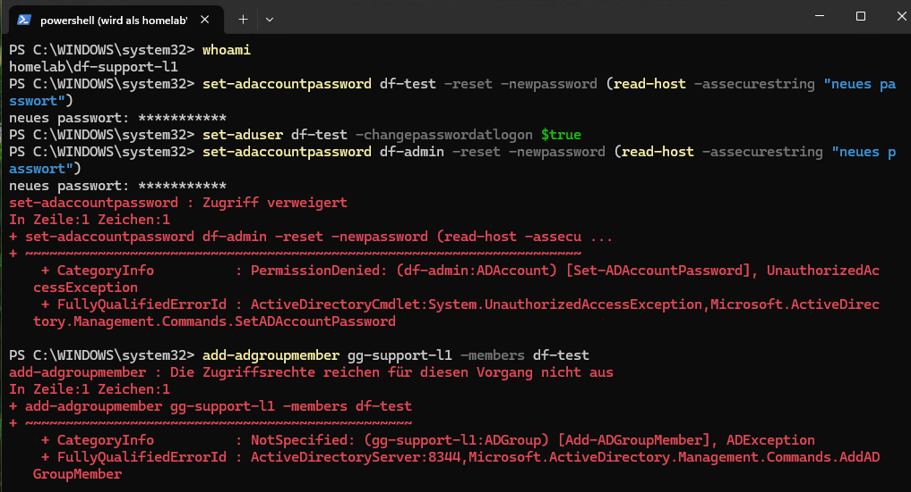

### Umsetzung 09.11.2026: Nachweise am Client, Kontosperrung und Entsperren für den 1st Level

#### 1. Grenzen von `df-admin` im GUI belegt

| Test (als `df-admin`) | Erwartung | Ergebnis |
|---|---|---|
| DC01 im Server-Manager des Clients verwalten | verweigert | ✅ „Online – Zugriff verweigert“ |
| Attribute von `df-test` in ADUC ändern | verweigert | ✅ Felder schreibgeschützt |

Der Server-Manager erreicht DC01 (Netzwerk, DNS und WinRM funktionieren), lehnt die Anmeldung aber ab: Seit dem Rechtebefund vom 08.11. ist `df-admin` kein Mitglied von *Administratoren* mehr. Domänencontroller gehören zur höchsten Schutzstufe (Tier 0) und werden nicht über die allgemeine Server-Admin-Gruppe verwaltet. ADUC fragt beim Öffnen die effektiv schreibbaren Attribute ab (`allowedAttributesEffective`) und sperrt alle anderen Felder. Lesen darf jeder Domänenbenutzer, schreiben nur mit Delegation.

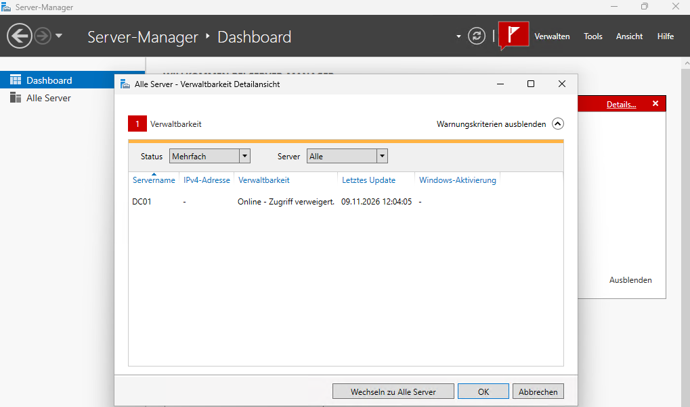
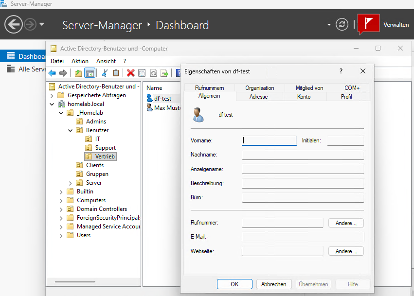

Der Kennwort-Reset aus der Kommandozeile (08.11.) wurde zusätzlich im GUI als `df-support-l1` nachgewiesen:

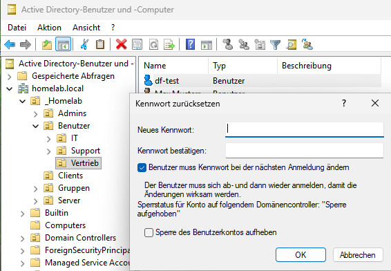
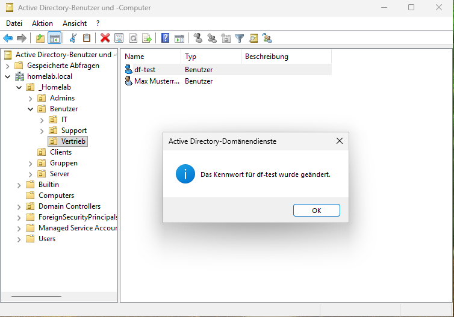

**Korrektur zur Doku vom 08.11.:** Die RSAT-Tools für Gruppenrichtlinien waren entgegen der Doku nicht installiert (`gpmc.msc` nicht gefunden). Nachinstalliert, siehe Troubleshooting unten.

#### 2. Befund: Keine Kontosperrung in der Domäne

Die Default Domain Policy stand auf dem Windows-Standard **Kontosperrungsschwelle 0**: Konten wurden nie gesperrt, unbegrenztes Kennwortraten wäre möglich gewesen. Gesetzt wurde:

| Richtlinie | Vorher | Nachher |
|---|---|---|
| Kontosperrungsschwelle | 0 (nie) | 5 ungültige Anmeldeversuche |
| Kontosperrdauer | – | 15 Minuten |
| Zurücksetzungsdauer des Zählers | – | 15 Minuten |

Die Sperrrichtlinie für Domänenkonten wirkt nur in einer GPO an der Domänenwurzel; an einer OU verknüpft gilt sie nur für lokale Konten. Die Änderung erfolgte mit dem Notfallkonto, `df-admin` kann GPOs nur lesen.

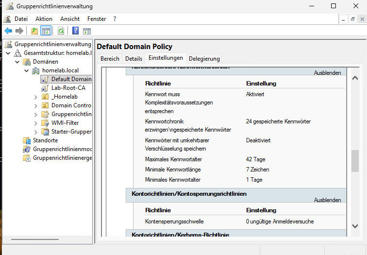
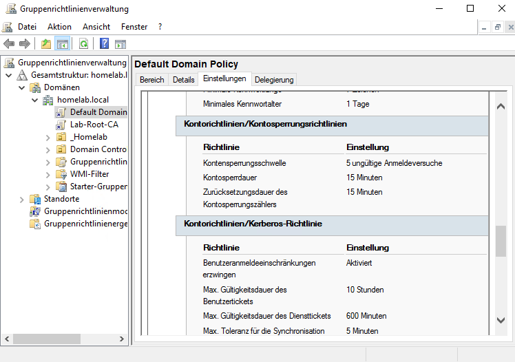

Nebenbefund für später: minimale Kennwortlänge 7 Zeichen (Standard), nach heutigen Empfehlungen zu kurz. Bewusst nicht im selben Schritt geändert, um Tests nicht zu vermischen.

#### 3. Delegation „Konto entsperren“ für den 1st Level

Entsperren bedeutet technisch, das Attribut `lockoutTime` auf 0 zu setzen. Das Recht geht an dieselbe domänenlokale Gruppe wie der Kennwort-Reset, die AGDLP-Kette bleibt unverändert:

```
dsacls "OU=Benutzer,OU=_Homelab,DC=homelab,DC=local" /I:S /G "HOMELAB\DL-Benutzer-PWReset:RPWP;lockoutTime;user"
```

| Test | Erwartung | Ergebnis |
|---|---|---|
| 5 Fehlanmeldungen als `df-test` am Client | Konto gesperrt | ✅ |
| Entsperren als `df-support-l1` **vor** der Delegation | verweigert | ✅ „Zugriffsrechte reichen nicht aus“ |
| Entsperren als `df-support-l1` **nach** der Delegation | erlaubt | ✅ `LockedOut` True → False |


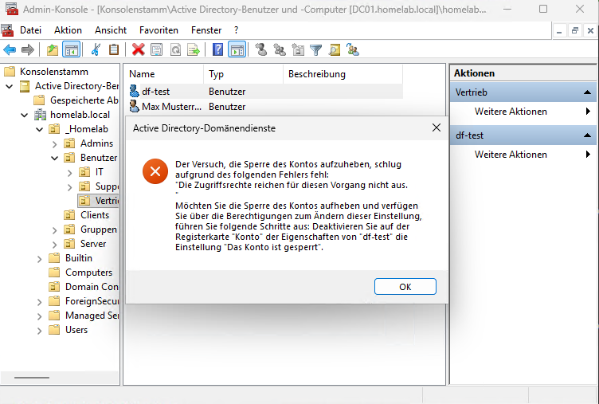
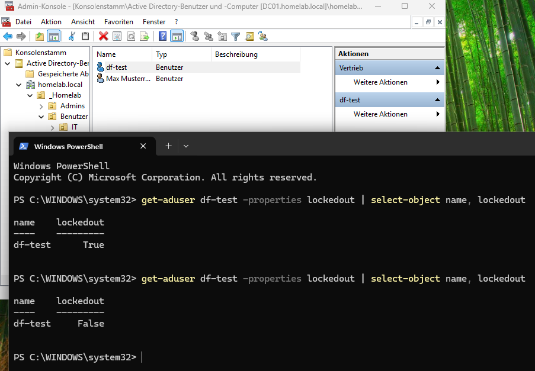

Damit ist die Rolle **1st Level vollständig**: Kennwort zurücksetzen und Konto entsperren in der OU *Benutzer*, alles andere wird verweigert.

#### Troubleshooting: RSAT-Installation meldet Erfolg, installiert aber nichts

`Add-WindowsCapability` mit falsch geschriebenem Namen (`rsat.group.policy.managment.tools…`) lieferte die übliche Ausgabe (`Online : True`, `RestartNeeded : False`) ohne Fehler, installiert wurde nichts. Ursache: Bei einem unbekannten Namen bricht das Cmdlet nicht ab. Lösung: Zustand nach der Installation prüfen und den Namen per Pipeline durchreichen statt abzutippen:

```powershell
Get-WindowsCapability -Online -Name Rsat.GroupPolicy* | Add-WindowsCapability -Online
Get-WindowsCapability -Online -Name Rsat.GroupPolicy*   # State : Installed
```

#### Troubleshooting: „RPC-Server nicht verfügbar“ durch NAT-Adresse des DC im DNS

Die Admin-Konsole am Client hing sich auf, danach kam *„Der RPC-Server ist nicht verfügbar“*, obwohl ADUC kurz zuvor noch funktionierte. Ping und `Test-NetConnection 192.168.56.10 -Port 135` waren erfolgreich. `nslookup homelab.local` lieferte aber zusätzlich **10.0.2.15** und eine IPv6-Adresse des NAT-Adapters von DC01.

**Ursache:** DC01 registriert die Adressen aller Netzwerkadapter im DNS. Der Client bekam abwechselnd die NAT-Adresse, die aus dem Host-only-Netz nicht erreichbar ist. Verbindungen scheiterten deshalb sporadisch (typisches Problem bei DCs mit mehreren Adaptern).

**Lösung auf DC01:**
1. NAT-Adapter → IPv4 → Erweitert → DNS: „Adressen dieser Verbindung in DNS registrieren“ deaktiviert, IPv6 auf diesem Adapter abgewählt
2. DNS-Server → Eigenschaften → Schnittstellen: nur `192.168.56.10`
3. A/AAAA-Einträge mit der NAT-Adresse aus der Zone gelöscht
4. `ipconfig /registerdns`, Netlogon neu gestartet, am Client `ipconfig /flushdns`

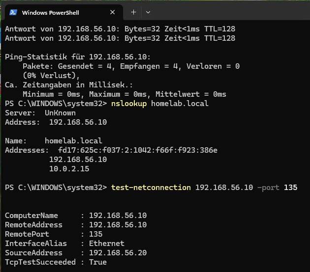
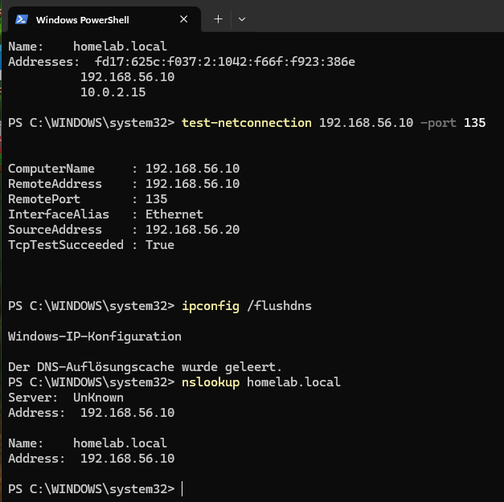

**Erkenntnis:** Bei sporadischen RPC-Fehlern zuerst die DNS-Antworten prüfen, nicht nur die Erreichbarkeit per Ping.

### Offen

- `GG-Support-L2` mit Delegation (Benutzer anlegen/deaktivieren, Gruppen ändern), `df-support-l2`, `df-test2`
- Anmeldung an Servern per GPO einschränken, lokale Adminrechte und WinRM per GPO, Windows LAPS
- Gruppen und Konten per PowerShell-Skript mit CSV
- Altes Testkonto aus `GG-Support-L1` entfernen
- Minimale Kennwortlänge erhöhen (Fine-Grained Password Policy für Admin-Konten prüfen)


[← Zur Übersicht](../README.md) · [Troubleshooting-Index](../TROUBLESHOOTING.md)
