# Interne CA und TLS für Zammad

[← Zur Übersicht](../README.md) · [Troubleshooting-Index](../TROUBLESHOOTING.md)

## Meilenstein: Interne CA und TLS für Zammad

Zammad lief bisher unverschlüsselt über HTTP („Nicht sicher“ im Browser). Jetzt ist die Weboberfläche über `https://zammad.homelab.local` erreichbar, abgesichert mit einem Zertifikat einer eigenen Root-CA. Die CA wird per Gruppenrichtlinie an die Domänen-Clients verteilt, sodass der Browser ohne Warnung vertraut.

### Aufbau

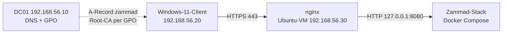

| Komponente | Aufgabe |
|---|---|
| DC01 (`192.168.56.10`) | DNS-Eintrag `zammad.homelab.local`, GPO `Lab-Root-CA` verteilt das Root-Zertifikat |
| Ubuntu-VM (`192.168.56.30`) | Root-CA (OpenSSL), nginx als Reverse Proxy mit TLS, Zammad-Stack |
| Windows-11-Client | vertraut der Root-CA über den Zertifikatspeicher der Domäne |

Ablauf: Der Client löst `zammad.homelab.local` über den DC auf, spricht per HTTPS mit nginx, und nginx reicht die Anfrage intern per HTTP an Zammad auf `127.0.0.1:8080` weiter.

### Umsetzung

**1. DNS-Eintrag (DC01, PowerShell)**

Zuerst die Host-only-Adresse der Ubuntu-VM ermitteln (`ip -4 a`, Adapter `enp0s8`). Eingetragen wird diese Adresse, nicht die NAT-Adresse `10.0.2.x`.
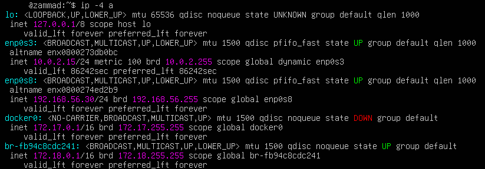

```powershell
Add-DnsServerResourceRecordA -ZoneName "homelab.local" -Name "zammad" -IPv4Address "192.168.56.30"
```

Test am Client mit `nslookup zammad.homelab.local` (Antwort `192.168.56.30`).
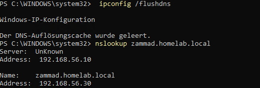

**2. Root-CA und Serverzertifikat (Ubuntu-VM, OpenSSL)**

```bash
mkdir -p ~/ca && cd ~/ca && chmod 700 .
openssl genrsa -aes256 -out rootCA.key 4096
openssl req -x509 -new -key rootCA.key -sha256 -days 1825 -subj "/CN=Homelab Root CA" -out rootCA.crt
openssl genrsa -out zammad.key 2048
openssl req -new -key zammad.key -subj "/CN=zammad.homelab.local" -out zammad.csr
printf "subjectAltName=DNS:zammad.homelab.local\nbasicConstraints=CA:FALSE\nkeyUsage=digitalSignature,keyEncipherment\nextendedKeyUsage=serverAuth\n" > ext.cnf
openssl x509 -req -in zammad.csr -CA rootCA.crt -CAkey rootCA.key -CAcreateserial -days 365 -sha256 -extfile ext.cnf -out zammad.crt
```

Der Root-Key ist mit einer Passphrase geschützt. Das Serverzertifikat enthält den Namen als **SAN** (Subject Alternative Name), denn moderne Browser ignorieren den Common Name. Die Laufzeit beträgt 365 Tage, weil Chrome und Safari bei Serverzertifikaten mehr als 398 Tage ablehnen.
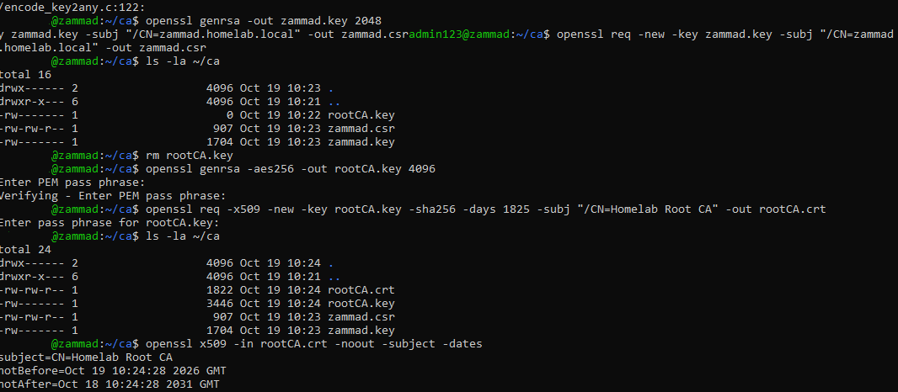

Prüfung:

```bash
openssl verify -CAfile rootCA.crt zammad.crt
openssl x509 -in zammad.crt -noout -subject -issuer -dates -ext subjectAltName
openssl x509 -in rootCA.crt -noout -ext basicConstraints
```

Erwartet: `zammad.crt: OK`, Issuer `Homelab Root CA`, SAN `DNS:zammad.homelab.local`, Root mit `CA:TRUE`.
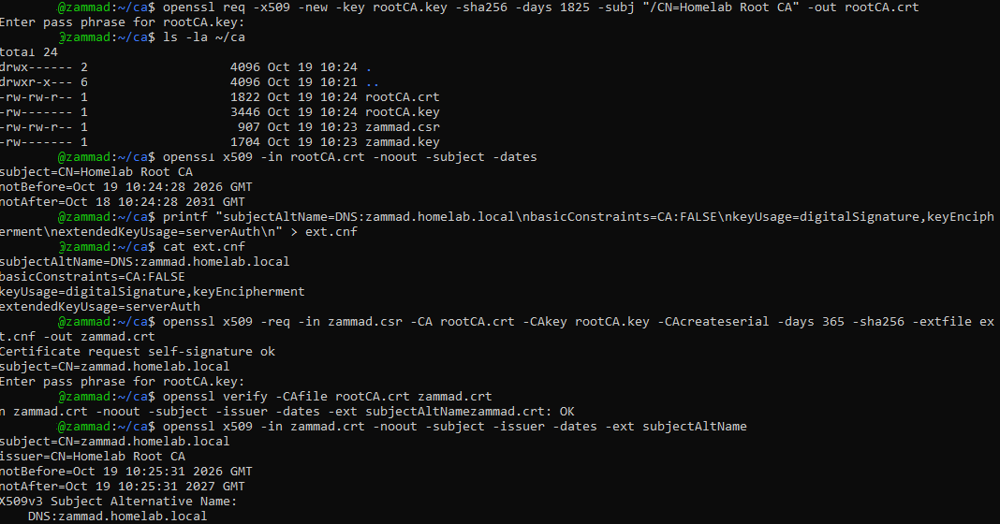

**3. nginx als Reverse Proxy (Ubuntu-VM)**

Zertifikat und Server-Key liegen unter `/etc/ssl`, der Root-Key bleibt im Ordner `~/ca` und gehört nicht auf den Webserver:

```bash
sudo install -m 644 zammad.crt /etc/ssl/certs/zammad.crt
sudo install -m 600 -o root -g root zammad.key /etc/ssl/private/zammad.key
```

Server-Block `/etc/nginx/sites-available/zammad`:

```nginx
server {
  listen 443 ssl;
  server_name zammad.homelab.local;
  ssl_certificate /etc/ssl/certs/zammad.crt;
  ssl_certificate_key /etc/ssl/private/zammad.key;
  ssl_protocols TLSv1.2 TLSv1.3;
  client_max_body_size 50M;
  location / {
    proxy_pass http://127.0.0.1:8080;
    proxy_http_version 1.1;
    proxy_set_header Upgrade $http_upgrade;
    proxy_set_header Connection "upgrade";
    proxy_set_header Host $host;
    proxy_set_header X-Real-IP $remote_addr;
    proxy_set_header X-Forwarded-For $proxy_add_x_forwarded_for;
    proxy_set_header X-Forwarded-Proto https;
    proxy_read_timeout 86400;
  }
}
```

Die Upgrade-Header sind nötig, weil Zammad für Live-Updates WebSockets nutzt. Aktiviert mit einem Symlink in `sites-enabled`, danach `sudo nginx -t` und `sudo systemctl restart nginx`.
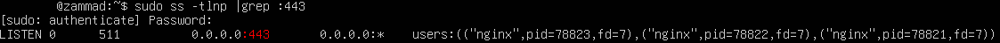

**4. Zammad-Port auf localhost binden**

Docker öffnet veröffentlichte Ports an den Regeln der Host-Firewall vorbei. Deshalb ist die Bindung an `127.0.0.1` die eigentliche Absicherung: Zammad ist nur noch über nginx erreichbar. In der `docker-compose.yml` des nginx-Containers von Zammad (Zeile 164) wurde vor den Host-Port die Adresse `127.0.0.1` gesetzt:

```yaml
ports:
  - "127.0.0.1:${NGINX_EXPOSE_PORT:-8080}:${NGINX_PORT:-8080}"
```

Danach `docker compose up -d`. `docker ps` zeigt nur noch `127.0.0.1:8080->8080/tcp`, ohne `0.0.0.0` und ohne `[::]`. Die ursprüngliche Datei liegt als `docker-compose.yml.bak` daneben.
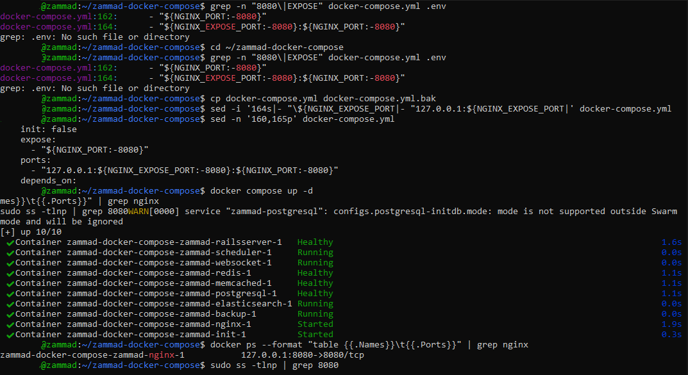

Test auf dem Server (die Kette wird gegen die eigene Root-CA geprüft):

```bash
curl --cacert ~/ca/rootCA.crt --resolve zammad.homelab.local:443:127.0.0.1 -I https://zammad.homelab.local
```

Antwort: `HTTP/1.1 200 OK`.
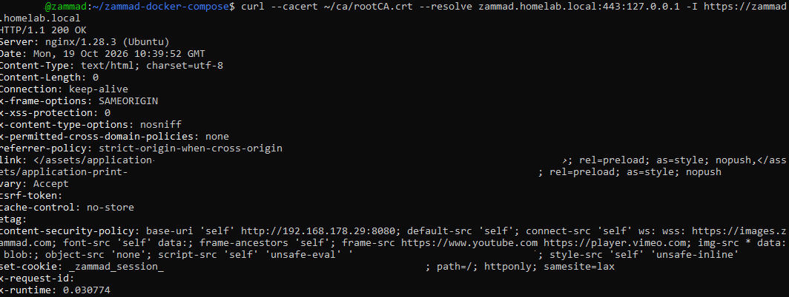

**5. Root-CA per Gruppenrichtlinie verteilen (DC01)**

`rootCA.crt` (nur die öffentliche Datei, niemals den Key) wurde per `scp` auf den DC kopiert und mit einem Hashvergleich (`openssl x509 -fingerprint -sha256` gegen `certutil -hashfile … SHA256`) auf Unverändertheit geprüft. In `gpmc.msc` wurde die GPO `Lab-Root-CA` mit der Domäne verknüpft und das Zertifikat unter *Computerkonfiguration → Richtlinien → Windows-Einstellungen → Sicherheitseinstellungen → Richtlinien für öffentliche Schlüssel → Vertrauenswürdige Stammzertifizierungsstellen* importiert.
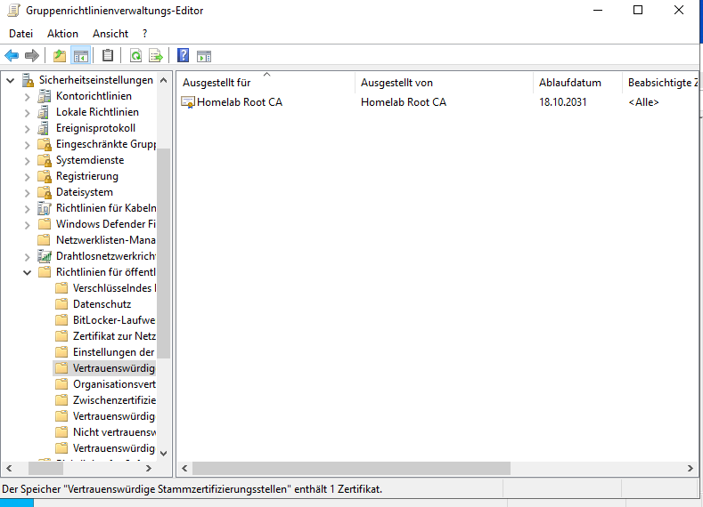

Am Client: `gpupdate /force`, dann in Edge `https://zammad.homelab.local` aufrufen. Das Schloss erscheint ohne Warnung.
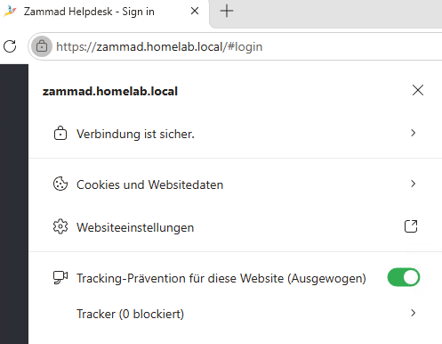

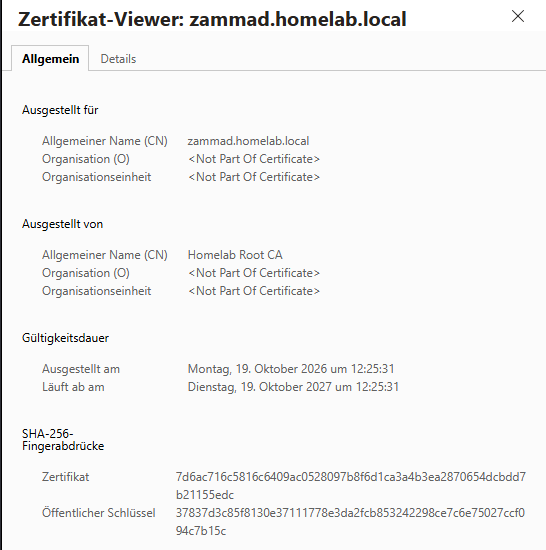

Der Zertifikats-Viewer zeigt `zammad.homelab.local`, ausgestellt von `Homelab Root CA`, gültig vom 19.10.2026 bis 19.10.2027.

Die Zertifikathierarchie zeigt die Kette `Homelab Root CA` → `zammad.homelab.local`. Der Browser prüft die Kette also gegen die eigene CA, es ist keine Ausnahme gesetzt.
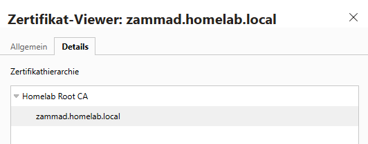

**6. System-Adresse in Zammad umstellen**

Unter *Admin → System → Einstellungen → Basis* wurden der Domainname auf `zammad.homelab.local` und der HTTP-Typ auf `https` gesetzt. Zuvor zeigte die Anmeldeseite noch die alte Adresse mit Port 8080, und die Content-Security-Policy im Antwort-Header erlaubte nur diese Adresse. Die SystemID bleibt unverändert, sie steckt in jeder Ticketnummer.
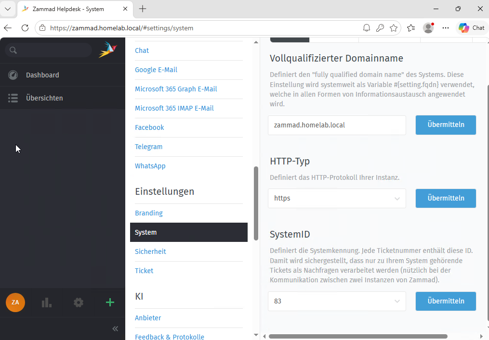

### Troubleshooting: Host-Laufwerk voll (`VERR_DISK_FULL`)

**Symptom:** Während des Betriebs erschien in VirtualBox die Meldung „The I/O cache encountered an error while updating data in medium ahci-0-0 (rc=VERR_DISK_FULL)“, die VM wurde pausiert.
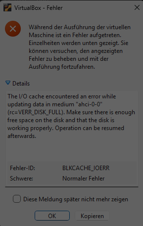

**Ursache:** Das Laufwerk des **Hosts** war voll, nicht das der VM. Auf dem Mini-PC lagen noch alte VM-Ordner, deren Einträge zwar aus VirtualBox entfernt waren, deren Plattendateien aber weiter Platz belegten (Entfernen ohne die Option „Alle Dateien löschen“). Dazu kommen die Differenzdateien der Snapshots.

**Lösung:** Erst Platz schaffen, dann die VM fortsetzen, nicht umgekehrt. Nach dem Aufräumen waren rund 60 GB frei. Anschließend prüfte `sudo dmesg | grep -iE "error|i/o|ext4"` das Dateisystem: Es gab keine EXT4-Fehler, nur die normale Bootabfolge (`ro` → `r/w`). Die roten `vmwgfx`-Zeilen betreffen nur die Konsolengrafik der VM und sind für den Betrieb unerheblich.
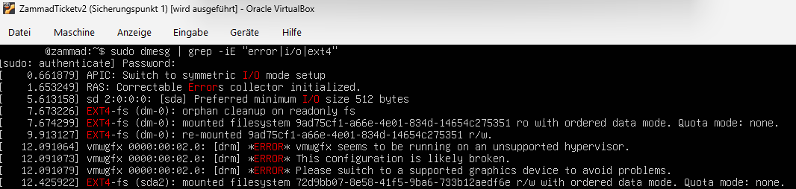

**Erkenntnis:** Die Meldung spricht von „disk“, meint aber den Datenträger des Hosts, und das ist irreführend. Verwaiste Plattendateien nach dem Entfernen einer VM sind eine häufige, unsichtbare Ursache.

### Troubleshooting: Root-Key hat 0 Bytes (`Verify failure`)

**Symptom:** `openssl genrsa -aes256 …` brach mit `Verify failure` und `problems getting password` ab. Im Ordner lag danach eine `rootCA.key` mit **0 Bytes**.

**Ursache:** Beide Passphrase-Eingaben stimmten nicht überein. Die Eingabe ist verdeckt, ein Vertipper (oder ein abweichendes Tastaturlayout in der VM-Konsole) fällt nicht auf. openssl legt die Zieldatei an, bevor die Passphrase bestätigt ist, und lässt sie leer zurück.

**Lösung:** Leere Datei mit `rm rootCA.key` löschen und neu erzeugen. Kontrolle mit `ls -la`: Die fertige Datei hat rund 3,4 kB (im Screenshot oben bei der Root-CA zu sehen).

**Erkenntnis:** Nach jedem Schlüsselbefehl die Dateigröße prüfen. Eine leere Schlüsseldatei verursacht später Folgefehler an Stellen, die scheinbar nichts mit der Passphrase zu tun haben.

### Troubleshooting: Eingefügte Befehle werden verfälscht

**Symptom:** Zusätzlich zu den oben schon dokumentierten Einfügeproblemen scheiterte der Befehl `mkdir` mit `command not found`, weil davor `^[[200~` stand.
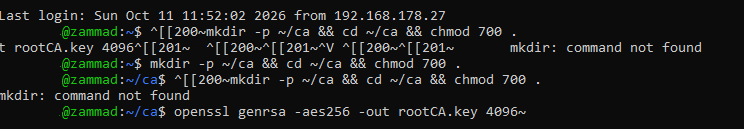

Ein anderer eingefügter Block endete mit `sudo: maximum 3 incorrect authentication attempts`.
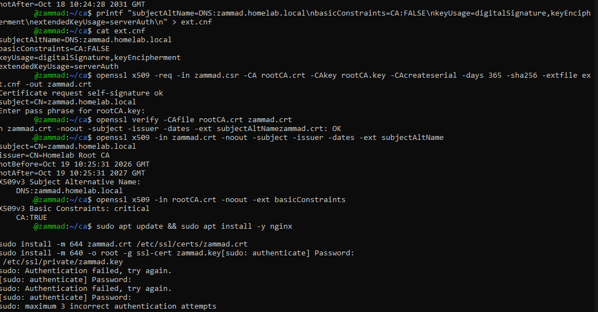

**Ursache:** Die erste `sudo`-Zeile fragte nach dem Passwort, und das Terminal schickte die restlichen eingefügten Zeilen sofort hinterher. sudo las sie als Passwortversuche und brach nach drei „falschen“ ab. In einem anderen Fall wurden zwei Befehle ohne Zeilenumbruch zusammengeklebt (`grep 8080curl --cacert …`), was zu `grep: unrecognized option '--cacert'` führte.

**Lösung:** `bind 'set enable-bracketed-paste off'` setzen, vor eingefügten Blöcken einmal von Hand `sudo -v` ausführen und Befehle einzeln absenden.

**Erkenntnis:** Fehlermeldungen wie „command not found“ oder „unrecognized option“ bei einem eigentlich korrekten Befehl deuten auf verfälschten Text hin, nicht auf einen Fehler in der Konfiguration.

### Troubleshooting: `install: invalid group: 'ssl-cert'`

**Symptom:** Das Ablegen des Server-Keys mit `-g ssl-cert` scheiterte.

**Ursache:** Die Gruppe `ssl-cert` kommt mit dem gleichnamigen Paket und war auf dieser Maschine nicht vorhanden.

**Lösung:** Key mit `install -m 600 -o root -g root` ablegen. nginx liest den Key beim Start als root, eine Gruppe wird nicht gebraucht, und der strengere Modus ist sogar sicherer.

### Troubleshooting: nginx direkt gestartet (`Permission denied` beim Key)

**Symptom:** `nginx` (ohne `sudo`) meldete `cannot load certificate key … Permission denied`.
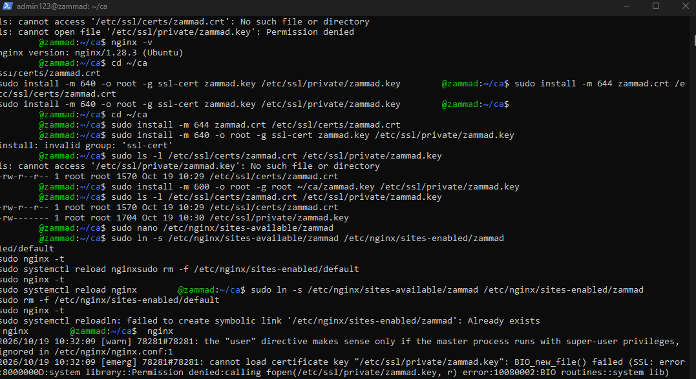

**Ursache:** Der Key gehört `root:root` mit Modus 600, ein normaler Benutzer darf ihn nicht lesen. Das ist gewollt. Der Dienst läuft über systemd als root.

**Lösung:** nginx nur über `sudo nginx -t` und `sudo systemctl restart nginx` prüfen und starten.

### Troubleshooting: SSH-Warnung `REMOTE HOST IDENTIFICATION HAS CHANGED`

**Symptom:** `scp` vom DC zur Ubuntu-VM brach mit der Warnung vor einem geänderten Host-Key ab.
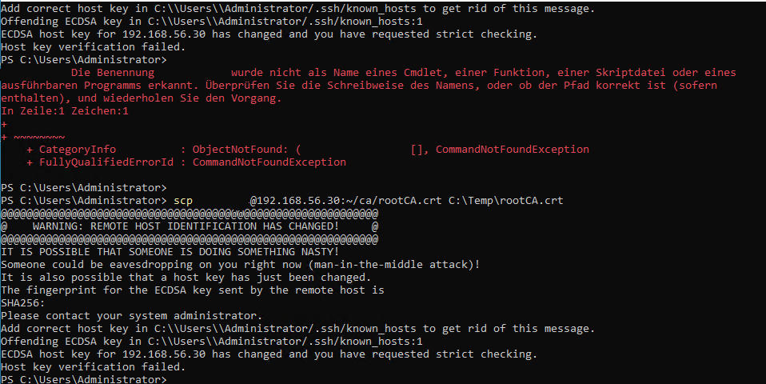

**Ursache:** Im `known_hosts` des DC stand noch der Key einer früheren VM mit derselben IP-Adresse (`192.168.56.30`), denn die VM war neu aufgebaut worden.

**Lösung:** Erst den Fingerabdruck auf der VM auslesen (`ssh-keygen -lf /etc/ssh/ssh_host_ecdsa_key.pub`) und mit dem in der Warnung vergleichen, damit ein echter Man-in-the-Middle ausgeschlossen ist. Erst danach den alten Eintrag mit `ssh-keygen -R 192.168.56.30` entfernen.

**Erkenntnis:** Die Warnung nicht einfach wegklicken. Der Fingerabdruck-Vergleich dauert eine Minute und macht aus „wird schon stimmen“ eine Prüfung.

### Troubleshooting: SSH-Test aus dem Heimnetz läuft in den Timeout

**Symptom:** `ssh` und `ping` zu `192.168.56.30` und zum DC liefen in einen Timeout.

**Ursache:** `Test-NetConnection` zeigte `SourceAddress 192.168.178.27` über das WLAN, getestet wurde also von einem Rechner im Heimnetz. Das Host-only-Netz existiert nur auf dem Mini-PC (dasselbe Muster wie im Abschnitt zur Netzwerkbrücke oben). Von außen erreicht man die VM nur über die NAT-Portweiterleitung am Mini-PC.

**Lösung:** Mit der LAN-Adresse des Mini-PCs und dem weitergeleiteten Port verbinden (`ssh -p 2222 <benutzer>@<IP-des-Mini-PCs>`). Innerhalb des Labs, zum Beispiel vom DC zur Ubuntu-VM, genügt die Host-only-Adresse.

### Troubleshooting: PowerShell erkennt den Parameter nicht

**Symptom:** `Add-DnsServerResourceRecordA - ZoneName …` meldete `Es wurde kein Positionsparameter gefunden`.
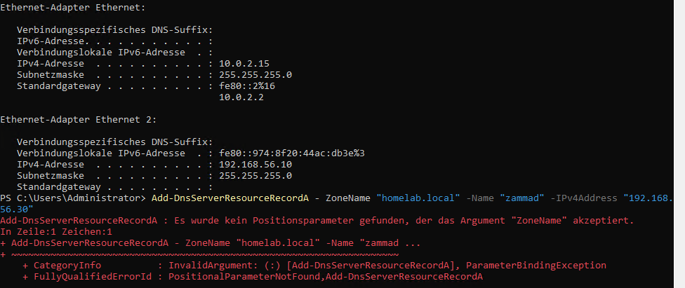

**Ursache:** Zwischen Minuszeichen und Parametername stand ein Leerzeichen. PowerShell las `ZoneName` als Positionsargument.

### Troubleshooting: `ERR_CERT_AUTHORITY_INVALID` auf einem Rechner ohne Root-CA

**Symptom:** Auf einem Rechner außerhalb der Domäne zeigte Edge „Ihre Verbindung ist nicht privat“.
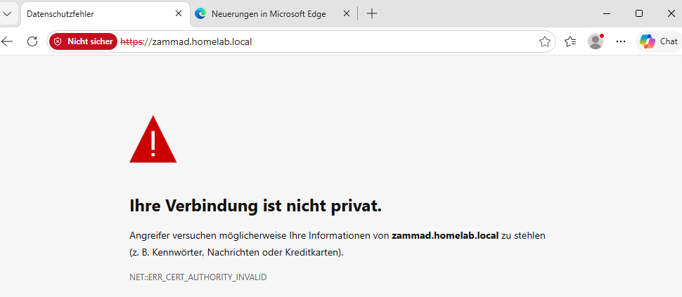

**Ursache:** Der Rechner kannte die `Homelab Root CA` nicht, weil die GPO nur Domänenmitglieder erreicht. Name und Laufzeit des Zertifikats waren in Ordnung, sonst wäre `ERR_CERT_COMMON_NAME_INVALID` oder `ERR_CERT_DATE_INVALID` erschienen.

**Lösung:** Nicht „Weiter“ klicken, sondern die Root-CA gezielt installieren:

```powershell
Import-Certificate -FilePath C:\Temp\rootCA.crt -CertStoreLocation Cert:\LocalMachine\Root
```

**Erkenntnis:** Die Fehlerkennung benennt die Ursache genau. Die Warnung ohne CA ist zugleich die Gegenprobe, dass die Vertrauenskette wirklich geprüft wird und nicht nur eine Ausnahme gesetzt wurde. Firefox nutzt einen eigenen Speicher (`security.enterprise_roots.enabled = true`).

### Troubleshooting: Zammad-Passwort vergessen

**Symptom:** Der Admin-Zugang war nicht mehr bekannt. Der Weg über „Passwort vergessen?“ braucht einen konfigurierten Mailversand, den das Lab nicht hat.

**Lösung:** Passwort über die Rails-Konsole im Container zurücksetzen und danach in der Oberfläche durch ein endgültiges ersetzen. Das temporäre Passwort steht in der Shell-History und bleibt deshalb nicht bestehen.

```bash
cd ~/zammad-docker-compose
docker compose exec zammad-railsserver rails r "u = User.find_by(login: '<LOGIN>'); u.password = '<TEMPORAERES-PASSWORT>'; u.save!; puts 'ok'"
```

### Troubleshooting: Zammad-Anmeldung scheitert mit „Verifizierung des Sicherheits-Tokens fehlgeschlagen“

**Symptom:** Nach der Umstellung auf HTTPS zeigte `https://zammad.homelab.local` auf der Anmeldeseite einen Dialog „Die Verifizierung des Sicherheits-Tokens ist fehlgeschlagen“. Der Countdown lud die Seite neu, der Fehler kehrte zurück.
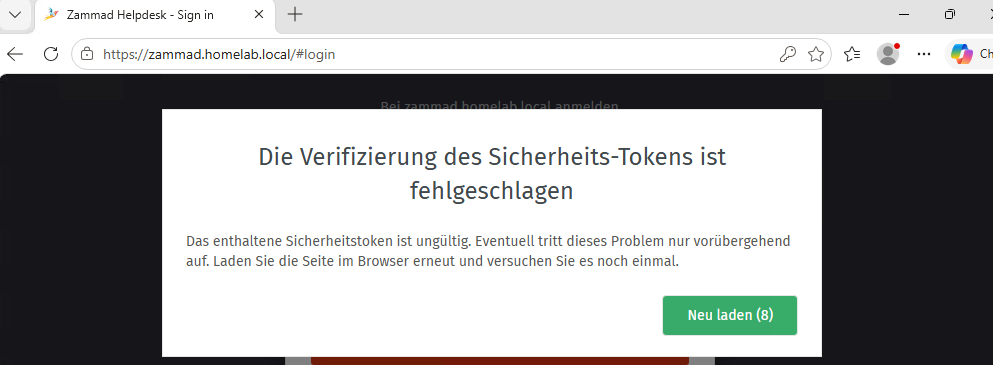

**Diagnose:** Die Meldung stammt von der CSRF-Prüfung in Rails. Bei einem Reverse Proxy ist die häufigste Ursache ein falsch weitergereichtes Protokoll, deshalb habe ich beide Proxy-Stufen einzeln geprüft. Auf dem Host steckt die Konfiguration direkt in `nginx.conf`, nicht in `sites-enabled` (ein `grep` dort blieb leer). `nginx -T` zeigt die tatsächlich geladene Konfiguration, unabhängig vom Pfad:

```bash
sudo nginx -T 2>/dev/null | grep -nE "server_name|listen|proxy_|ssl_certificate"
```
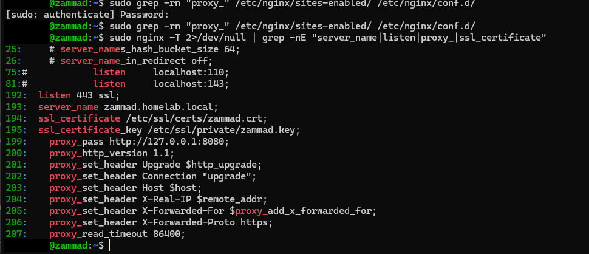

Der äußere nginx ist in Ordnung (`Host` und `X-Forwarded-Proto https` korrekt gesetzt). Hinter ihm läuft aber der nginx-Container des Zammad-Stacks, also eine zweite Proxy-Stufe:

```bash
docker compose exec zammad-nginx grep -rn "X-Forwarded\|proxy_set_header" /etc/nginx/
```
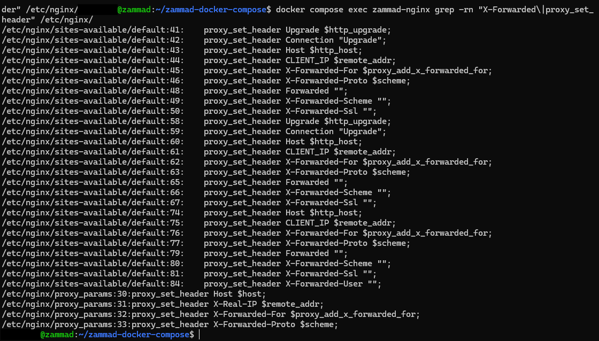

In den Zeilen 46, 63 und 77 steht `proxy_set_header X-Forwarded-Proto $scheme;`.

**Ursache:** Der äußere nginx terminiert TLS und spricht mit dem Container nur HTTP. Für den inneren nginx ist `$scheme` deshalb `http` und überschreibt das `https` der äußeren Stufe. Rails hielt die Anfrage für unverschlüsselt, die Prüfung scheiterte.

**Lösung:** Der Stack kennt die Variable `NGINX_SERVER_SCHEME` (in der `docker-compose.yml` vorhanden). Sie wird in einer neuen `.env` gesetzt, der Container neu erstellt und die Wirkung geprüft:

```bash
cd ~/zammad-docker-compose
grep -rn "NGINX_SERVER_SCHEME" .env docker-compose*.yml
echo 'NGINX_SERVER_SCHEME=https' >> .env
docker compose up -d zammad-nginx
docker compose exec zammad-nginx grep -n "X-Forwarded-Proto" /etc/nginx/sites-available/default
```
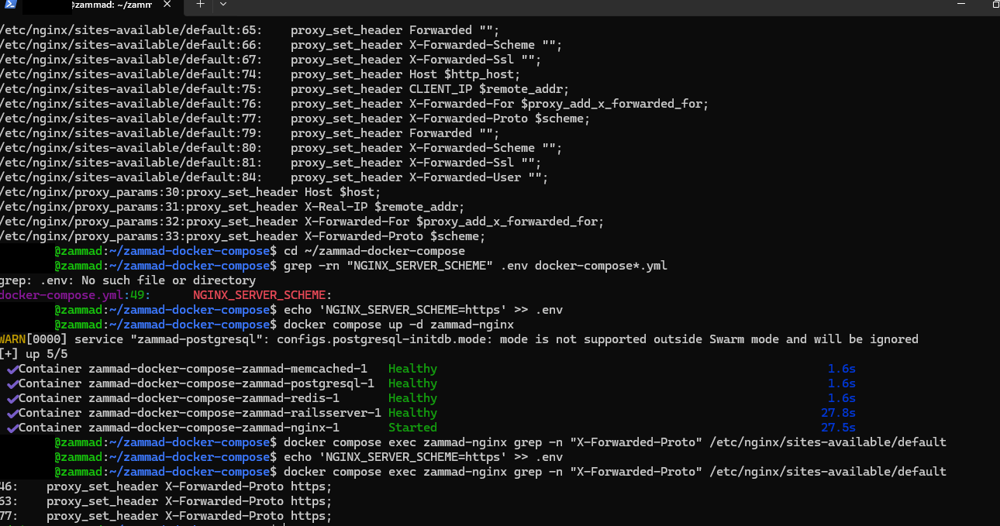

Danach funktioniert die Anmeldung im InPrivate-Fenster, nach dem Löschen der alten Cookies auch im normalen Browserfenster. Ein `restart` reicht nicht, die Variable wird erst beim Neuerstellen des Containers übernommen (`up -d`). Weil ich den `echo`-Befehl versehentlich mehrfach ausgeführt hatte, stand die Zeile mehrfach in der `.env`. Bereinigt und erneut geprüft:
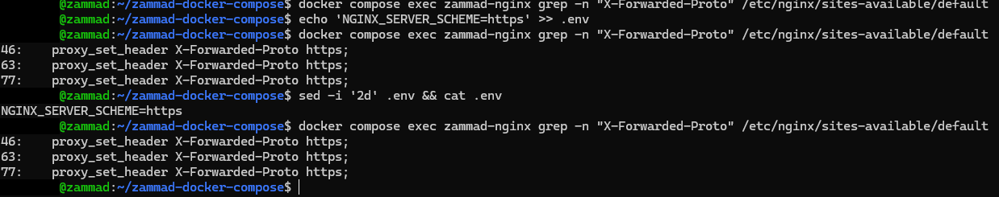

**Erkenntnis:** Bei mehreren hintereinandergeschalteten Proxys jede Stufe einzeln prüfen, denn eine innere Stufe kann Header der äußeren überschreiben. Ein InPrivate-Fenster trennt Cookie-Altlasten schnell von Konfigurationsfehlern. Vor dem Anhängen mit `>>` den Dateiinhalt mit `cat` prüfen.

### Sicherheitsbetrachtung

- **CA-Key:** In der Praxis gehört der Root-Key offline und passphrasengeschützt aufbewahrt, idealerweise mit einer Zwischen-CA für die Ausstellung. Im Lab liegt er bewusst vereinfacht auf demselben Server.
- **Zertifikatslaufzeit:** Das Serverzertifikat läuft nach 365 Tagen ab (19.10.2027). Die Erneuerung ist als wiederkehrende Aufgabe zu planen, die Root-CA gilt fünf Jahre.
- **Port-Bindung:** Zammad lauscht nur auf `127.0.0.1:8080`. Das ist die eigentliche Absicherung, weil Docker veröffentlichte Ports an der Host-Firewall vorbei öffnet.
- **Host-Firewall:** `ufw` ist eingerichtet (siehe [Meilenstein](04-host-firewall.md#meilenstein-host-firewall-ufw-auf-der-ticketsystem-vm)), ersetzt aber keine zentrale Firewall im Netz. Genau dafür ist die virtuelle Firewall (OPNsense) als nächster Ausbau vorgesehen.
- **Geheimnisse:** Keine Zugangsdaten und Schlüssel in Screenshots oder im Repo. Eine `.gitignore` mit `*.key`, `*.srl` und `*.csr` verhindert, dass Schlüsselmaterial versehentlich committet wird.
- **Backup:** Die VM-Snapshots liegen auf demselben Datenträger wie die VMs und ersetzen kein Backup. Der Vorfall mit dem vollen Host-Laufwerk (siehe [VERR_DISK_FULL](#troubleshooting-host-laufwerk-voll-verr_disk_full)) hat gezeigt, wie verwundbar das ist. Die Einordnung aller Maßnahmen und Lücken steht in [SECURITY-COMPLIANCE.md](../SECURITY-COMPLIANCE.md).


[← Zur Übersicht](../README.md) · [Troubleshooting-Index](../TROUBLESHOOTING.md)
