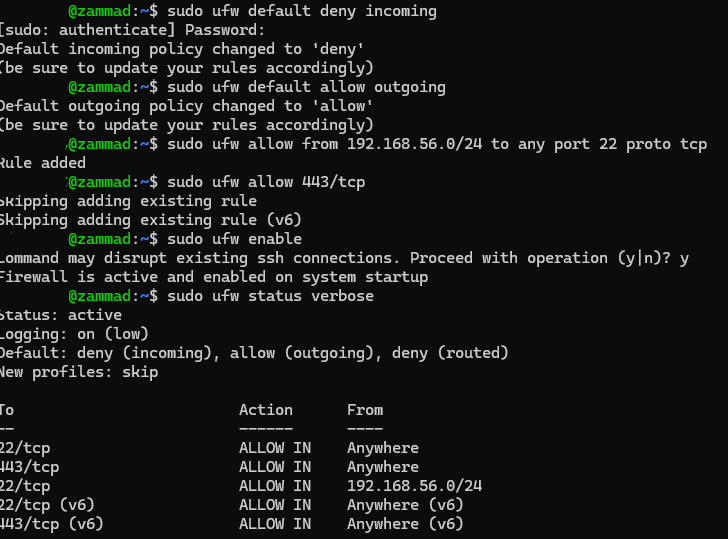
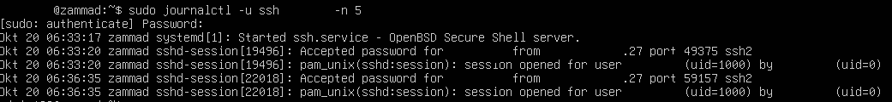
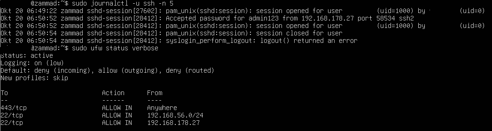
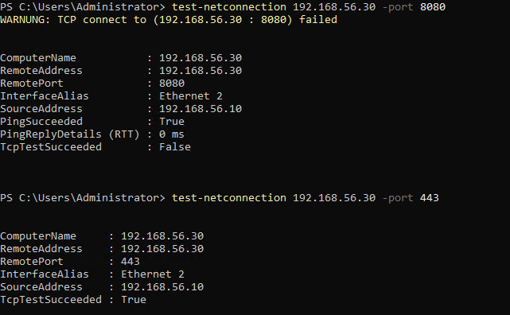

# Host-Firewall (ufw) auf der Ticketsystem-VM

[← Zur Übersicht](../README.md) · [Troubleshooting-Index](../TROUBLESHOOTING.md)

## Meilenstein: Host-Firewall (ufw) auf der Ticketsystem-VM

Die Ticketsystem-VM nimmt eingehenden Verkehr nur noch auf den Ports an, die sie braucht: HTTPS für nginx und SSH für die Administration. Alles andere wird verworfen. `ufw` schützt dabei nur diese eine VM und ersetzt keine zentrale Firewall im Netz (siehe [Sicherheitsbetrachtung](03-pki-tls.md#sicherheitsbetrachtung)).

### Regelwerk

Standardrichtlinie: `deny` für eingehenden, `allow` für ausgehenden und `deny` für weitergeleiteten Verkehr, Logging auf `low`.

| Regel | Quelle | Begründung |
|---|---|---|
| `443/tcp` | Anywhere | HTTPS zu nginx, der einzige Weg zu Zammad |
| `22/tcp` | `192.168.56.0/24` | SSH aus dem Lab-Netz (DC01, Client) |
| `22/tcp` | `192.168.178.27` | SSH vom Admin-Notebook über die NAT-Weiterleitung (Mini-PC Port 2222 → VM Port 22) |

Port 8080 ist bewusst nicht freigegeben. Zammad lauscht ohnehin nur auf `127.0.0.1:8080` (siehe [TLS, Schritt 4](03-pki-tls.md#meilenstein-interne-ca-und-tls-für-zammad)), die Firewall ist also eine zweite, unabhängige Schutzebene.

Das finale Regelwerk enthält ausschließlich IPv4-Regeln. IPv6 ist nicht freigegeben, der DNS-Eintrag `zammad.homelab.local` ist ein A-Record und alle Tests im Lab laufen über IPv4.

Zielzustand, in dieser Reihenfolge umgesetzt (SSH-Regeln **vor** `ufw enable`):

```bash
sudo ufw default deny incoming
sudo ufw default allow outgoing
sudo ufw allow 443/tcp
sudo ufw allow from 192.168.56.0/24 to any port 22 proto tcp
sudo ufw allow from 192.168.178.27 to any port 22 proto tcp
sudo ufw enable
sudo ufw status verbose
```

Beim Aktivieren warnt ufw (`Command may disrupt existing ssh connections`). Bestehende Verbindungen laufen nach dem Aktivieren weiter, deshalb gehört jeder Test in eine **neue** Sitzung, und die alte bleibt als Rückfallebene offen.

### Fehlersuche: Drei Stolpersteine

**1. Die Subnetz-Regel war wirkungslos.** Beim ersten Aktivieren standen `22/tcp` und `443/tcp` für „Anywhere“ bereits im Regelwerk, ufw meldete beim Hinzufügen von 443 `Skipping adding existing rule`. Die Regel `22/tcp` aus `192.168.56.0/24` schränkte damit nichts ein, SSH blieb von überall erreichbar.


**2. Falsche Annahme zur Quelladresse.** Geplant war, dass SSH über die NAT-Weiterleitung mit der Quelladresse `10.0.2.2` (VirtualBox-NAT) ankommt, und eine Regel für `10.0.2.0/24` wurde ergänzt. Das Journal des SSH-Dienstes zeigt etwas anderes: `Accepted password for <BENUTZER> from 192.168.178.27`, also die Adresse des Notebooks. Weder das Lab-Subnetz noch `10.0.2.0/24` passten, der Login lief ausschließlich über die offene Regel. Hätte ich die offene Regel einfach gelöscht, wäre der Fernzugriff weg gewesen.


Die Regel wurde deshalb auf die tatsächliche Quelle ausgerichtet (`192.168.178.27`), die Regel für `10.0.2.0/24` danach wieder entfernt.

**3. Überlappende Regeln.** Zwischenzeitlich standen die Einzeladresse und das Heimnetz `192.168.178.0/24` nebeneinander. Das /24 schließt die Einzeladresse ein, macht deren Regel überflüssig und öffnet SSH für jedes Gerät im Heimnetz. Beibehalten wurde nur die Einzeladresse. Gelöscht wird über `sudo ufw status numbered` und `sudo ufw delete <Nr>`, **von der höchsten Nummer abwärts**, weil sich die Nummern nach jedem Löschen verschieben.

**Erkenntnis:** Die Quelladresse gehört aus dem Log gelesen, nicht angenommen. Und eine Regel ist erst belegt, wenn der Test auch dann besteht, wenn keine andere Regel mehr dafür einspringen kann.

### Verifikation

| Test | Erwartung | Ergebnis |
|---|---|---|
| SSH vom Notebook über Port 2222, neue Sitzung, nach dem Entfernen der offenen Regel | Login klappt | Journal: `Accepted password … from 192.168.178.27` |
| SSH von DC01 (`192.168.56.10`) zur VM | Login klappt über die Regel für `192.168.56.0/24` | Login funktioniert |
| Regelwerk | Keine `22/tcp`-Regel für „Anywhere“ | `ufw status verbose` zeigt nur die drei Regeln aus der Tabelle |
| Port 443 von DC01 (`192.168.56.10`) | offen | `TcpTestSucceeded : True` |
| Port 8080 von DC01 | geschlossen | `TcpTestSucceeded : False` |





Zwei Anmerkungen zu den Ergebnissen:

- Der Test auf Port 8080 zeigt das **Gesamtergebnis** beider Schutzebenen (Bindung an `127.0.0.1` und Default deny). Er sagt nicht, welche der beiden allein ausreichen würde.
- `PingSucceeded : True` ist kein Widerspruch zu „Default deny“: ufw lässt ICMP-Echo über seine Standardregeln in `/etc/ufw/before.rules` zu, unabhängig von den eigenen Regeln. Für die Fehlersuche im Lab ist das gewollt.

### Voraussetzungen und offene Punkte

- **Feste Adresse für das Notebook:** Die SSH-Regel hängt an `192.168.178.27`. Damit sie dauerhaft trägt, ist die Adresse des Notebooks in der Fritzbox fest zugewiesen (statisch). Würde sie per DHCP wechseln, sperrte die Regel den Fernzugriff aus.
- **Authentifizierung:** SSH läuft weiterhin mit Passwort. Die Firewall begrenzt, wer den Port erreicht, nicht wie sich jemand anmeldet. Schlüsselauthentifizierung ist der nächste Schritt (siehe [Nächste Schritte](../README.md#nächste-schritte)).


[← Zur Übersicht](../README.md) · [Troubleshooting-Index](../TROUBLESHOOTING.md)
