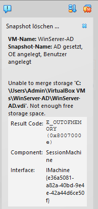
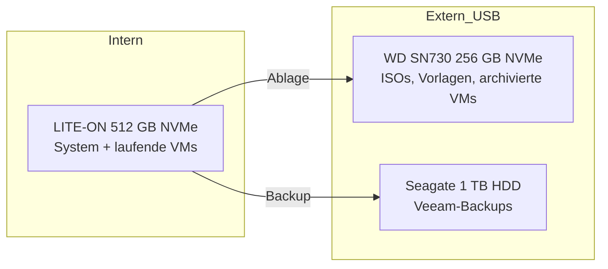

# 06 – Hardware: Speicherengpass und Erweiterung

> **Kurzfassung:** Der Homelab-Host lief mit 256 GB Systemplatte voll. Nach Bestandsaufnahme und Variantenvergleich wurde eine Lösung gewählt, die **fast vollständig mit vorhandener Hardware** auskommt: Klon auf eine 512-GB-NVMe, ausgelagerte Ablage auf externer NVMe, Backup auf externer HDD. Neu gekauft wurden nur zwei USB-Gehäuse.

---

## 1. Ausgangslage

Der Host ist ein Lenovo ThinkCentre M720q (Tiny-Format), auf dem alle VMs des Labs laufen:

| VM | Rolle |
|---|---|
| DC01 | Windows Server 2022, AD DS, DNS (homelab.local) |
| Windows-11-Client | Domänen-Client, RSAT |
| Zammad | Ubuntu Server, Docker Compose, nginx + interne CA |

**Hardware-Ist-Stand (13.11.2026):**

| Komponente | Ausstattung |
|---|---|
| CPU | Intel Core i3-8100T, 4 Kerne / 4 Threads, 35 W |
| RAM | 16 GB (2× 8 GB DDR4-2666 SO-DIMM), beide Slots belegt |
| Systemplatte | WD PC SN730 NVMe, 256 GB |
| Erweiterung | 1× M.2 (belegt), 2,5"-SATA-Schacht (leer), PCIe x8 (nur mit Riser) |

Erhoben per PowerShell (`Win32_Processor`, `Win32_PhysicalMemory`, `Get-PhysicalDisk`, `Win32_BIOS`) und Sichtprüfung bei geöffnetem Gehäuse.

## 2. Problem

- Die 256-GB-Systemplatte war durch VM-Dateien und **Snapshots** nahezu voll.
- **Auslöser:** Beim Aufbau des AD-Rollenmodells sollte vor der L2-Delegation Platz geschaffen werden. Selbst das **Löschen** eines alten Snapshots schlug fehl: VirtualBox muss dabei die Differenzplatte in die Basisplatte zusammenführen und braucht dafür freien Speicher (`E_OUTOFMEMORY`, „Not enough free storage space“). Ohne freien Platz ließen sich Snapshots also weder anlegen noch entfernen. Die Arbeit wurde daraufhin **bewusst abgebrochen** – ohne Rückfallpunkt keine weiteren Änderungen am Domain Controller.

  
- Snapshots sind für das Lab zentral (Rückfallpunkt vor jedem Umbau) – ohne freien Platz entfällt diese Absicherung.
- Ein geplantes Backup-Konzept (Veeam) braucht zusätzlich ein **separates** Sicherungsziel.

## 3. Bestandsaufnahme vorhandener Teile

Bevor gekauft wird, wurde geprüft, was bereits vorhanden ist:

| Teil | Typ | Bewertung |
|---|---|---|
| LITE-ON CA3-8D512, 512 GB | M.2 NVMe | geeignet als neue Systemplatte |
| Seagate ST1000LM024, 1 TB | 2,5" SATA-**HDD**, 5400 U/min | zu langsam für VMs, gut für Backups |
| LITE-ON L8T-256L9G, 256 GB (2014) | M.2 **SATA** | veraltet, nur Ablage |
| WD SN730, 256 GB (nach Klon frei) | M.2 NVMe | schnell, als externe Ablage nutzbar |

**Lernpunkt:** Eine zunächst als „1-TB-SSD“ eingeplante Platte stellte sich anhand der Modellnummer als HDD heraus. Ohne diese Prüfung wären VMs auf einem ungeeigneten Datenträger gelandet.

## 4. Geprüfte Varianten

| # | Variante | Neukosten | Bewertung |
|---|---|---|---|
| A | Zweite NVMe in Slot „SSD2“ | – | **verworfen:** Slot auf dieser Platinenvariante nicht bestückt (nur Lötpads) |
| B | Klon 256 → 512 GB intern, Altplatten extern | nur USB-Gehäuse | **gewählt** |
| C | Neue 1–2-TB-NVMe kaufen | mittel | technisch gut, aber unnötig, solange 512 GB vorhanden sind |
| D | 2,5"-SATA-SSD in den freien Schacht | gering–mittel | sinnvolle **nächste Stufe**, aktuell nicht nötig |
| E | PCIe-Riser + M.2-Adapter | mittel, fummelig | erst relevant, wenn D nicht reicht |
| F | VMs in die Cloud auslagern | laufend | Azure-Testzeitraum abgelaufen; Free-Tiers für AD-Lab ungeeignet |

**Variante A** zeigt, warum Sichtprüfung vor Planung kommt: Das Gehäuse ist für zwei NVMe ausgelegt, die Platine aber nicht bestückt.

## 5. Entscheidung

**Variante B**, nach dem Prinzip *erst vorhandene Ressourcen ausschöpfen, dann gezielt kaufen*.

**Begründung:**
- **Wirtschaftlich:** Neukosten nur für zwei USB-Gehäuse; Speicher verdoppelt sich intern.
- **Leistung:** Laufende VMs bleiben auf interner NVMe. Externe USB-Datenträger werden bewusst **nicht** für laufende VMs genutzt (Risiko beschädigter virtueller Platten bei Verbindungsabbruch).
- **Sicherheit:** Backup liegt auf einem **getrennten, abziehbaren** Datenträger – schützt auch gegen Ransomware und Hardwaredefekt des Hosts.
- **Rückfallplan:** Die alte WD-Platte wird erst formatiert, wenn das System von der neuen Platte mehrere Tage stabil läuft.

## 6. Umsetzung

1. ✅ SMART-Zustand aller Altplatten prüfen (CrystalDiskInfo): alle „Gut“, keine wiederzugewiesenen oder schwebenden Sektoren
2. ✅ BitLocker-Status prüfen (`manage-bde -status`): nicht aktiv, kein Anhalten nötig
3. Klon WD 256 GB → LITE-ON 512 GB mit Rescuezilla (Boot-Stick via Rufus), Partition auf volle Größe erweitern
4. Platten tauschen, Bootfähigkeit prüfen
5. Nach Stabilitätsphase: WD formatieren, als externe Ablage einbinden
6. 1-TB-HDD als Ziel für Veeam Agent for Microsoft Windows (Free), Backup-Job + **Test-Restore**
7. USB Selective Suspend deaktivieren (keine schlafenden Datenträger)

<!-- Screenshots ergänzen: CrystalDiskInfo, Rescuezilla-Klon, Datenträgerverwaltung vorher/nachher -->

## 7. Ausblick (bewusst zurückgestellt)

| Maßnahme | Nutzen | Auslöser |
|---|---|---|
| RAM: 1× 16 GB + 1× 8 GB = 24 GB (Sparvariante) | mehr parallele VMs | sobald 16 GB limitieren (absehbar) |
| CPU: i5-9500T / i7-8700T (gebraucht) | 6 statt 4 Kerne | bei CPU-Engpass unter Last |
| 2,5"-SATA-SSD im freien Schacht | weiterer interner VM-Speicher | wenn 512 GB wieder knapp werden |
| LAN-Kabel statt WLAN | stabilere Anbindung | jederzeit, sehr günstig |

RAM wird wegen der aktuellen Preise bewusst als **Sparvariante** geplant: ein 8-GB-Riegel wird durch 1× 16 GB ersetzt (24 GB gesamt). Gemischte Riegelgrößen laufen nur teilweise im Dual-Channel – für ein Lab ein vertretbarer Kompromiss.

## 8. Fazit

Die Erweiterung löst den Speicherengpass mit minimalen Kosten, trennt Betrieb, Ablage und Backup sauber voneinander und hält die nächsten Ausbaustufen offen. Entscheidend war die Reihenfolge **Bestandsaufnahme → Variantenvergleich → Entscheidung** statt direkten Neukaufs.
