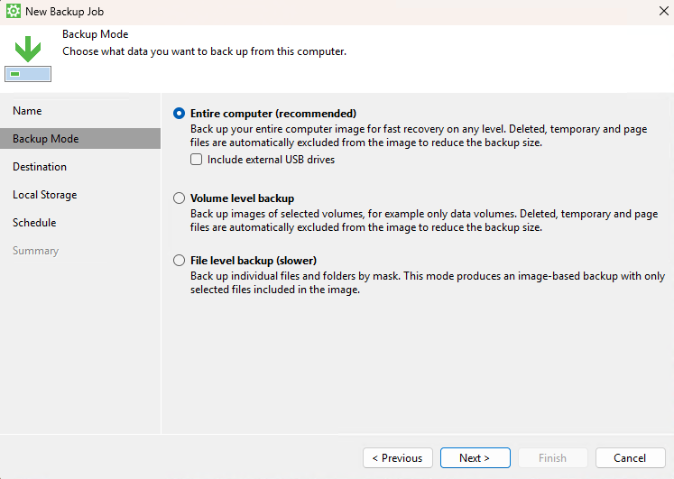
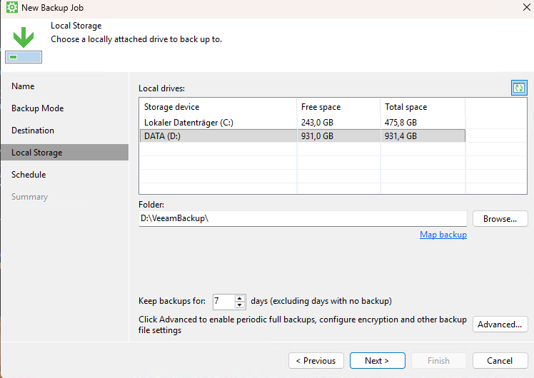
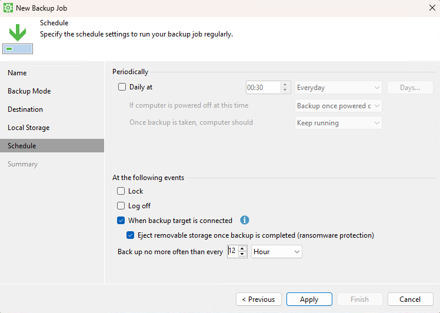
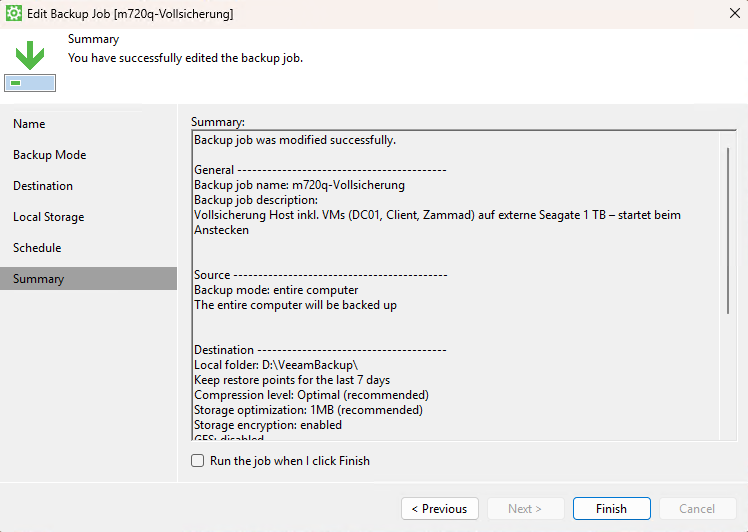
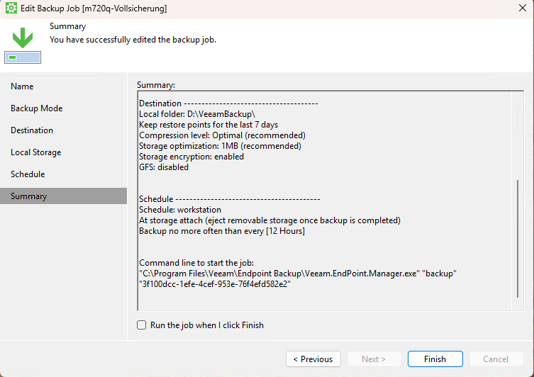
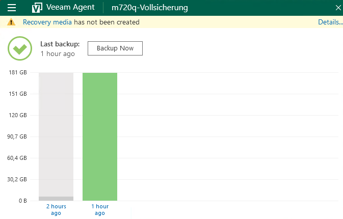
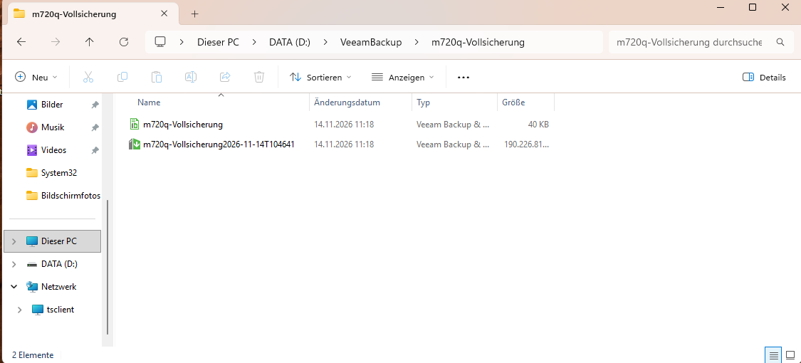
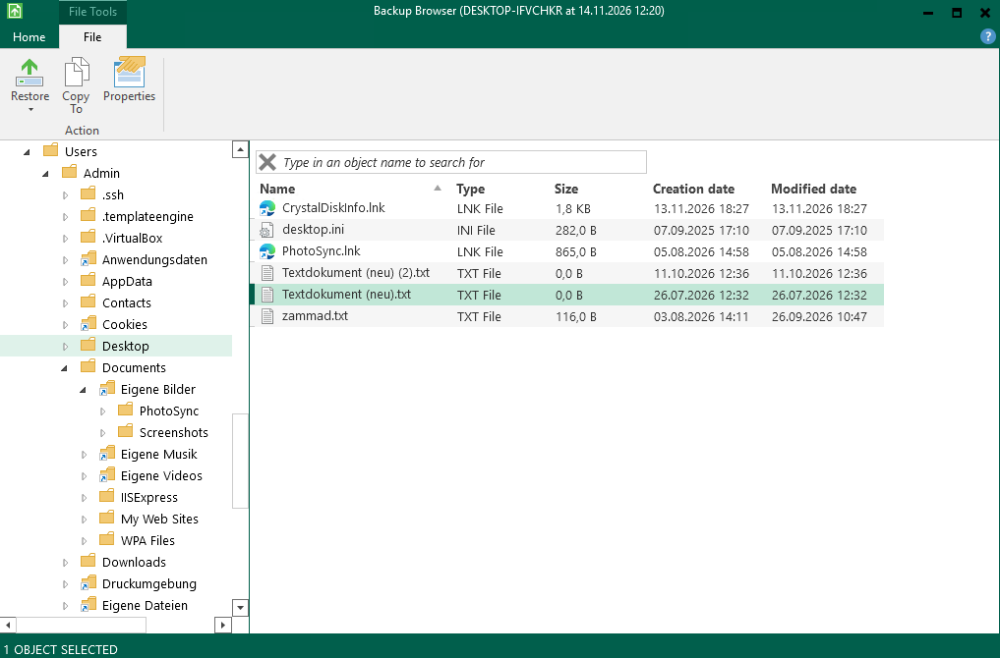
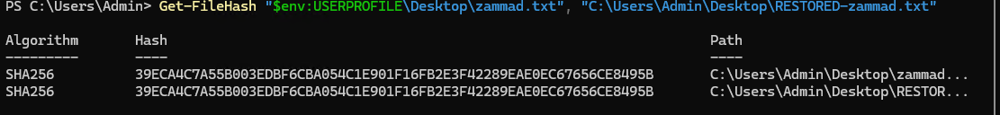

# 07 – Backup mit Veeam Agent und getesteter Wiederherstellung

[← Zur Übersicht](../README.md) · [Troubleshooting-Index](../TROUBLESHOOTING.md)

> **Kurzfassung:** Der Homelab-Host wird als Vollsicherung inklusive aller VMs auf eine externe 1-TB-HDD gesichert. Die Sicherung ist verschlüsselt, startet automatisch beim Anstecken der Platte und meldet die Platte danach selbst ab (Offline-Kopie). Die Wiederherstellung wurde real getestet und per Prüfsumme belegt.

---

## 1. Ausgangslage

Laut [Mini-Risikoanalyse](../SECURITY-COMPLIANCE.md#3-mini-risikoanalyse) war Datenverlust das höchste Risiko im Lab: Es gab nur VM-Snapshots, und die lagen auf demselben Datenträger wie die VMs. Ein Defekt der Systemplatte, ein voller Datenträger oder Ransomware hätten Snapshots und VMs gleichzeitig getroffen. Mit dem [Plattentausch](06-hardware-speichererweiterung.md) wurde die 1-TB-HDD als getrenntes Sicherungsziel frei.

## 2. Anforderungen

| Anforderung | Umsetzung |
|---|---|
| Getrenntes Medium | externe Seagate 1 TB (HDD) per USB, nicht dauerhaft angeschlossen |
| Schutz gegen Ransomware | Platte ist nur während der Sicherung verbunden und wird danach automatisch ausgeworfen |
| Vertraulichkeit | Sicherungsdateien AES-verschlüsselt (enthält u. a. die AD-Datenbank des DC) |
| Wiederherstellbarkeit des ganzen Hosts | Vollsicherung („Entire computer“), Bare-Metal-Restore per Recovery Media |
| Konsistenz | VMs vor der Sicherung sauber heruntergefahren (Client → Zammad → DC01) |
| Nachweis | Test-Restore mit Prüfsummenvergleich |

## 3. Konfiguration

Werkzeug: **Veeam Agent for Microsoft Windows (Free)**, installiert auf dem Host per `winget install Veeam.VeeamAgent`.

| Einstellung | Wert | Begründung |
|---|---|---|
| Job-Name | `m720q-Vollsicherung` | Gerät und Umfang auf einen Blick |
| Modus | Entire computer, **ohne** externe USB-Laufwerke | Host + VMs in einem Abbild; das Sicherungsziel darf sich nicht selbst sichern |
| Ziel | `D:\VeeamBackup\` (Seagate, Local storage) | getrenntes Medium |
| Aufbewahrung | 7 Tage, Tage ohne Sicherung zählen nicht | passt zur abziehbaren Platte: es bleiben immer 7 echte Wiederherstellungspunkte |
| Verschlüsselung | aktiviert | Passwort im Passwortmanager, nicht im Vault oder Repo |
| Zeitplan | **kein** täglicher Termin, Start „beim Anstecken des Ziels“, höchstens alle 12 Stunden | nachts ist die Platte nicht verbunden; ein fester Termin würde nur Fehlermeldungen erzeugen und ggf. laufende VMs absturzkonsistent sichern |
| Nach der Sicherung | Wechseldatenträger auswerfen | Offline-Kopie (Ransomware-Schutz) |







## 4. Erste Vollsicherung

Die erste Sicherung lief rund eine Stunde und belegt etwa 181 GB (rund 230 GB belegt auf C:, Veeam komprimiert und lässt Auslagerungs- und temporäre Dateien weg). Auf der 1-TB-Platte bleibt genug Platz für die inkrementellen Folgesicherungen.




**Stolperstein:** Beim ersten Anlegen des Jobs war die Verschlüsselung noch nicht aktiviert, und die Sicherung startete sofort. Der Job wurde abgebrochen und mit Verschlüsselung neu gestartet. Anschließend wurde geprüft, dass im Zielordner nur die verschlüsselte Sicherung liegt und kein unverschlüsseltes Fragment übrig geblieben ist. Verschlüsselung muss vor der ersten Sicherung feststehen; nachträglich aktiviert erzwingt sie eine neue Vollsicherung.

## 5. Test-Restore

Ein Backup gilt erst als Backup, wenn die Wiederherstellung nachweislich funktioniert. Getestet wurde die Wiederherstellung auf Dateiebene:

1. Veeam → *Restore Files* → Wiederherstellungspunkt vom 14.11.2026, Entschlüsselung per Passwort
2. Datei `zammad.txt` (116 Byte, vor der Sicherung angelegt) aus dem Backup an einen anderen Ort kopiert, um nichts zu überschreiben
3. Original und Wiederherstellung per SHA-256 verglichen



```powershell
Get-FileHash "$env:USERPROFILE\Desktop\zammad.txt", "$env:USERPROFILE\Desktop\RESTORED-zammad.txt"
```



**Ergebnis:** Beide Prüfsummen sind identisch, die Datei wurde bitgenau aus der verschlüsselten Sicherung wiederhergestellt.

## 6. Betrieb

- **Ablauf:** VMs herunterfahren (Client → Zammad → DC01), Platte anstecken, Sicherung läuft automatisch, Platte wird ausgeworfen, abziehen, VMs wieder starten (DC01 → Zammad → Client).
- **Rhythmus:** wöchentlich und vor jedem größeren Umbau (z. B. vor der L2-Delegation im AD-Rollenmodell).
- **Beobachten:** SMART-Wert C7 (CRC-Fehler) der HDD; steigt er nach Sicherungen deutlich, liegt es an Gehäuse oder Kabel.
- **Zusätzliche Rückfallebene:** Die alte Systemplatte (WD 256 GB) liegt als startfähiger Klon vom 14.11.2026 offline.

## 7. Offene Punkte

| Punkt | Warum |
|---|---|
| Recovery Media erstellen (Boot-Stick/ISO) | ohne laufendes Windows ist sonst kein Restore möglich |
| Bare-Metal-Restore einmal testen (z. B. auf die freie WD) | Datei-Restore belegt die Lesbarkeit, nicht die Wiederherstellung des ganzen Hosts |
| Anwendungskonsistente Sicherung des DC (Windows Server Backup / System State in der VM) | die Host-Sicherung erfasst laufende VMs nur absturzkonsistent; deshalb werden sie vorher heruntergefahren |
| Zweite Kopie außer Haus (3-2-1-Regel) | aktuell zwei Kopien (Original + HDD) an einem Ort |

[← Zur Übersicht](../README.md) · [Troubleshooting-Index](../TROUBLESHOOTING.md)
