# 08 – System-State-Sicherung und Restore des Domain Controllers

[← Zur Übersicht](../README.md) · [Troubleshooting-Index](../TROUBLESHOOTING.md)

> **Kurzfassung:** Die Veeam-Sicherung aus [Kapitel 07](07-backup-veeam.md) erfasst DC01 nur absturzkonsistent. Ergänzend wird der Systemstatus des DC innerhalb der VM per Windows Server Backup **anwendungskonsistent** (VSS) gesichert und die Wiederherstellung im Verzeichnisdienst-Wiederherstellungsmodus (DSRM) an einem gezielt gelöschten Testobjekt belegt.

---

## 1. Ausgangslage

Veeam sichert den Host als Ganzes. Laufende VMs würden dabei nur so gesichert, als wäre der Strom ausgefallen; deshalb werden sie vor jeder Host-Sicherung heruntergefahren. Für den Domain Controller reicht das auf Dauer nicht:

- Eine Host-Sicherung kann nur den **ganzen** Host zurückdrehen, nicht gezielt das Active Directory.
- Ein zurückgespielter VM-Snapshot eines DC ist in Umgebungen mit mehreren DCs gefährlich (**USN-Rollback**).
- Der übliche Weg im Betrieb ist eine Systemstatus-Sicherung im Gastsystem mit belegtem Restore.

Kapitel 07 führt diesen Punkt deshalb als [offenen Punkt](07-backup-veeam.md#8-offene-punkte).

## 2. Begriffe

| Begriff | Bedeutung im Lab |
|---|---|
| **Absturzkonsistent** | Zustand wie nach einem Stromausfall; die AD-Datenbank (`NTDS.dit`) kann mitten in einem Schreibvorgang erfasst sein |
| **Anwendungskonsistent** | VSS stimmt sich mit den beteiligten Diensten (NTDS, SYSVOL, Registry) ab und friert einen definierten Zustand ein |
| **Systemstatus** | AD-Datenbank, SYSVOL, Registry, Boot-Dateien, COM+-Klassen-Registrierung |
| **Nicht-autoritativer Restore** | DC kehrt zum Stand der Sicherung zurück und übernimmt danach Änderungen seiner Replikationspartner. Mit nur einem DC gibt es keine Partner: der Stand der Sicherung gilt |
| **Autoritativer Restore** | `ntdsutil` → `authoritative restore`: setzt wiederhergestellte Objekte gegen andere DCs durch. Im Lab mit einem DC nicht nötig, nur zur Abgrenzung |
| **Tombstone-Lebensdauer** | 180 Tage; ältere Sicherungen dürfen nicht zurückgespielt werden |

## 3. Vorbereitung

| Schritt | Umsetzung | Begründung |
|---|---|---|
| Feature installieren | `Install-WindowsFeature Windows-Server-Backup -IncludeManagementTools` | Windows Server Backup (`wbadmin`) ist nicht vorinstalliert |
| Eigenes Sicherungsziel | zweite virtuelle Platte `WinServer-DC01-Backup.vdi`, 40 GB, dynamisch, SATA, in DC01 als `E:` (GPT, NTFS, Bezeichnung `SystemStateBackUp`) | `wbadmin` sichert den Systemstatus nicht auf das Quellvolume `C:` |
| Testobjekt **vor** der Sicherung | OU `_Restore-Test` mit Benutzer `restore.test` (deaktiviert) | wird nach der Sicherung gelöscht und muss durch den Restore zurückkommen |
| Kennung des Testobjekts notieren | ObjectGUID `12084672-d126-4c56-b319-53b9cab7559f`, SID endet auf `-1128` | belegt nach dem Restore, dass **dasselbe** Objekt zurück ist und kein neu angelegtes |

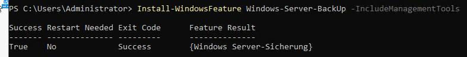

### Stolperstein: „Der angegebene Sicherungsort wurde nicht gefunden“

Der erste Sicherungsversuch auf `E:` schlug sofort fehl. `Get-Volume` und `Get-Disk` zeigten den Grund: DC01 hatte nur die Systemplatte, ein Laufwerk `E:` existierte nicht.

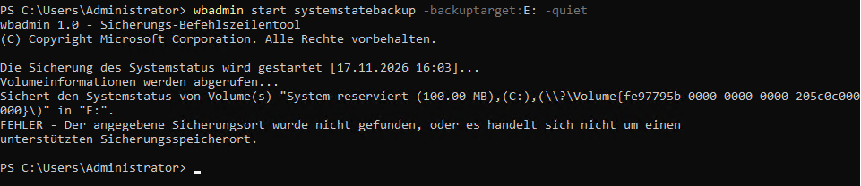
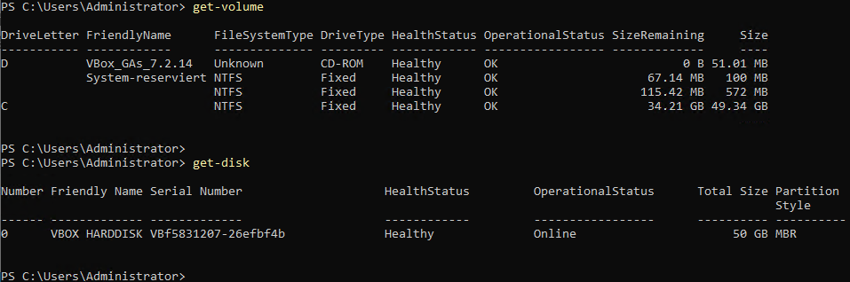

**Lösung:** VM heruntergefahren, in VirtualBox eine zweite virtuelle Platte (40 GB) am SATA-Controller angelegt, VM gestartet und die Platte in PowerShell eingerichtet:

```powershell
Get-Disk | Where-Object PartitionStyle -eq 'RAW'
Initialize-Disk -Number 1 -PartitionStyle GPT
New-Partition -DiskNumber 1 -UseMaximumSize -DriveLetter E
Format-Volume -DriveLetter E -FileSystem NTFS -NewFileSystemLabel SystemStateBackUp
```

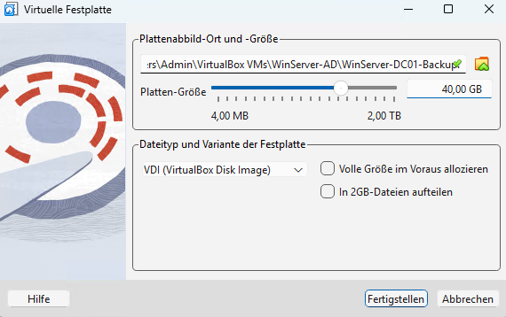
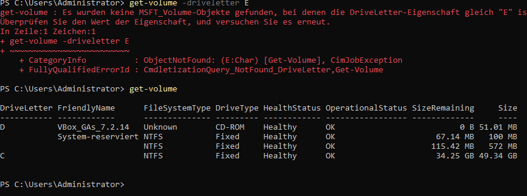
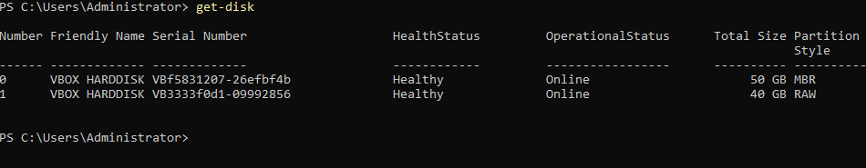
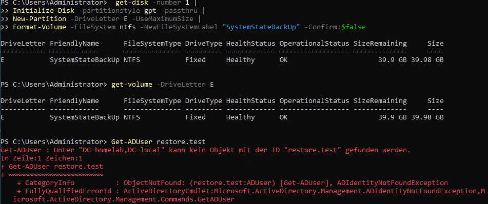

**Lehre:** Das Sicherungsziel ist Teil der Planung, nicht des Sicherungsbefehls. Ein eigenes Volume nur für die Sicherung hält sie außerdem getrennt von den Daten des DC.

## 4. Sicherung (17.11.2026)

```powershell
wbadmin start systemstatebackup -backupTarget:E: -quiet
wbadmin get versions -backupTarget:E:
```

| Prüfpunkt | Ergebnis |
|---|---|
| Alle VSS-Writer inkl. NTDS beteiligt | ✅ |
| Dauer | ca. 13 Minuten (16:28–16:41 Ortszeit) |
| Versionskennung | `11/17/2026-15:28` (wbadmin zeigt UTC), wiederherstellbar: Systemstatus |
| Ereignisprotokoll *Microsoft-Windows-Backup* | ✅ ID 1 (gestartet), ID 4 (erfolgreich), ID 14 (abgeschlossen), keine Warnungen |

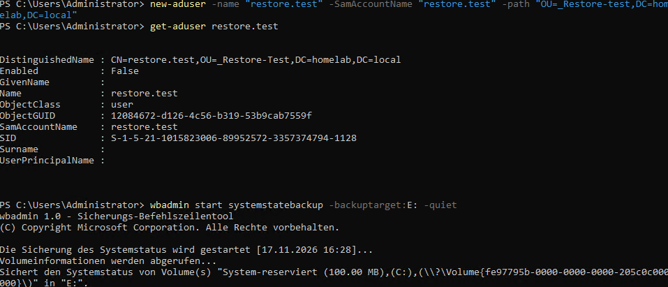
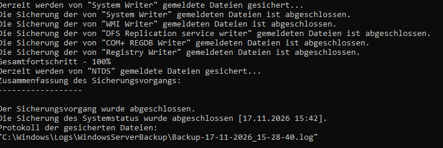
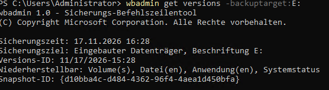
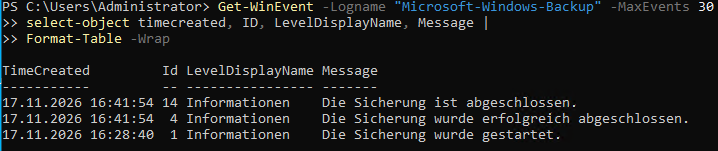

## 5. Vorbereitung des Restore-Tests (18.11.2026)

Der Restore verändert DC01. Deshalb vorher:

1. **Ereignisprotokoll** der Sicherung geprüft (siehe oben): keine Fehler, die Sicherung ist verwertbar.
2. **DSRM-Passwort** neu gesetzt (`ntdsutil` → `set dsrm password` → `reset password on server null`), nur im Passwortmanager abgelegt.
3. **Veeam-Rückfallpunkt** des ganzen Hosts unmittelbar vor dem Test (inkrementell, verschlüsselt, VMs heruntergefahren). Scheitert der Test, wird der Host auf diesen Stand zurückgesetzt.

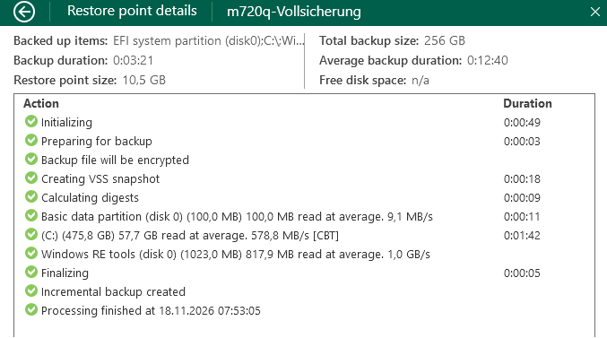

**Beachten:** Das DSRM-Konto liegt in der lokalen SAM des DC und damit in der Registry, die zum Systemstatus gehört. Nach dem Restore gilt voraussichtlich wieder das DSRM-Passwort vom Zeitpunkt der Sicherung. Deshalb beide Passwörter aufbewahren und das DSRM-Passwort nach dem Test erneut setzen (erledigt, siehe [Nachweis](#7-nachweis)).

## 6. Restore-Test (20.11.2026)

Unmittelbar vor dem Test wurde geprüft, dass sich an DC01 seit dem Veeam-Rückfallpunkt nichts geändert hatte. Testobjekt und Sicherung wurden noch einmal festgehalten:

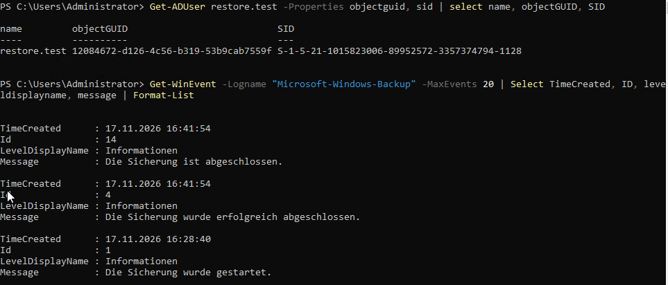
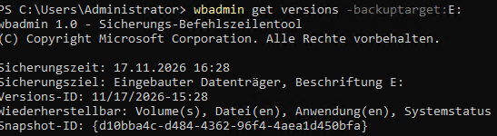

### 6.1 Fehler herbeiführen

```powershell
Remove-ADUser restore.test -Confirm:$false
Get-ADUser restore.test
```

`Get-ADUser` meldet erwartungsgemäß, dass unter `DC=homelab,DC=local` kein Objekt `restore.test` gefunden wird.

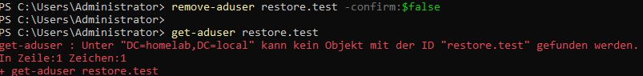

### 6.2 In den DSRM starten

```powershell
bcdedit /set safeboot dsrepair
Restart-Computer
```

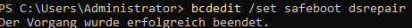

**Stolperstein:** Der Anmeldebildschirm schlägt nach dem Neustart weiter das zuletzt verwendete Domänenkonto `HOMELAB\Administrator` vor und lehnt es ab, weil die Domäne „nicht verfügbar“ ist. Das ist im DSRM richtig: Die AD-Dienste laufen nicht. Anmelden muss man sich mit **`.\Administrator`** (lokales Konto, „Anmelden an: DC01“) und dem DSRM-Passwort. Der Schriftzug „Abgesicherter Modus“ war auf dem Desktop nicht zu sehen; den DSRM belegen deshalb `whoami` und `bcdedit`.

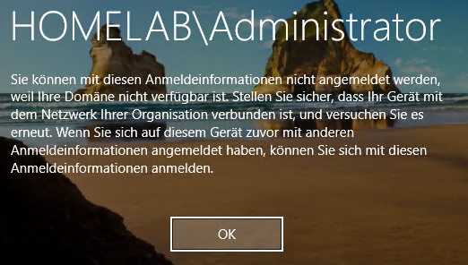
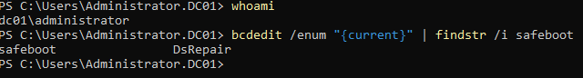

### 6.3 Wiederherstellen

```powershell
wbadmin get versions -backupTarget:E:
wbadmin start systemstaterecovery -version:11/17/2026-15:28 -backupTarget:E: -quiet
```

Dauer: 12:20 bis 12:28 Uhr. `wbadmin` weist darauf hin, dass der per DFSR replizierte Inhalt (SYSVOL) danach erneut synchronisiert wird; was das bei nur einem DC bedeutet, steht in [Abschnitt 7](#7-nachweis).

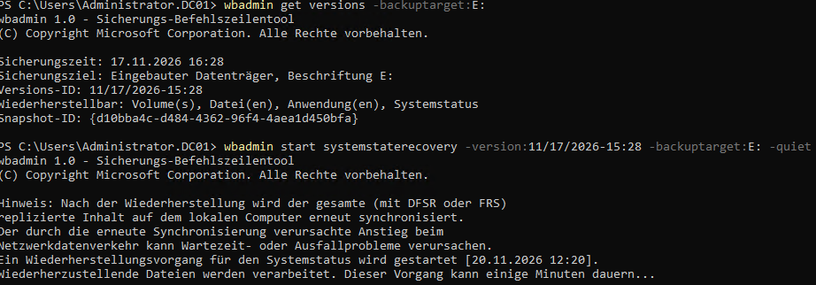
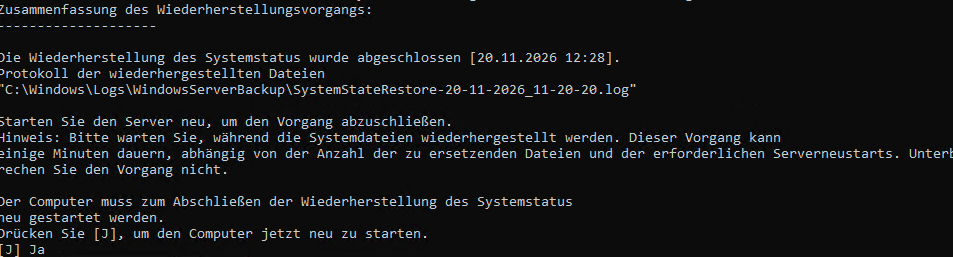

### 6.4 Normal starten

Bevor die Neustart-Abfrage von `wbadmin` mit **J** bestätigt wurde, wurde in einem zweiten Admin-Fenster der abgesicherte Start entfernt; sonst startet DC01 erneut im DSRM. Weil `bcdedit` hier keine Erfolgsmeldung ausgab, wurde das Ergebnis gegengeprüft (keine Ausgabe = entfernt):

```powershell
bcdedit /deletevalue safeboot
bcdedit /enum "{current}" | findstr /i safeboot
```

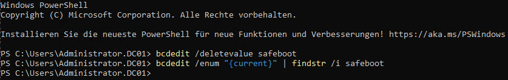

Nach dem Neustart bestätigt Windows einmalig den Abschluss der Wiederherstellung:

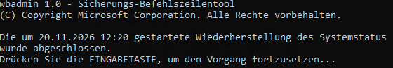

## 7. Nachweis

| Prüfpunkt | Erwartung | Ergebnis |
|---|---|---|
| `Get-ADUser restore.test -Properties ObjectGUID, SID` | Objekt wieder da, **gleiche** GUID und SID | ✅ GUID `12084672-d126-4c56-b319-53b9cab7559f`, SID `…-1128`, identisch mit dem Stand vor der Sicherung |
| `Get-SmbShare` | SYSVOL und NETLOGON vorhanden | ✅ beide freigegeben |
| `dcdiag /q` | keine AD-Fehler | ✅ nur Test *SystemLog* fehlgeschlagen, Ursache: Dienst *Microsoft Edge Update* startete nicht (kein AD-Bezug) |
| DFSR (SYSVOL) | kein Warten auf Replikationspartner | ✅ kein Ereignis 4614/4612, Dienst sauber gestartet |
| Client-Anmeldung, `gpresult /r` | Anmeldung über DC01, GPOs greifen | ✅ `HOMELAB\df-support-l1`, AGDLP-Gruppen aufgelöst, nach `gpupdate /force` um 12:52 *Default Domain Policy* und *Lab-Root-CA* neu angewendet |
| Zammad per HTTPS | erreichbar, Zertifikat gültig | ✅ „Verbindung ist sicher“ |
| DSRM-Passwort | nach dem Restore neu setzen | ✅ neu gesetzt, nur im Passwortmanager |

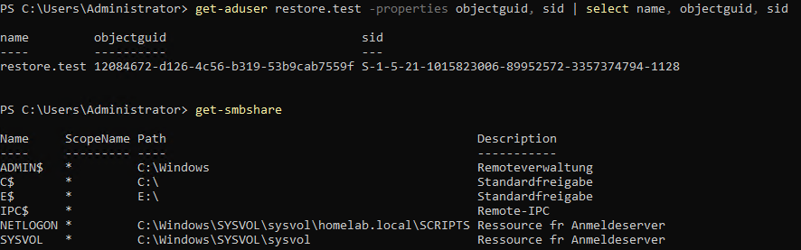
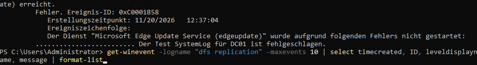
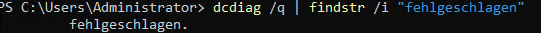

**SYSVOL bei nur einem DC:** Der wbadmin-Hinweis ließ befürchten, dass SYSVOL nach dem nicht-autoritativen Restore auf einen Replikationspartner wartet (Ereignis 4614) und nicht freigegeben wird; Gegenmittel wäre ein autoritativer SYSVOL-Restore über `msDFSR-Options`. Das trat nicht ein: Im Protokoll *DFS Replication* steht als einziges SYSVOL-Ereignis das 4602 von der Heraufstufung am 24.07.2026, die Freigaben waren sofort da.

```powershell
Get-WinEvent -FilterHashtable @{LogName="DFS Replication"; Id=4602,4604,4612,4614} -MaxEvents 5
```

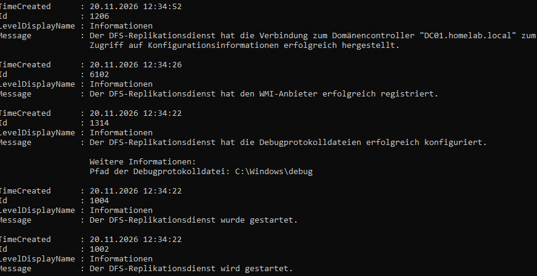
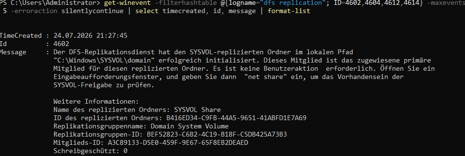

**Gegenprobe am Client:** Die Benutzerseite zeigt die Anmeldung über DC01 und die aufgelöste AGDLP-Kette (`GG-Support-L1`, `DL-Benutzer-PWReset`). Die Computerseite zeigte zunächst noch die Anwendung von 12:07, also **vor** dem Restore; erst `gpupdate /force` belegte, dass SYSVOL nach dem Restore wieder ausliefert. Auch das Computerkonto (`DESKTOP-EPORV65$`) authentifizierte sich weiter: Die Vertrauensstellung hat den Restore einer drei Tage alten Sicherung überstanden. Den Computerteil von `gpresult` darf `df-support-l1` übrigens nicht abfragen („Zugriff verweigert“, kein lokaler Administrator), passend zum Rechtekonzept aus [Kapitel 01](01-active-directory.md).

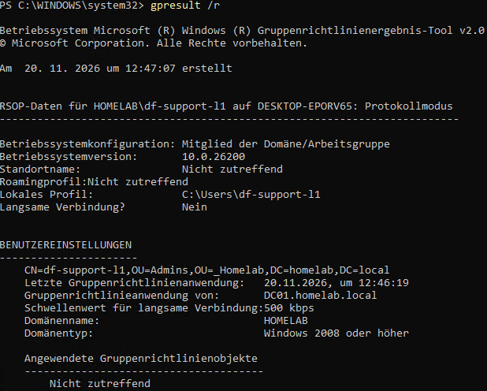
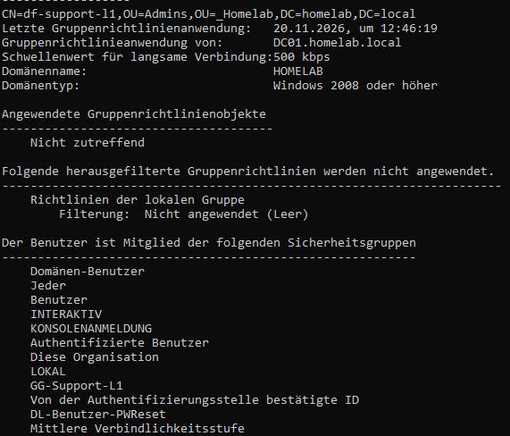
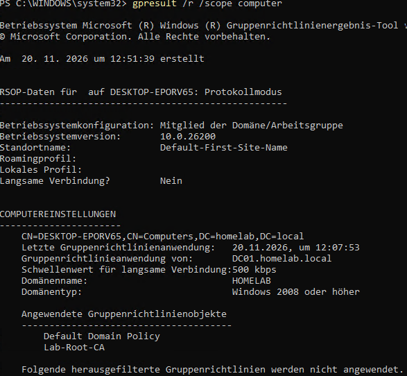
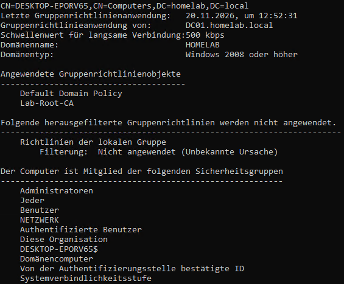


**Ergebnis:** Der Systemstatus des DC lässt sich aus der Sicherung vom 17.11. vollständig wiederherstellen. Ein gelöschtes Objekt kommt mit identischer Kennung zurück, Domänendienste, Gruppenrichtlinien und abhängige Dienste laufen danach ohne Nacharbeit.

**Lehren:**
- Den abgesicherten Start **vor** dem Neustart entfernen, sonst Schleife im DSRM.
- Nach einem Restore nicht den zwischengespeicherten Stand auf dem Client prüfen, sondern die Anwendung erzwingen (`gpupdate /force`) und auf den Zeitstempel achten.
- `dcdiag` liest das Systemprotokoll mit; nicht jeder fehlgeschlagene Test ist ein AD-Problem.

## 8. Einordnung

- Mit einem einzigen DC ist der Systemstatus-Restore die einzige Möglichkeit, AD gezielt zurückzuholen. In einer echten Umgebung mit mehreren DCs würde ein gelöschtes Objekt eher über den **AD-Papierkorb** oder einen **autoritativen Restore** zurückgeholt.
- Ein einziger DC bleibt ein Single Point of Failure. Ein zweiter DC ist als späterer Ausbau vorgemerkt.

[← Zur Übersicht](../README.md) · [Troubleshooting-Index](../TROUBLESHOOTING.md)
